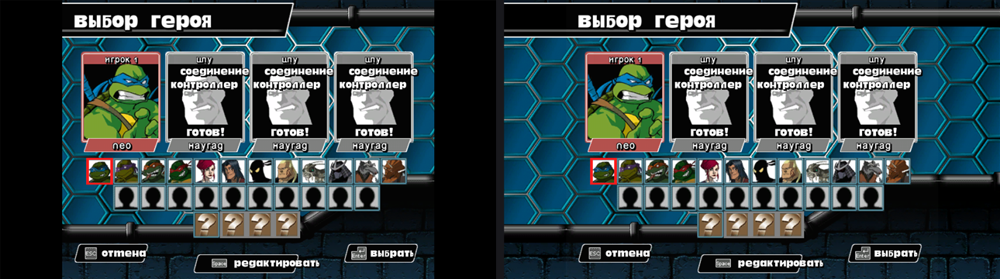
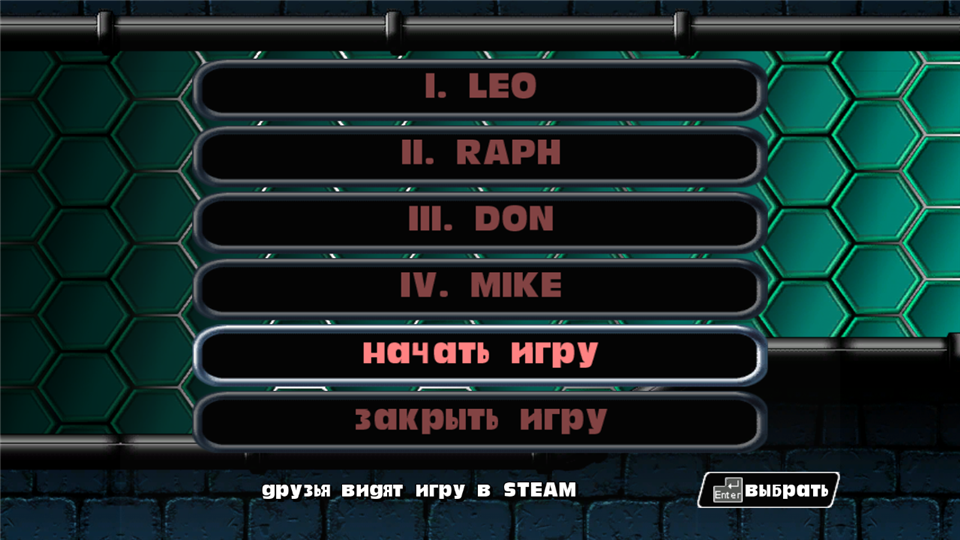
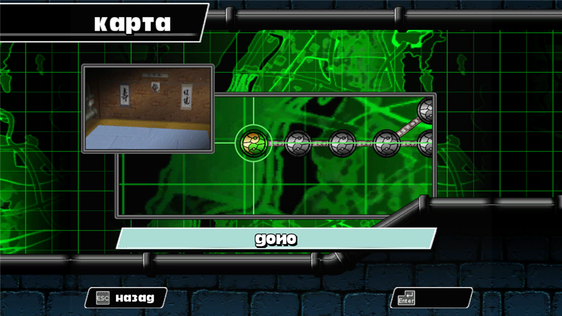

<h1 align="center">TMNT Mutant Melee — network play</h1>

<p align="center">
  <b>meleenet — a network game for up to four players for TMNT Mutant Melee (PC, 2005)</b><br>
  One file · everyone has their own copy of the game and their own screen · Steam or a direct address · wide screen with menus that fill the frame
</p>

<p align="center">
  
  
  
  
  
  
  
  
</p>

<p align="center">
  <a href="https://github.com/int3re/TMNT-MUTANT-MELEE-COOP/releases/latest/download/meleenet-launcher.exe"></a><br>
  <sub>One file, about 4.6 MB: the mod is inside the launcher. It installs the mod, updates it and starts the game.</sub>
</p>

<p align="center">
  <a href="README.md">Русский</a> · <b>English</b>
</p>

<p align="center">
  
</p>

**meleenet** is a mod for the Russian release of *TMNT Mutant Melee*. In the game's РУКОПАШНЫЙ БОЙ (Melee) up
to four players fight, but only at one computer. The mod gives the same over the network: every player has
their own copy of the game and their own screen, and the network game starts from the game's own main menu —
with its buttons and in its font.

Along the way the mod brings a game of 2005 to today's monitors: a borderless window instead of the 640×480
full screen, any resolution, a wide frame that both the fights and the menus fill, smoothed edges and sharp
textures, attacks on the mouse buttons.

> The mod contains no files of the game and does not change `ztmnt.exe` on the disk: every change is made in
> memory at start. You need your own copy of the game. This is an unofficial fan mod; the version is a trial one.

> The mod and its launcher speak Russian, like the release of the game they are made for. This page and the
> documentation explain every Russian word that is on the screen.

**Other mods of this series:**
[TMNT (2003) — co-op for up to four players](https://github.com/int3re/TMNT-2003-COOP) ·
[TMNT 2: Battle Nexus — co-op for up to four players](https://github.com/int3re/TMNT-2-BATTLE-NEXUS-COOP) ·
[The Incredibles: Rise of the Underminer — co-op for two](https://github.com/int3re/INCREDIBLES-RISE-OF-THE-UNDERMINER-COOP)

## Contents

- [The launcher: one file](#the-launcher-one-file)
- [What is added and what is changed](#what-is-added-and-what-is-changed)
- [The mod's menus](#the-mods-menus)
- [Features](#features)
- [Quick start](#quick-start)
- [Controls](#controls)
- [What you need](#what-you-need)
- [Documentation](#documentation)
- [Versions and compatibility](#versions-and-compatibility)
- [State of the project](#state-of-the-project)
- [Building from source](#building-from-source)
- [How it works](#how-it-works)
- [Taking part](#taking-part)
- [Credits](#credits)
- [Thanking the author](#thanking-the-author)
- [Licence and rights](#licence-and-rights)

## The launcher: one file

The only file to download is **[`meleenet-launcher.exe`](https://github.com/int3re/TMNT-MUTANT-MELEE-COOP/releases/latest/download/meleenet-launcher.exe)**:
the mod is inside it, there is no separate installer. The launcher finds the game, installs the mod, watches
for updates, sets up the picture, the network and the keys, and starts the game.

<table>
  <tr>
    <td align="center" width="33%"><br><b>1. Install</b><br><sub>The mod is already inside: one button, no internet needed</sub></td>
    <td align="center" width="33%"><br><b>2. Play</b><br><sub>The files go next to the game, the game itself is not changed</sub></td>
    <td align="center" width="33%"><br><b>3. Update</b><br><sub>The launcher tells you about a new version itself</sub></td>
  </tr>
</table>

| What it does | How |
|---|---|
| **Finds the game** | in its own folder, by the game's entry in Windows or in a folder next to it; if it cannot, it asks where `ztmnt.exe` is |
| **Installs the mod without the internet** | the mod is inside the launcher; the game's files are not changed |
| **Updates with one button** | the new version is downloaded from GitHub, checked by SHA-256 and installed; settings, keys and saves stay |
| **Tells whether you can play with friends** | under the versions it says whether their network protocol is the same |
| **Updates itself too** | at its start it takes a newer launcher, checks it, takes its place and starts again |
| **Sets the game up before the start** | the tabs ГРАФИКА (Graphics), СЕТЬ (Network) and УПРАВЛЕНИЕ (Controls): the window and the picture, the network game, keys and mouse buttons |
| **Waits if the game is open** | or asks it to close, as the cross of its window does |
| **Works when GitHub opens badly** | tries the settings of Windows, a VPN client on the same PC, or your own proxy |
| **Removes the mod** | with one button in the settings: exactly what was installed is removed |

The launcher's look is taken from the game's own menus: a honeycomb, black pipes, a wall of blue bricks, black
windows in a steel rim. The colour of the honeycomb and of the accents is the colour of one of the four turtles'
bandanas; a mask of the chosen colour is tied beside the title.

<p align="center">
  <br>
  <sub>Four bandanas, four colours: Leonardo, Raphael, Donatello, Michelangelo.</sub>
</p>

<table>
  <tr>
    <td align="center" width="33%"><br><sub>ГРАФИКА (Graphics): the window, the resolution, the wide frame and the menus, smoothing</sub></td>
    <td align="center" width="33%"><br><sub>СЕТЬ (Network): the input delay, who sees the game in Steam, the mouse buttons</sub></td>
    <td align="center" width="33%"><br><sub>УПРАВЛЕНИЕ (Controls): keys and mouse buttons, ready layouts</sub></td>
  </tr>
  <tr>
    <td align="center" width="33%"><br><sub>ЛАУНЧЕР (Launcher): updates, a proxy, logs, removing the mod, the bandana's colour</sub></td>
    <td align="center" width="33%"><br><sub>An update: downloading, checking, installing</sub></td>
    <td align="center" width="33%"><br><sub>An action's cell waits for a key or a mouse button</sub></td>
  </tr>
</table>

In detail — on the **[launcher's page](docs/en/LAUNCHER.md)**. Without a window, from the command line:
`meleenet-launcher.exe /install "game folder" /quiet`.

## What is added and what is changed

<p align="center">
  <br>
  <sub>The same screen on a wide monitor: at the left the game's menu as it is, 4:3 with bars; at the right with the mod.</sub>
</p>

| | In the original | With the mod |
|---|---|---|
| **A game of four** | four at one PC | the same over the network: Steam, a local network, IP — up to four PCs |
| **The window** | only an exclusive 640×480 full screen | a borderless window over the whole monitor or an ordinary window; Alt+Tab at once |
| **Resolution** | 640×480 | the monitor's own or any of your choice |
| **Wide screen** | a 4:3 frame | a frame of the monitor's shape (16:9, 16:10, 21:9): in fights the view is wider at the sides |
| **Menus on a wide screen** | — | backgrounds, pipes and walls go to the screen's edges, the words stand on their plates |
| **Quality of the picture** | no smoothing | smoothed edges up to 8x, texture filtering up to 16x |
| **Mouse buttons** | not used | the left, the right, the middle and both side buttons can be given to attacks, like keys |
| **Main menu** | ИСТОРИЯ (Story), РУКОПАШНЫЙ БОЙ (Melee), БИБЛИОТЕКА (Library), ПАРАМЕТРЫ (Options), ВЫХОД (Quit) | СЕТЕВАЯ ИГРА (Network game) is added as the third button |
| **Loading screen** | the game crashed on it now and then | fixed |
| **Settings** | on the game's ПАРАМЕТРЫ (Options) screens | also in the launcher, before the start: graphics, network, keys |
| **Installing and updates** | — | one file: [the launcher](#the-launcher-one-file) installs the mod, updates it and starts the game |

All of it in pictures — on the page **["What is added and what is changed"](docs/en/TOUR.md)**; what changed from
version to version — in the **[history of versions](docs/en/CHANGELOG.md)**.

## The mod's menus

Everything the mod adds to the game is made by the game's own means: its buttons, its font, its highlight, the
same keys as in the other menus. The mod has no windows of its own over the game.

<table>
  <tr>
    <td align="center" width="33%"><br><sub>The main menu: СЕТЕВАЯ ИГРА (Network game) is the third button</sub></td>
    <td align="center" width="33%"><br><sub>The СЕТЕВАЯ ИГРА page: create a game, friends' games in Steam, join by address</sub></td>
    <td align="center" width="33%"><br><sub>A game is created: all four are there, the host starts</sub></td>
  </tr>
</table>

The messages of a network game — that a player has left, that the connection is lost, that the games have parted
— are written by the game itself, in its font, at the top of the frame.

## Features

### Network game


- **up to four players at different PCs** in РУКОПАШНЫЙ БОЙ (Melee) — just as four at one computer. Only the
  presses travel over the network, no picture is sent: there is no video delay, the game runs frame for frame on
  every PC;
- **Steam or an address**: friends in Steam see each other's game in a list; without Steam a guest types the
  host's address (a local network, a forwarded port, Radmin VPN, Hamachi, ZeroTier);
- **meeting inside the game**: the СЕТЕВАЯ ИГРА button in the main menu and a page made of the game's own buttons;
- **the common progress** is the host's: for the time of the game the guests get the host's save, the mod never
  touches the players' own saves;
- **the connection survives** lost packets and a long loading of a level;
- **if a player has left** or the connection to them is lost for more than 15 seconds, the others go on without
  them;
- **everyone's picture is their own**: the window, the resolution, the shape of the frame and the smoothing do
  not affect the course of the game.

The game's ИСТОРИЯ (Story) is made for one player: over the network one plays it, the others watch.

<br clear="right">

### Screen and picture

- **a borderless window** over the whole monitor or an ordinary window instead of the exclusive 640×480 full screen;
- **any resolution** and **a frame of the monitor's shape**: 16:9, 16:10, 21:9;
- **menus that fill a wide frame**: the honeycomb, the pipes and the brick walls go to the screen's edges; if
  you wish — the game's own 4:3 with bars;
- **smoothed edges** up to 8x and **sharp textures at an angle** up to 16x;
- a rare crash of the game on the loading screen is fixed.

<p align="center">
  <br>
  <sub>The Story's map: the frame around the map's window goes to the screen's edges.</sub>
</p>

### Controls

- **mouse buttons** — the left, the right, the middle and both side ones — are given to attacks in the launcher,
  like keys;
- **ready layouts**: "Как в игре" (As in the game) and "WASD + мышь" (WASD + mouse), or your own;
- in the game's menus the arrows, Enter and Esc always work.

## Quick start

1. Download **[`meleenet-launcher.exe`](https://github.com/int3re/TMNT-MUTANT-MELEE-COOP/releases/latest/download/meleenet-launcher.exe)** and run it.
   It is the only file: the mod is inside it. All versions are on the [Releases](../../releases) page.
2. If the launcher has not found the game itself, show it the folder where `ztmnt.exe` is.
3. Press **УСТАНОВИТЬ МОД** (Install the mod), then **ИГРАТЬ** (Play). The game's main menu gets the button
   **СЕТЕВАЯ ИГРА** (Network game).

> The launcher is not signed with a certificate, so Windows may show "Windows protected your PC". Press
> "More info" → "Run anyway".

Playing together:

| | The host (player 1) | The guests (players 2–4) |
|---|---|---|
| 1 | СЕТЕВАЯ ИГРА → **СОЗДАТЬ ИГРУ** (Create a game) | СЕТЕВАЯ ИГРА → **ИГРЫ ДРУЗЕЙ В STEAM** (Friends' games in Steam) → the host's game; or **ВОЙТИ ПО АДРЕСУ** (Join by address) |
| 2 | waits until the guests' names appear in the list | wait |
| 3 | **НАЧАТЬ ИГРУ** (Start the game) | every game closes and in a few seconds opens again — already in the common game |
| 4 | chooses **РУКОПАШНЫЙ БОЙ** (Melee) in the main menu | on the heroes' screen everyone chooses their own |

Over Steam: Steam is running at everyone's PC, the players are friends. Without Steam the guests need a direct
connection to the host over UDP, port `47830`. In detail — in the **[network game guide](docs/en/NETPLAY.md)**.

## Controls

The keys are the game's own. In a network game everyone plays at their own PC with player 1's keys.

| Action | "Как в игре" (As in the game) | "WASD + мышь" (WASD + mouse) |
|---|---|---|
| Walk | W A S D | W A S D |
| Attack | N | left mouse button |
| Second attack | M | right mouse button |
| Action | H | E |
| Jump | J | Space |
| Special move | Space | Q |
| Block | B | Left Shift |
| Menus | arrows, Enter, Esc | arrows, Enter, Esc |
| Pause in a fight | Esc | Esc |

A key or a mouse button is given to an action by the launcher: the УПРАВЛЕНИЕ (Controls) tab → press the
action's cell → press a key or a mouse button. The full description is in the
[controls page](docs/en/CONTROLS.md).

## What you need

- **Windows 10 or 11**;
- **your own copy of the game**: the Russian release of *TMNT Mutant Melee* with `ztmnt.exe`
  (SHA-256 `585a5809…9bbdce2`). The launcher checks the file and warns if it is another one: with another file
  the mod changes nothing;
- for a game over Steam — Steam running and any account; nothing has to be bought;
- for a game by address over the internet — port `47830` UDP open at the host, or a common virtual network.

## Documentation

| Page | About |
|---|---|
| [What is added and what is changed](docs/en/TOUR.md) | a tour in pictures: the game's menus, the network game, the launcher |
| [Installing](docs/en/INSTALL.md) | what you need, installing, updating, removing, what goes where |
| [The launcher](docs/en/LAUNCHER.md) | every screen and tab, updates, a proxy for GitHub, the command line |
| [Network game](docs/en/NETPLAY.md) | how to meet over Steam or by address, the rules of a network game, lost connections |
| [Controls](docs/en/CONTROLS.md) | keys, mouse buttons, layouts, how to change them |
| [Settings](docs/en/SETTINGS.md) | the launcher's rows and the whole `meleenet.ini` |
| [If something is wrong](docs/en/TROUBLESHOOTING.md) | common questions and what to send in a bug report |
| [History of versions](docs/en/CHANGELOG.md) | what changed from version to version |
| [Building](docs/en/BUILDING.md) | how to build the mod and the launcher from source, releases, the lab |
| [How it is made](docs/en/ARCHITECTURE.md) | lockstep, the game's clock, hooks, native menus, modules |
| [Notes on taking the game apart](re/notes.md) | addresses and the inner workings of `ztmnt.exe` (in Russian) |

All the documentation is also **[in Russian](docs/README.md)**.

## Versions and compatibility

The current version of the mod is **0.1.1**, of the launcher — **1.1.0**. The launcher shows the version of the
mod in the game's folder.

In a network game everyone must have a version of the mod with the same network protocol: the game must run the
same on every PC, so any change in its course changes the protocol too.

| Versions of the mod | Protocol | Play together |
|---|---|---|
| 0.1.0 – 0.1.1 | 1 | yes |

## State of the project

The mod is a trial one: it was made and checked in a lab — on several copies of the game on one computer, with
no window on the screen. What is checked and what is not:

- **checked in the lab:** a network game of two, three and four copies by address and over a stand-in for
  Steam, with lost packets; the whole way through the menus (create a game → join → start → a fight); copies
  with different shapes of the frame; version 0.1.1 against 0.1.0; the logs of all copies matched frame for
  frame. The menus that fill the frame were pictured on 16:9, 16:10 and 21:9;
- **checked by a real run, with no window on the screen:** updating from the real GitHub — a launcher of the
  earlier version found this release itself, downloaded it, checked it, took its place and installed the mod
  0.1.1 over 0.1.0;
- **not checked yet:** a game between real Steam accounts; the real window in front — the keyboard, the mouse
  buttons, typing an address; gamepads; a pause in a network game; long games; a guest leaving in the middle
  of a fight.

Known limits:

- a network game starts with a restart: after НАЧАТЬ ИГРУ (Start the game) every game closes and opens anew;
- there is no joining a game that is already running and no coming back after a lost connection;
- in a network game a slow PC slows the game for everyone: the players share the game's steps;
- ИСТОРИЯ (Story) over the network is for one playing person, as in the game itself;
- the game's library stays a 4:3 page on black;
- in the game's Russian font the digits 4 and 6 look like the letters «ч» and «б» — it shows in the address on
  the network page;
- the mod is made for one release of the game; the words of the mod and of the launcher are in Russian.

## Building from source

You need Windows, Visual Studio with the C++ tools, and CMake. The build is 32-bit only: `ztmnt.exe` is a 32-bit
process.

```bash
cmake -S . -B build -A Win32
```

```bash
cmake --build build --config Release
```

The ready files and the launcher appear in `build/dist/Release`. ENet and Ultimate ASI Loader are taken from a
neighbouring folder with [TMNT-2003-COOP](https://github.com/int3re/TMNT-2003-COOP); the Steamworks SDK is
optional. All of it, releases and the lab — in [docs/en/BUILDING.md](docs/en/BUILDING.md).

## How it works

The mod is `meleenet.asi`, which [Ultimate ASI Loader](https://github.com/ThirteenAG/Ultimate-ASI-Loader)
(`dinput8.dll`) loads into the game's process. At start the mod checks the SHA-256 of `ztmnt.exe` and only then
sets its hooks; with any other file it changes nothing.

The network game is a deterministic lockstep. Every PC runs the whole game, and only the input travels over the
network: no PC runs a frame until it has the other players' presses for it. The same input gives the same game,
so enemies, physics and items need not be sent. Once a second the games compare a fingerprint of their state.
To make the game run the same, the mod gives it a clock of its own and watches everything that could part the
copies: the stopwatches of fades, the loading of levels on a second thread, whether a hero's line is being
spoken. A network game starts with a restart: two games that have just been started run the same from the first
frame.

The mod's menus are the game's own menus: the game's screens are described by scripts, and the mod hands the
game's parser its own script of the main menu, made of the game's own buttons. The menus that fill the frame are
made the same way: every screen's script is widened to the edges of a wide frame on its way to the parser.

The launcher is a separate program with no dependencies: Direct2D and DirectWrite for the picture, WinHTTP for
the network. The mod's files are in its resources. A new version comes as a new launcher: it is downloaded,
checked by the SHA-256 from the release and opened as data, not run.

Details — in [docs/en/ARCHITECTURE.md](docs/en/ARCHITECTURE.md) and in the
[notes on taking the game apart](re/notes.md) (in Russian).

## Taking part

Bug reports and suggestions go to [Issues](../../issues). Attach `meleenet.log` and `meleenet-menu.log` from the
game's folder **from every PC**: without the other players' logs a network bug usually cannot be found. Look
through the logs before you publish them: they hold your Steam name and the game's folder.

How to propose a change and how to check it with no window on the screen — in
[CONTRIBUTING.en.md](CONTRIBUTING.en.md) and [docs/en/BUILDING.md](docs/en/BUILDING.md).

## Credits

| To whom | For what | Licence |
|---|---|---|
| [Ultimate ASI Loader](https://github.com/ThirteenAG/Ultimate-ASI-Loader) (ThirteenAG) | loading the mod into the game | MIT |
| [MinHook](https://github.com/TsudaKageyu/minhook) (Tsuda Kageyu) | hooks of x86 functions | BSD 2-Clause |
| [ENet](https://github.com/lsalzman/enet) (Lee Salzman) | the network over UDP with a reliable and an unreliable channel | MIT |
| [Steamworks SDK](https://partner.steamgames.com/) (Valve) | the network over Steam; not part of the repository | Valve's licence |
| [Dela Gothic One](https://github.com/syakuzen/DelaGothic), [Onest](https://github.com/googlefonts/onest), [JetBrains Mono](https://github.com/JetBrains/JetBrainsMono) | the launcher's fonts | SIL OFL 1.1 |
| [Ghidra](https://ghidra-sre.org/) and [Capstone](https://www.capstone-engine.org/) | the tools the game was taken apart with | Apache 2.0, BSD |
| [coop-anything](https://github.com/cranebeaker/coop-anything) | ways of turning a single-PC game into a network one and of checking it | — |
| [rea](https://github.com/morluto/rea) | tools for taking executables apart | — |
| The mods [TMNT 2003](https://github.com/int3re/TMNT-2003-COOP), [TMNT 2](https://github.com/int3re/TMNT-2-BATTLE-NEXUS-COOP) and [The Incredibles](https://github.com/int3re/INCREDIBLES-RISE-OF-THE-UNDERMINER-COOP) | the network transport, the lab and the base of the launcher grew out of them | MIT |

Special thanks to **Konami** and its Hawaii studio for the game itself, and to everyone who plays with the mod
and sends logs: without them network bugs cannot be found.

## Thanking the author

The mod is free. If it was of use to you and you want to say thanks, you can send **USDT** to one of the addresses:

| Network | Wallet address (USDT) |
|---|---|
| **TRON (TRC20)** | `TVdy7i7qoF1ZdrnNSZaC5Mgz1ZddaMhw4y` |
| **The Open Network (TON)** | `UQB-oxQVLLN3hm-YRGfr5-XJ95P0zIAeLFstgG40HiaR8oMz` |
| **BNB Smart Chain (BEP20)** | `0xA11f8221952FA5f540bC528072213b14F124379B` |

- The smallest amount is **0.1 USDT**.
- Send only USDT and only over the network whose address you chose: a transfer of another coin or over another
  network will not arrive.
- The USDT contract on BNB Smart Chain:
  [`0x55d398326f99059fF775485246999027B3197955`](https://bscscan.com/token/0x55d398326f99059fF775485246999027B3197955).

You can also say thanks without money: with a star for the repository, a bug report or a log after a game.

## Licence and rights

The mod's code is distributed under the [MIT](LICENSE) licence. Third-party libraries keep their own licences:
MinHook — BSD 2-Clause, ENet — MIT, Ultimate ASI Loader — MIT, the launcher's fonts — SIL Open Font License 1.1
(the texts of the licences are in [src/launcher/assets/fonts](src/launcher/assets/fonts)). The game, its files
and its art are not covered by the mod's licence.

This is an unofficial fan project. It is not connected with Konami, Mirage Studios, Viacom or other rights
holders and is not endorsed by them. *Teenage Mutant Ninja Turtles* and the related names and characters are
trademarks of their owners. The repository and the releases contain no files of the game: the mod needs your own
copy. The screenshots show the mod at work and are given as illustration; the players' names on them are made
up. The launcher's look is its own: it has neither the game's logo nor its characters.

To work over Steam the mod uses the id of Valve's test application Spacewar (AppID 480), so during a network
game Steam shows the status "Spacewar".
