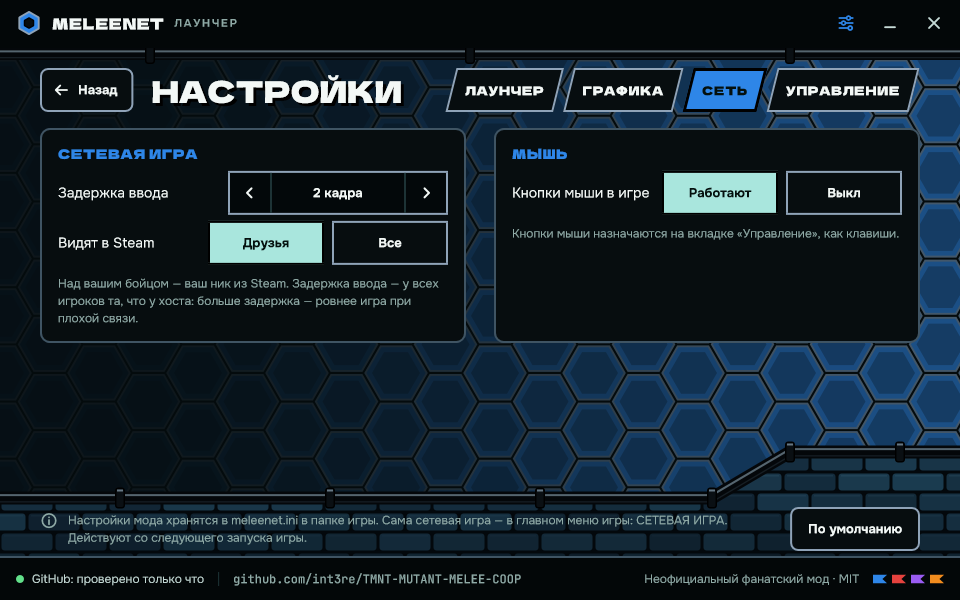
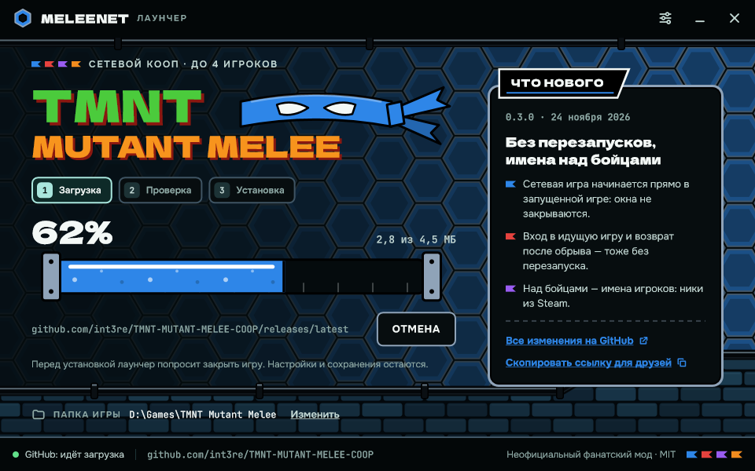
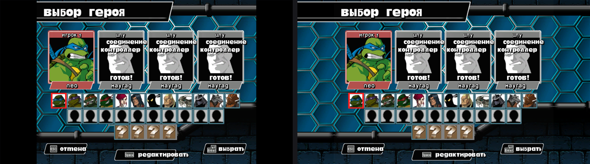
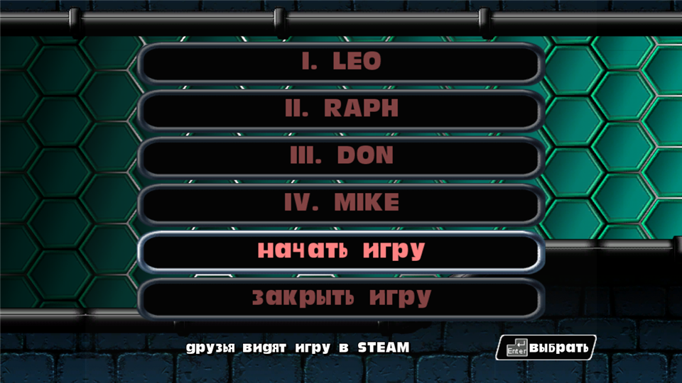
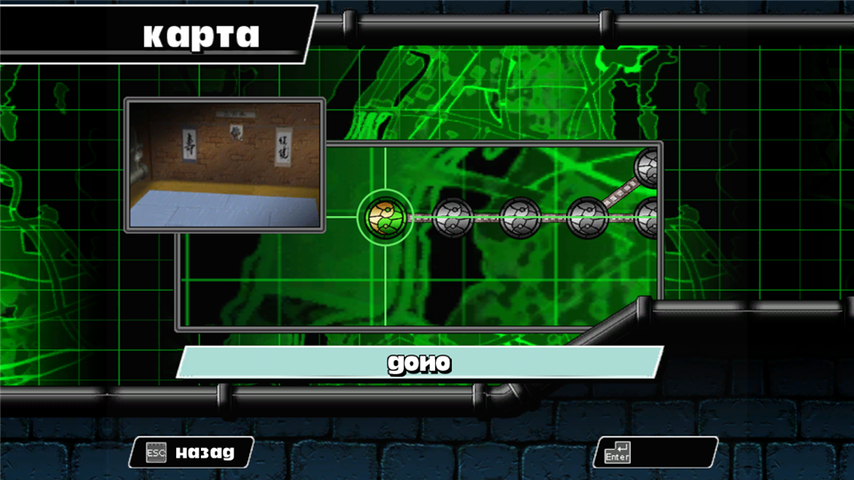

<h1 align="center">TMNT Mutant Melee — игра по сети</h1>

<p align="center">
  <b>meleenet — сетевая игра до четырёх игроков для TMNT Mutant Melee (ПК, 2005)</b><br>
  Один файл · у каждого своя копия игры и свой экран · Steam или прямой адрес · широкий экран и меню на весь кадр
</p>

<p align="center">
  
  
  
  
  
  
  
  
</p>

<p align="center">
  <a href="https://github.com/int3re/TMNT-MUTANT-MELEE-COOP/releases/latest/download/meleenet-launcher.exe"></a><br>
  <sub>Один файл, около 4,6 МБ: мод лежит внутри лаунчера. Он ставит мод, обновляет его и запускает игру.</sub>
</p>

<p align="center">
  <b>Русский</b> · <a href="README.en.md">English</a>
</p>

<p align="center">
  
</p>

**meleenet** — мод для русского издания игры *TMNT Mutant Melee*. В «Рукопашном бою» игры дерутся до четырёх
игроков, но только за одним компьютером. Мод даёт то же самое по сети: у каждого игрока своя копия игры и свой
экран, а сетевая игра начинается из главного меню самой игры — её кнопками и её шрифтом.

Заодно мод приводит игру 2005 года к сегодняшним мониторам: окно без рамки вместо полного экрана 640×480, любое
разрешение, широкий кадр, в котором и бои, и меню занимают весь экран, сглаживание и чёткие текстуры, удары на
кнопках мыши.

> Мод не содержит файлов игры и не меняет `ztmnt.exe` на диске: все изменения делаются в памяти при запуске.
> Нужна своя копия игры. Это неофициальный фанатский мод; версия пробная.

**Другие моды этой серии:**
[TMNT (2003) — кооператив до четырёх игроков](https://github.com/int3re/TMNT-2003-COOP) ·
[TMNT 2: Battle Nexus — кооператив до четырёх игроков](https://github.com/int3re/TMNT-2-BATTLE-NEXUS-COOP) ·
[Суперсемейка: Подземная битва — кооператив на двоих](https://github.com/int3re/INCREDIBLES-RISE-OF-THE-UNDERMINER-COOP)

## Содержание

- [Лаунчер: один файл](#лаунчер-один-файл)
- [Что добавлено и что изменено](#что-добавлено-и-что-изменено)
- [Меню мода](#меню-мода)
- [Возможности](#возможности)
- [Быстрый старт](#быстрый-старт)
- [Управление](#управление)
- [Что нужно для игры](#что-нужно-для-игры)
- [Документация](#документация)
- [Версии и совместимость](#версии-и-совместимость)
- [Состояние проекта](#состояние-проекта)
- [Сборка из исходников](#сборка-из-исходников)
- [Как это работает](#как-это-работает)
- [Участие](#участие)
- [Благодарности](#благодарности)
- [Поблагодарить автора](#поблагодарить-автора)
- [Лицензия и права](#лицензия-и-права)

## Лаунчер: один файл

Скачать нужно только **[`meleenet-launcher.exe`](https://github.com/int3re/TMNT-MUTANT-MELEE-COOP/releases/latest/download/meleenet-launcher.exe)**:
мод лежит внутри него, отдельного установщика нет. Лаунчер находит игру, ставит мод, следит за обновлениями,
настраивает картинку, сеть и клавиши и запускает игру.

<table>
  <tr>
    <td align="center" width="33%"><br><b>1. Установить</b><br><sub>Мод уже внутри: ставится одной кнопкой, без интернета</sub></td>
    <td align="center" width="33%"><br><b>2. Играть</b><br><sub>Файлы ложатся рядом с игрой, сама игра не меняется</sub></td>
    <td align="center" width="33%"><br><b>3. Обновлять</b><br><sub>О новой версии лаунчер скажет сам</sub></td>
  </tr>
</table>

| Что он делает | Как |
|---|---|
| **Находит игру** | в своей папке, по записи игры в Windows или в соседней папке; не нашёл — спросит, где лежит `ztmnt.exe` |
| **Ставит мод без интернета** | мод лежит внутри лаунчера; файлы игры не меняются |
| **Обновляет одной кнопкой** | новая версия скачивается с GitHub, сверяется по SHA-256 и ставится; настройки, клавиши и сохранения остаются |
| **Говорит, можно ли играть с друзьями** | под версиями написано, тот же ли у них сетевой протокол |
| **Обновляет и себя** | при запуске сам берёт лаунчер новее, сверяет его, встаёт на его место и перезапускается |
| **Настраивает игру до запуска** | вкладки ГРАФИКА, СЕТЬ и УПРАВЛЕНИЕ: окно и картинка, сетевая игра, клавиши и кнопки мыши |
| **Ждёт, если игра открыта** | или сам попросит её закрыться, как крестик её окна |
| **Работает, когда GitHub открывается плохо** | пробует настройки Windows, VPN-клиент на этом же ПК или ваш прокси |
| **Убирает мод** | одной кнопкой в настройках: удаляется ровно то, что было поставлено |

Оформление лаунчера взято из меню самой игры: соты, чёрные трубы, стена из синего кирпича, чёрные окна в стальной
рамке. Цвет сот и акцентов — цвет повязки одной из четырёх черепах; маска выбранного цвета повязана рядом с
названием.

<p align="center">
  <br>
  <sub>Четыре повязки — четыре цвета: Леонардо, Рафаэль, Донателло, Микеланджело.</sub>
</p>

<table>
  <tr>
    <td align="center" width="33%"><br><sub>ГРАФИКА: окно, разрешение, широкий кадр и меню, сглаживание</sub></td>
    <td align="center" width="33%"><br><sub>СЕТЬ: задержка ввода, кто видит игру в Steam, кнопки мыши</sub></td>
    <td align="center" width="33%"><br><sub>УПРАВЛЕНИЕ: клавиши и кнопки мыши, готовые раскладки</sub></td>
  </tr>
  <tr>
    <td align="center" width="33%"><br><sub>ЛАУНЧЕР: обновления, прокси, журналы, удаление мода, цвет повязки</sub></td>
    <td align="center" width="33%"><br><sub>Обновление: загрузка, сверка, установка</sub></td>
    <td align="center" width="33%"><br><sub>Ячейка действия ждёт клавишу или кнопку мыши</sub></td>
  </tr>
</table>

Подробно — на **[странице лаунчера](docs/LAUNCHER.md)**. Без окна, из командной строки:
`meleenet-launcher.exe /install "папка игры" /quiet`.

## Что добавлено и что изменено

<p align="center">
  <br>
  <sub>Один и тот же экран на широком мониторе: слева — меню игры как есть, 4:3 с полосами; справа — с модом.</sub>
</p>

| | В оригинале | С модом |
|---|---|---|
| **Игра вчетвером** | четверо за одним ПК | то же по сети: Steam, локальная сеть, IP — до четырёх ПК |
| **Окно** | только эксклюзивный полный экран 640×480 | окно без рамки на весь монитор или обычное окно; Alt+Tab сразу |
| **Разрешение** | 640×480 | по монитору или любое своё |
| **Широкий экран** | кадр 4:3 | кадр по форме монитора (16:9, 16:10, 21:9): в боях обзор шире по бокам |
| **Меню на широком экране** | — | фоны, трубы и стены идут до краёв экрана, надписи стоят на своих плашках |
| **Качество картинки** | без сглаживания | сглаживание до 8x, фильтр текстур до 16x |
| **Кнопки мыши** | не используются | левая, правая, средняя и обе боковые назначаются на удары, как клавиши |
| **Главное меню** | ИСТОРИЯ, РУКОПАШНЫЙ БОЙ, БИБЛИОТЕКА, ПАРАМЕТРЫ, ВЫХОД | добавлена СЕТЕВАЯ ИГРА — третьей кнопкой |
| **Экран загрузки** | изредка игра на нём падала | исправлено |
| **Настройки** | на экранах ПАРАМЕТРЫ в игре | ещё и в лаунчере, до запуска: графика, сеть, клавиши |
| **Установка и обновления** | — | один файл: [лаунчер](#лаунчер-один-файл) ставит мод, обновляет его и запускает игру |

Всё это в картинках — на странице **[«Что добавлено и что изменено»](docs/TOUR.md)**; что менялось от версии
к версии — в **[истории версий](docs/CHANGELOG.md)**.

## Меню мода

Всё, что мод добавляет в игру, сделано средствами самой игры: её кнопки, её шрифт, её подсветка, те же клавиши,
что и в остальных меню. Своих окон поверх игры у мода нет.

<table>
  <tr>
    <td align="center" width="33%"><br><sub>Главное меню: СЕТЕВАЯ ИГРА — третья кнопка</sub></td>
    <td align="center" width="33%"><br><sub>Страница СЕТЕВАЯ ИГРА: создать игру, игры друзей в Steam, войти по адресу</sub></td>
    <td align="center" width="33%"><br><sub>Игра создана: все четверо на месте, хост начинает</sub></td>
  </tr>
</table>

Сообщения в сетевой игре — что игрок вышел, что связь пропала, что игры разошлись — пишет сама игра, своим
шрифтом, вверху кадра.

## Возможности

### Сетевая игра


- **до четырёх игроков с разных ПК** в «Рукопашном бою» — так же, как вчетвером за одним компьютером. По сети
  идут только нажатия, картинка не передаётся: задержки видео нет, игра на всех ПК идёт кадр в кадр;
- **Steam или адрес**: друзья в Steam видят игру друг друга в списке; без Steam гость набирает адрес хоста
  (локальная сеть, проброс порта, Radmin VPN, Hamachi, ZeroTier);
- **встреча в самой игре**: кнопка СЕТЕВАЯ ИГРА в главном меню и страница из кнопок самой игры;
- **общий прогресс** — у хоста: гости на время игры получают его сохранение, собственные сохранения игроков
  мод не трогает;
- **связь переживает** потерю пакетов и долгую загрузку уровня;
- **если игрок вышел** или связь с ним пропала дольше чем на 15 секунд, остальные продолжают без него;
- **картинка у каждого своя**: окно, разрешение, форма кадра и сглаживание на ход игры не влияют.

«История» в игре рассчитана на одного: по сети её проходит один игрок, остальные смотрят.

<br clear="right">

### Экран и картинка

- **окно без рамки** на весь монитор или обычное окно вместо эксклюзивного полного экрана 640×480;
- **любое разрешение** и **кадр по форме монитора**: 16:9, 16:10, 21:9;
- **меню на весь широкий кадр**: соты, трубы и кирпичные стены идут до краёв экрана; при желании — родные 4:3
  с полосами;
- **сглаживание краёв** до 8x и **чёткие текстуры под углом** до 16x;
- исправлено редкое падение игры на экране загрузки.

<p align="center">
  <br>
  <sub>Карта «Истории»: рамка вокруг окна карты доведена до краёв экрана.</sub>
</p>

### Управление

- **кнопки мыши** — левая, правая, средняя и обе боковые — назначаются на удары в лаунчере, как клавиши;
- **готовые раскладки**: «Как в игре» и «WASD + мышь», или своя;
- в меню игры всегда работают стрелки, Enter и Esc.

## Быстрый старт

1. Скачайте **[`meleenet-launcher.exe`](https://github.com/int3re/TMNT-MUTANT-MELEE-COOP/releases/latest/download/meleenet-launcher.exe)** и запустите.
   Это единственный файл: мод лежит внутри него. Все версии — на странице [Releases](../../releases).
2. Если лаунчер не нашёл игру сам, укажите папку, где лежит `ztmnt.exe`.
3. Нажмите **УСТАНОВИТЬ МОД**, потом **ИГРАТЬ**. В главном меню игры появится кнопка **СЕТЕВАЯ ИГРА**.

> Лаунчер не подписан сертификатом, поэтому Windows может показать «Система Windows защитила ваш
> компьютер». Нажмите «Подробнее» → «Выполнить в любом случае».

Играть вместе:

| | Хост (игрок 1) | Гости (игроки 2–4) |
|---|---|---|
| 1 | СЕТЕВАЯ ИГРА → **СОЗДАТЬ ИГРУ** | СЕТЕВАЯ ИГРА → **ИГРЫ ДРУЗЕЙ В STEAM** → игра хоста; или **ВОЙТИ ПО АДРЕСУ** |
| 2 | ждёт, пока имена гостей появятся в списке | ждут |
| 3 | **НАЧАТЬ ИГРУ** | все игры закрываются и через несколько секунд открываются снова — уже в общей игре |
| 4 | в главном меню выбирает **РУКОПАШНЫЙ БОЙ** | на выборе героев каждый выбирает своего |

Через Steam: Steam запущен у всех, игроки — друзья. Без Steam гостям нужна прямая связь до хоста по UDP, порт
`47830`. Подробно — в **[руководстве по сетевой игре](docs/NETPLAY.md)**.

## Управление

Клавиши — самой игры. В сетевой игре каждый играет на своём ПК клавишами игрока 1.

| Действие | «Как в игре» | «WASD + мышь» |
|---|---|---|
| Ходить | W A S D | W A S D |
| Атака | N | левая кнопка мыши |
| Вторая атака | M | правая кнопка мыши |
| Действие | H | E |
| Прыжок | J | Пробел |
| Спецприём | Пробел | Q |
| Блок | B | Левый Shift |
| Меню | стрелки, Enter, Esc | стрелки, Enter, Esc |
| Пауза в бою | Esc | Esc |

Клавишу или кнопку мыши действию даёт лаунчер: вкладка УПРАВЛЕНИЕ → нажать на ячейку действия → нажать клавишу
или кнопку мыши. Полное описание — в [описании управления](docs/CONTROLS.md).

## Что нужно для игры

- **Windows 10 или 11**;
- **своя копия игры**: русское издание *TMNT Mutant Melee* с `ztmnt.exe`
  (SHA-256 `585a5809…9bbdce2`). Лаунчер проверяет файл и предупреждает, если он другой: с другим файлом мод
  ничего не меняет;
- для игры через Steam — запущенный Steam и любая учётная запись; покупать ничего не нужно;
- для игры по адресу через интернет — открытый у хоста порт `47830` UDP или общая виртуальная сеть.

## Документация

| Страница | О чём |
|---|---|
| [Что добавлено и что изменено](docs/TOUR.md) | обзор в картинках: меню игры, сетевая игра, лаунчер |
| [Установка](docs/INSTALL.md) | что нужно, установка, обновление, удаление, что и куда ставится |
| [Лаунчер](docs/LAUNCHER.md) | все экраны и вкладки, обновления, прокси для GitHub, командная строка |
| [Сетевая игра](docs/NETPLAY.md) | как собраться через Steam или по адресу, правила сетевой игры, обрывы связи |
| [Управление](docs/CONTROLS.md) | клавиши, кнопки мыши, раскладки, как их менять |
| [Настройки](docs/SETTINGS.md) | строки лаунчера и весь `meleenet.ini` |
| [Если что-то не так](docs/TROUBLESHOOTING.md) | частые вопросы и что прислать в отчёте об ошибке |
| [История версий](docs/CHANGELOG.md) | что менялось от версии к версии |
| [Сборка](docs/BUILDING.md) | как собрать мод и лаунчер из исходников, релизы, лаборатория |
| [Как это устроено](docs/ARCHITECTURE.md) | lockstep, часы игры, перехваты, родные меню, модули |
| [Заметки по разбору игры](re/notes.md) | адреса и устройство `ztmnt.exe`: главный цикл, ввод, экран, скрипты меню |

Вся документация есть и **[на английском](docs/en/README.md)**.

## Версии и совместимость

Текущая версия мода — **0.1.1**, лаунчера — **1.1.0**. Версию мода в папке игры показывает лаунчер.

В сетевой игре у всех должна быть версия мода с одним сетевым протоколом: игра на всех ПК обязана идти
одинаково, поэтому любое изменение в её ходе меняет и протокол.

| Версии мода | Протокол | Играют вместе |
|---|---|---|
| 0.1.0 – 0.1.1 | 1 | да |

## Состояние проекта

Мод пробный: он сделан и проверен в лаборатории — на нескольких копиях игры на одном компьютере, без окна на
экране. Что проверено, а что нет:

- **проверено в лаборатории:** сетевая игра двух, трёх и четырёх копий по адресу и через замену Steam, с
  потерей пакетов; весь путь через меню (создать игру → войти → начать → бой); копии с разной формой кадра;
  версия 0.1.1 против 0.1.0; журналы всех копий совпадали кадр в кадр. Меню на весь кадр сняты на 16:9, 16:10
  и 21:9;
- **проверено настоящим запуском, без окна на экране:** обновление с настоящего GitHub — лаунчер прежней версии
  сам нашёл этот релиз, скачал его, сверил, встал на его место и поставил мод 0.1.1 поверх 0.1.0;
- **ещё не проверено:** игра между настоящими аккаунтами Steam; настоящее окно в фокусе — клавиатура, кнопки
  мыши, ввод адреса; геймпады; пауза в сетевой игре; долгие игры; выход гостя посреди боя.

Известные ограничения:

- сетевая игра начинается перезапуском: после НАЧАТЬ ИГРУ все игры закрываются и открываются заново;
- нет входа в уже идущую игру и возврата после обрыва связи;
- в сетевой игре медленный ПК замедляет игру у всех: шаги игры у игроков общие;
- «История» по сети — на одного играющего, как и в самой игре;
- библиотека игры остаётся страницей 4:3 на чёрном фоне;
- в русском шрифте игры цифры 4 и 6 выглядят как «ч» и «б» — это видно в адресе на странице сетевой игры;
- мод сделан для одного издания игры; надписи мода и лаунчера — на русском языке.

## Сборка из исходников

Нужны Windows, Visual Studio с инструментами C++ и CMake. Сборка только 32-битная: `ztmnt.exe` — 32-битный
процесс.

```bash
cmake -S . -B build -A Win32
```

```bash
cmake --build build --config Release
```

Готовые файлы и лаунчер появятся в `build/dist/Release`. ENet и Ultimate ASI Loader берутся из соседней папки
с [TMNT-2003-COOP](https://github.com/int3re/TMNT-2003-COOP); Steamworks SDK — по желанию. Всё это, релизы и
лаборатория — в [docs/BUILDING.md](docs/BUILDING.md).

## Как это работает

Мод — это `meleenet.asi`, который [Ultimate ASI Loader](https://github.com/ThirteenAG/Ultimate-ASI-Loader)
(`dinput8.dll`) загружает в процесс игры. При старте мод сверяет SHA-256 файла `ztmnt.exe` и только потом
ставит перехваты; с любым другим файлом он ничего не меняет.

Сетевая игра — детерминированный lockstep («шаг в ногу»). Каждый ПК выполняет полную игру, а по сети идёт
только ввод: ни один ПК не выполняет кадр, пока не получит нажатия остальных игроков для него. Одинаковый ввод
даёт одинаковую игру, поэтому врагов, физику и предметы передавать не нужно. Раз в секунду игры сверяют
отпечаток состояния. Чтобы игра шла одинаково, мод даёт ей свои часы и следит за всем, что могло бы развести
копии: секундомерами затемнений, загрузкой уровней на втором потоке, тем, звучит ли реплика героя. Сетевая игра
начинается с перезапуска: две только что запущенные игры идут одинаково с первого кадра.

Меню мода — меню самой игры: экраны игры описаны скриптами, и мод подаёт разборщику игры свой скрипт главного
меню из её же кнопок. Так же сделаны меню на весь кадр: каждый скрипт экрана по дороге к разборщику
расширяется до краёв широкого кадра.

Лаунчер — отдельная программа без зависимостей: Direct2D и DirectWrite для картинки, WinHTTP для сети. Файлы
мода лежат в его ресурсах. Новая версия приходит как новый лаунчер: он скачивается, сверяется по SHA-256 из
релиза и открывается как данные, а не запускается.

Подробности — в [docs/ARCHITECTURE.md](docs/ARCHITECTURE.md) и в [заметках по разбору игры](re/notes.md).

## Участие

Сообщения об ошибках и предложения — в [Issues](../../issues). К сообщению приложите `meleenet.log` и
`meleenet-menu.log` из папки игры **со всех ПК**: без журналов остальных игроков сетевую ошибку обычно не найти.
Перед публикацией просмотрите журналы: в них есть ваше имя в Steam и папка игры.

Как предложить изменение и как проверить его без окна на экране — в [CONTRIBUTING.md](CONTRIBUTING.md) и
[docs/BUILDING.md](docs/BUILDING.md).

## Благодарности

| Кому | За что | Лицензия |
|---|---|---|
| [Ultimate ASI Loader](https://github.com/ThirteenAG/Ultimate-ASI-Loader) (ThirteenAG) | загрузка мода в игру | MIT |
| [MinHook](https://github.com/TsudaKageyu/minhook) (Tsuda Kageyu) | перехваты функций x86 | BSD 2-Clause |
| [ENet](https://github.com/lsalzman/enet) (Lee Salzman) | сеть по UDP с надёжным и ненадёжным каналами | MIT |
| [Steamworks SDK](https://partner.steamgames.com/) (Valve) | сеть через Steam; в репозиторий не входит | лицензия Valve |
| [Dela Gothic One](https://github.com/syakuzen/DelaGothic), [Onest](https://github.com/googlefonts/onest), [JetBrains Mono](https://github.com/JetBrains/JetBrainsMono) | шрифты лаунчера | SIL OFL 1.1 |
| [Ghidra](https://ghidra-sre.org/) и [Capstone](https://www.capstone-engine.org/) | инструменты, которыми разбиралась игра | Apache 2.0, BSD |
| [coop-anything](https://github.com/cranebeaker/coop-anything) | приёмы превращения игры на одного в сетевую и её проверки | — |
| [rea](https://github.com/morluto/rea) | инструменты разбора исполняемых файлов | — |
| Моды [TMNT 2003](https://github.com/int3re/TMNT-2003-COOP), [TMNT 2](https://github.com/int3re/TMNT-2-BATTLE-NEXUS-COOP) и [Суперсемейка](https://github.com/int3re/INCREDIBLES-RISE-OF-THE-UNDERMINER-COOP) | сетевой транспорт, лаборатория и основа лаунчера выросли из них | MIT |

Отдельное спасибо **Konami** и её гавайской студии за саму игру и всем, кто играет с модом и присылает журналы:
без них сетевые ошибки не найти.

## Поблагодарить автора

Мод бесплатный. Если он вам пригодился и хочется сказать спасибо, можно перевести **USDT** на один из адресов:

| Сеть | Адрес кошелька (USDT) |
|---|---|
| **TRON (TRC20)** | `TVdy7i7qoF1ZdrnNSZaC5Mgz1ZddaMhw4y` |
| **The Open Network (TON)** | `UQB-oxQVLLN3hm-YRGfr5-XJ95P0zIAeLFstgG40HiaR8oMz` |
| **BNB Smart Chain (BEP20)** | `0xA11f8221952FA5f540bC528072213b14F124379B` |

- Минимальная сумма — **0,1 USDT**.
- Отправляйте только USDT и только в той сети, чей адрес выбрали: перевод другой монеты или по другой сети
  не дойдёт.
- Контракт USDT в сети BNB Smart Chain:
  [`0x55d398326f99059fF775485246999027B3197955`](https://bscscan.com/token/0x55d398326f99059fF775485246999027B3197955).

Сказать спасибо можно и без денег: звездой репозиторию, сообщением об ошибке или журналом после игры.

## Лицензия и права

Код мода распространяется по лицензии [MIT](LICENSE). Сторонние библиотеки сохраняют свои лицензии:
MinHook — BSD 2-Clause, ENet — MIT, Ultimate ASI Loader — MIT, шрифты лаунчера — SIL Open Font License 1.1
(тексты лицензий — в [src/launcher/assets/fonts](src/launcher/assets/fonts)). Игра, её файлы и её графика
лицензией мода не покрываются.

Это неофициальный фанатский проект. Он не связан с Konami, Mirage Studios, Viacom и другими правообладателями
и ими не одобрен. *Teenage Mutant Ninja Turtles* и связанные названия и персонажи — товарные знаки их
владельцев. Репозиторий и релизы не содержат файлов игры: для работы мода нужна ваша собственная копия. Снимки
экрана показывают работу мода и приведены для иллюстрации; имена игроков на них вымышлены. Оформление лаунчера —
собственное: логотипа и персонажей игры в нём нет.

Для работы через Steam мод использует идентификатор тестового приложения Valve Spacewar (AppID 480), поэтому
во время сетевой игры Steam показывает статус «Spacewar».
