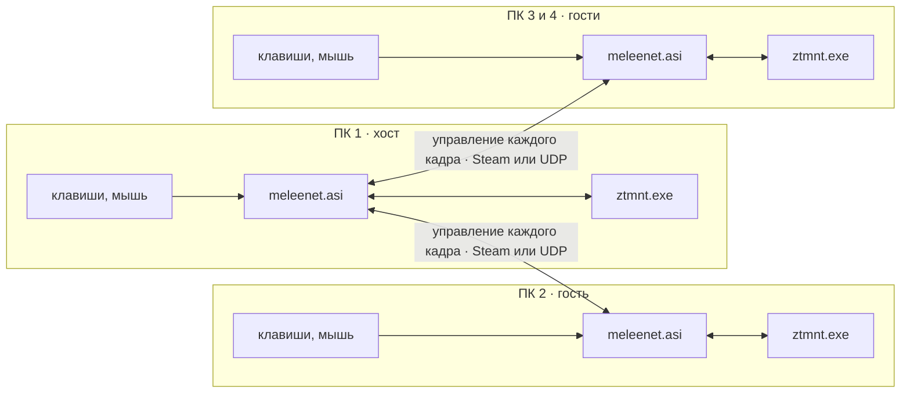

# Как это устроено

[Документация](README.md) · [Сборка](BUILDING.md) · [История версий](CHANGELOG.md)

**Русский** · [English](en/ARCHITECTURE.md)

meleenet — это две программы: **мод**, `meleenet.asi`, который живёт внутри процесса игры, и **лаунчер**,
который в игру не попадает вообще.

Игра — TMNT Mutant Melee для ПК: собственный движок Konami Hawaii на RenderWare 3.5, Direct3D 8. Здесь
описано, что мод с ней делает и почему. Как устроена сама игра — главный цикл, время, ввод, экран,
скрипты интерфейса, со всеми адресами — записано в заметках [`re/notes.md`](../re/notes.md); адреса и
структуры, которыми пользуется мод, собраны в [`src/mod/game.h`](../src/mod/game.h), у каждой — пояснение.

Мод проверен только в лаборатории — на копиях игры на одном компьютере. Что не проверено, перечислено
[в конце страницы](#что-не-проверено).

## Как мод попадает в игру

- При запуске игра импортирует `DINPUT8.dll`. В папке игры под этим именем лежит
  [Ultimate ASI Loader](https://github.com/ThirteenAG/Ultimate-ASI-Loader): он загружает `meleenet.asi`, а
  вызов `DirectInput8Create` передаёт настоящей `dinput8.dll` из Windows.
- `ztmnt.exe` не упакован и не защищён: его адреса верны с первой инструкции. Загрузчик вызывает
  `InitializeASI()` мода сразу после загрузки, раньше, чем начинает работать код игры, и хуки на функции
  игры ставятся там (`dllmain.cpp`).
- Мод сверяет SHA-256 файла `ztmnt.exe`. Поддерживается одна сборка — «Nov 22 2004», 1 753 088 байт; она у
  русского издания. Если файл мод не узнал, он не ставит ни одного хука на игру: игра идёт как без мода, а
  в `meleenet.log` об этом есть строка. Работает тогда только запись сбоев в журнал.
- Хуки — это трамплины [MinHook](https://github.com/TsudaKageyu/minhook) (`patch.cpp`). Кроме них мод
  подменяет несколько записей таблицы импорта (`Direct3DCreate8`, функции окна), ставит хуки на методы
  интерфейсов Direct3D 8 и в нескольких местах меняет байты кода в памяти. Перед хуком на функцию игры
  `sim.cpp`, `input.cpp`, `menu.cpp`, `sound.cpp`, `story.cpp` и `digits.cpp` сравнивают её первые байты с
  теми, какими они должны быть; если они другие, эта возможность выключается, и в журнале об этом написано.
  Файл `ztmnt.exe` на диске не меняется.

## Время: одинаковое на каждом компьютере

Движок двигает свой мир на то настоящее время, которое занял кадр, — умноженное на его «масштаб скорости»
0.85 и сглаженное. Два компьютера никогда не сделали бы одинаковые шаги. Поэтому мод даёт игре свои часы
(`sim.cpp`):

- **Игровой кадр — это ровно 0.85 / 60 с.** В конце каждого кадра игра делает «системное обновление»
  (0x408CB0): запоминает прошлое состояние геймпадов, разбирает сообщения окна, шагает часами, читает
  устройства. Игровой кадр — это такой проход после Update текущего режима игры. Хук на чтение устройств —
  *ворота кадра* мода: здесь решается, что игра узнает о геймпадах этого кадра.
- **Мод сам держит 60 кадров в секунду.** Шаг часов от настоящего времени не зависит: кадр, который
  длился дольше 1/60 с, всё равно двигает игру на один шаг, и после долгого кадра — загрузился уровень —
  мод упущенное не догоняет.
- **Кадр без картинки.** Картинку игрового кадра рисует одна функция игры (0x4051E0), и мод стоит на ней.
  Компьютер, который не успевает рисовать 60 картинок в секунду, играл бы медленнее настоящего, а в сетевой
  игре все идут в темпе самого медленного. Поэтому, пока игра отстаёт от своих часов больше чем на кадр,
  кадр боя проигрывается без картинки — до трёх подряд (`[video] frame_skip`, включено по умолчанию). Так
  делается только в режиме боя: меню и начало боя рисуются каждый кадр. У самой функции игры такое правило
  есть — для консолей, — но с ровными часами мода оно не срабатывает.
- **Экран загрузки — не время игры.** Пока основной поток загружает уровень, второй поток игры рисует
  экран загрузки и вызывает то же системное обновление — столько раз, сколько длится загрузка, то есть на
  каждом компьютере по-своему. Эти проходы мод игровыми кадрами не считает: время игры стоит, а в сетевой
  игре и геймпады остаются такими, какими их оставил последний игровой кадр.
- **Секундомеры.** Кроме часов, игра меряет настоящее время секундомерами: затемнение между режимами
  (0.35 с), ожидания при запуске и загрузке. Затемнение кончалось бы на одном компьютере на кадр раньше,
  чем на другом. У мода секундомеры идут по игровым кадрам: кадр для них — 1/60 с, сколько бы он ни длился.
- **Ролики** Bink — это цикл внутри одного вызова, длиной в ролик. В сетевой игре ролики не играются: два
  компьютера не вышли бы из ролика в одном и том же кадре.

### Случайные числа и реплики героев

Основной генератор игры — RpRandom из RenderWare: из него берёт 71 функция. `rand()` библиотеки C нужен
только звуку.

Реплики героев — отдельный случай. Правила игры всё время спрашивают у звука, «звучит ли реплика», и от
ответа зависит, что игра делает дальше и сколько случайных чисел берёт. Честный ответ зависит от звуковой
карты: на одном компьютере реплика кончается на кадр раньше, чем на другом, а на компьютере без звука не
играет вовсе. Поэтому отвечает мод, по часам игры (`sound.cpp`): реплика длится ровно столько, сколько её
клип в `soundPC\VCLIP.BKT`, в игровых кадрах от того кадра, в котором её попросили. Какую из реплик
события сказать, мод выбирает из собственных чисел.

Рисование и частицы — ещё один случай (`sim.cpp`). Рисуя кадр, игра тоже берёт случайные числа — на искры,
на дым: на число больше или меньше, смотря что попало в кадр, — и из того же генератора, что и правила.
Поэтому после каждой картинки мод возвращает генератор в состояние, в котором он был до неё: что
нарисовано, какой ширины кадр и нарисован ли он вообще, на числа правил не влияет. Обновление системы частиц
(0x481A50) берёт числа оттуда же, а какие системы частиц есть и в каком порядке, зависит от того, что игра
показывала раньше. У частиц поэтому своё состояние генератора: мод подставляет его на время вызова. Искры и
дым на разных компьютерах могут отличаться, числа правил — нет.

### Почему сетевая игра начинается с перезапуска

Игра одинакова на всех компьютерах, только если у неё одинаковое прошлое, а игра, которая уже сыграла бой,
хранит его следы. В лаборатории две свежие копии с одним сценарием нажатий совпадают с первого кадра
(5200 кадров, с боем), а копия, которая уже сыграла бой, расходится со свежей примерно через 500 кадров
боя. Поэтому сетевая игра — это игра, **запущенная заново**: у неё нет прошлого. Игроки встречаются до её
первого кадра и с самого первого кадра играют одно и то же.

Обойтись без перезапуска пробовали. Игра, которая уже что-то сыграла, хранит следы этого — порядок своих
систем частиц, очередь сообщений ИИ, — и две игры с разным прошлым расходятся; одинаковыми их делает только
свежий запуск. Поэтому и новый игрок входит в идущую сессию перезапуском: между двумя боями все игры
запускаются заново ([Дверь хоста](#дверь-хоста-вход-в-идущую-игру)).

## Сетевая игра: lockstep («шаг в ногу»)

Каждый компьютер считает всю игру целиком. По сети идёт только управление игроков (`netplay.cpp`).
Компьютеров от двух до четырёх; хост — в центре: гости говорят только с ним.

- В воротах кадра каждая копия читает **своё управление игрока 1** и назначает его на кадр *текущий +
  задержка ввода* (по умолчанию 2 кадра; задержку всем называет хост). Гость шлёт свои геймпады хосту,
  хост рассылает каждому геймпады всех игроков. Хост — игрок 1, гости — игроки 2–4.
- Кадр начинается только тогда, когда известны геймпады всех игроков для него. Пакет несёт все кадры,
  получение которых другая сторона ещё не подтвердила, так что потерянные пакеты стоят только времени.
- Каждые 60 кадров гости шлют хосту отпечаток состояния игры (генератор случайных чисел и время игры).
  Игра гостя может идти на кадр-два впереди игры хоста: отпечаток кадра, которого хост ещё не сыграл, хост
  хранит и сверяет, когда доходит до этого кадра. Если отпечатки разные, все копии пишут это в журнал и
  показывают «ИГРЫ РАЗОШЛИСЬ».
- Второй поток поддерживает связь, пока поток самой игры занят на несколько секунд (загружается уровень,
  перетаскивается окно).
- При встрече гость сообщает хосту отпечатки своих `ztmnt.exe` и `archive.arc`; хост не пускает гостя, у
  которого файлы другие. Гостю с другим сетевым протоколом хост на странице сетевой игры отвечает отказом.
- Сетевая игра идёт на сохранении хоста. Гость получает его и пишет в отдельный файл, `tmnt-net.sv`: имя
  файла сохранения подменяется в коде игры; своё сохранение гостя не трогается.
- Если гость вышел или от него 15 секунд ничего не слышно, сетевая игра продолжается без него, пока в ней
  остаётся хотя бы один гость. С кадра, с которого хост его отпустил, в геймпаде вышедшего стоит пометка
  «ушёл» — бит, которого игра не читает: каждый компьютер с одного и того же кадра знает, кто в игре. Если
  ушёл хост, сетевая игра окончена; каждый доигрывает один.
- Игра, для которой сессия окончена, закрывает транспорт и лобби Steam: порт и место в Steam свободны, и из
  той же запущенной игры можно создать новую сетевую игру или войти в чужую.
- **Пауза.** Клавишу паузы и меню паузы игра читает с одного геймпада — того, что ведёт меню. В сессии мод,
  прежде чем отдать игре геймпады кадра, добавляет в ведущий геймпад Esc остальных игроков, а на паузе — и
  их Enter: паузу ставит и снимает любой игрок. Пока выделение стоит на второй строке меню паузы — выйти из
  боя, — чужие клавиши не добавляются: эта строка остаётся за ведущим.

Транспорты (`src/common`): **ENet** поверх UDP для игры по адресу, **Steam Networking Messages** для игры
через Steam (через тестовое приложение Valve — Spacewar, AppID 480) и замена Steam, с помощью которой
лаборатория запускает нескольких «игроков Steam» на одном компьютере. Хост слушает оба пути сразу: в одной
сетевой игре могут быть гости из Steam и гости по адресу (`multi_transport.h`). В сессии хост
тоже слушает оба пути, каким бы ни пришли первые гости: позже игрок может прийти другим.

### Дверь хоста: вход в идущую игру

Игры сессии одинаковы потому, что стартовали вместе. Тот, кто приходит позже — или возвращается после
обрыва связи, — ждёт у «двери» хоста (`netplay.cpp`).

- Хост и во время игры отвечает на `Knock` игры, которой нет в сессии: сверяет версию протокола и отпечатки
  `ztmnt.exe` и `archive.arc`, считает места — в сессии вместе с ждущими не больше четырёх — и отвечает
  `Lobby` с пометкой «у хоста идёт игра» или отказом. Лобби Steam хоста остаётся на время игры, с состоянием
  `ingame`: друзья видят игру в списке и могут её выбрать.
- Ждущий стоит на странице сети. Если в это время идёт бой, хост показывает сообщение о новом игроке.
- Когда сессия между двумя боями — режимы главного меню, выбора героя, арены и параметров боя, выбора героя
  «Истории» и её карты, — хост шлёт `Go` каждой игре сессии и каждой игре у двери. Через мгновение каждая
  из них запускает себя заново в сессию всех: тем же способом, каким игры стартуют со страницы сети.
- Бой ради этого не прерывается: хост ждёт режима между боями.

### Что пришлось сделать одинаковым

Одинаковое управление даёт одинаковую игру, только если ничто другое не отличается. Кроме часов,
секундомеров и реплик, мод закрепляет вот что:

- **Запуск.** У игры, запущенной для сетевой игры, до первого входа в главное меню шаг часов и
  секундомеров в восемь раз длиннее, а темп 60 кадров в секунду не держится — так у всех. Экран «нажми
  ввод» за всех нажимает игра хоста.
- **Частицы.** Сколько частиц сделать, игра решает с помощью случайных чисел, поэтому в сетевой игре
  настройка «частицы» у всех равна 100 %.
- **Рисование и обновление частиц** случайных чисел у правил не берут (см. выше).
- **Ролики** не играются (см. выше).
- **Форма кадра на логику не влияет**: копии с кадром 16:9 и 4:3 считают одно и то же. Поэтому окно и
  разрешение у каждого игрока свои.

## Управление

Раз в кадр игра читает клавиатуру и джойстики и по привязкам из файла `tmntwire.hks` превращает их в
четыре «геймпада» — по 19 чисел: стик и кнопки. Всё в игре, и меню, и бои, читает эти геймпады. Мод стоит
сразу после этого чтения (`input.cpp`): в сетевой игре игра узнаёт про каждого игрока то, что пришло по
сети. Меню разработчиков игры остаётся делом своего компьютера: по сети оно не передаётся.

Клавиатуру игра превращает в геймпад одной функцией. Перед ней мод дописывает в состояние клавиатуры пять
«клавиш», которых нет ни на одной клавиатуре, — левую, правую и среднюю кнопки мыши и две боковые. Их
состояние он берёт у Windows, пока окно игры на переднем плане, а указатель — над её картинкой. Поэтому
кнопку мыши можно назначить действию как клавишу: это привязки самой игры, и по сети они идут как обычное
управление.

## «История» вместе

В самой игре «История» — для одного: герой против матчей сценария. Но матч «Истории» собирается из тех же
частей, что и бой «Рукопашного боя»: до восьми бойцов в двух командах, и в команде героя бывают «друзья» по
сценарию — их ведёт компьютер, а ранить друг друга свои не могут. В сетевой сессии мод добавляет остальных
игроков в каждый матч такими друзьями и отдаёт их бойцов геймпадам этих игроков (`story.cpp`).

- Хук стоит на функции игры, которая строит бойцов матча (0x455F00). Перед ней мод дописывает в матч по
  записи «друга» на каждого партнёра — в конец списка друзей: победила ли сторона героя, «История» читает по
  первым местам. После неё бойцы, построенные по этим записям, получают человека вместо компьютера и геймпад
  своего игрока.
- Запись партнёра: черепаха по номеру игрока (или первая, которая никому не досталась, если его черепаха —
  герой), команда героя, здоровье героя, панель HUD — свободная, а если свободных нет, одна из тех, что
  заняты врагами.
- Матч «последний на ногах» становится командным, и с героя снимается правило «нокаут героя заканчивает
  матч»: сторона побеждает, когда другая лежит. В матче на выживание без часов запись врага получает правило
  «конец, когда команда лежит»: такой матч кончается, когда лежит сторона врагов. Остальные правила матчей
  мод не трогает.
- Партнёры не добавляются: в тренировочные матчи с черепахой-роботом, в матч с бомбой и в другие мини-игры;
  в матч, где у врага есть вторая жизнь — он возвращается другим бойцом (игра считает записи таких матчей по
  месту, и лишняя запись их сдвинула бы); в матч, где заняты все восемь мест.
- Перед тем как матч строится снова, мод убирает из него то, что добавил.

## Картинка

- **Окно вместо полного экрана** (`video.cpp`). Сама игра знает только полный экран: при каждом запуске
  берёт 640×480 в 16 битах, сворачивается, когда вперёд выходит другое окно, а чтобы сменить разрешение,
  запускает себя заново. Мод делает устройство Direct3D 8 оконным и сам ставит окно игры: без рамки на весь
  монитор или как обычное.
- **Любой размер кадра.** Свой размер мод добавляет ещё одним режимом в конец списка видеорежимов, из
  которого выбирает игра.
- **Широкий экран.** У движка есть родной переключатель консолей на 16:9: обзор шире по бокам, 2D-слой
  сжат к центру, бока меню закрыты двумя чёрными полосами. Мод включает его и подставляет в его числа
  форму своего кадра — любую, не только 16:9.
- **Качество.** Сглаживание (MSAA) задаётся в параметрах устройства и работает, когда кадр заполняет окно
  целиком; анизотропная фильтрация — линейная фильтрация текстур, которую просит игра, заменяется
  анизотропной.
- **Два потока в одном устройстве.** Экран загрузки игра рисует вторым потоком, пока первый создаёт
  текстуры и буферы уровня, а устройство Direct3D создаёт без флага многопоточности. Отсюда редкие падения
  на загрузке. Мод добавляет этот флаг при создании устройства.

### Меню на весь широкий кадр

Экраны игры — это скрипты `ui/scripts/UI_*.txt` в её архиве, свёрстанные под 4:3: 640 единиц в ширину. На
широком кадре экран получается блоком 4:3 с пустыми боками. Каждый скрипт идёт к разборщику игры через мод
и по дороге расширяется (`uiwide.cpp`):

- элемент, который кончается у края раскладки, доводится до края кадра — так, как подходит его текстуре:
  повторяющаяся (соты фона, труба сверху) продолжается плиткой; несколько растянутых текселей (чёрные
  рамки, линии) тянутся дальше; кирпичные стены внизу и картинка экрана загрузки получают рядом второй
  элемент с зеркальной текстурой; плашки заголовков и полосы скорости — второй элемент из одного столбца
  текселей у края;
- чёрная рамка, которая стоит на самом краю раскладки (экран итогов «Истории»), переносится к краю кадра
  такой же узкой, а не тянется через стену рядом с ней;
- элемент, который ждёт за краем раскладки, чтобы въехать, или уезжает за него, ждёт за краем кадра;
- тексты, кнопки и портреты остаются на своих местах 4:3.

Чёрные полосы по бокам меню (0x40AB90) при этом не рисуются. Карту «Истории» игра рисует кодом, а не
скриптом: четыре затемнённые полосы вокруг окна карты мод рисует до краёв кадра (`video.cpp`). Библиотека
оставлена страницей 4:3 на чёрном. Настройка `menus = bars` в разделе `[video]` возвращает меню 4:3 с
полосами.

## Меню мода — это меню самой игры

Своих окон поверх игры мод не рисует (`menu.cpp`).

- **Главное меню** игры — это скрипт `UI_ModeSel_PC.txt` с пятью кнопками и одна функция режима главного
  меню, которая их ведёт. Мод отдаёт игре свой скрипт — шесть кнопок, собранных из её собственных: та же
  картинка, те же звуки, то же движение, — и ведёт их сам вместо этой функции. СЕТЕВАЯ ИГРА — третья
  кнопка.
- **Страницы сетевой игры** — создать игру, игры друзей, адрес, список игроков — это те же шесть кнопок с
  другими словами. Не рисуется ничего, чего игра не рисует сама.
- **Слова.** Свои тексты мод пишет в таблицу языка игры, поверх строк, которые показывает только другая
  консоль (сообщения о карте памяти), — на месте и не длиннее прежних (`gametext.cpp`).
- **Шрифт.** В шрифте русского издания кириллица нарисована на местах строчных латинских букв и двух цифр:
  Ч стоит на месте 4, Б — на месте 6. Тексты игры записаны этим «шифром», и мод пишет так же.
- **Цифры 4 и 6.** Настоящие 4 и 6 шрифту меню даёт `digits.cpp`: два новых глифа под кодами, которых нет ни
  в одном тексте игры. Шестёрка — это девятка самого шрифта, повёрнутая на пол-оборота; четвёрка нарисована
  в свободной клетке картинки шрифта (`glyph4.h`, его делает `tools/glyph_four.py`). Хук на отрисовку текста
  (0x40AC30) по дороге к шрифту заменяет те 4 и 6, которые цифры, а не буквы: слово без строчных латинских
  букв — число. Несколько слов, целиком составленных из «цифр» (ОБ, ОБО, БОБ, ЗОБ, ОБОЗ), и одиночная Б
  после ЧТО и ПЛАНА остаются буквами. Места игроков в списке пронумерованы 1.–4.; если дополнить шрифт не
  удалось, они нумеруются I.–IV., как в 0.1.x.
- **Сообщения** вверху кадра — кто вышел, что игры разошлись — выводит сама игра, своей отрисовкой текста,
  сразу после того как режим нарисовал кадр (`notice.cpp`, `menu.cpp`).

Игроки встречаются на странице, пока у всех обычные одиночные игры (`netlobby.cpp`): один открывает игру —
лобби Steam для друзей и порт UDP для адреса, — до трёх других находят её среди игр друзей или набирают
адрес. Когда хост начинает, каждая игра запускает себя заново, при этом сетевая игра записана в переменных
окружения: она начинается вместе с процессом, до первого кадра. Журнал игры, которая была до перезапуска,
остаётся в `meleenet-menu.log`. Игра, которая стучится к хосту с идущей сессией, ждёт на той же странице:
хост отвечает ей из сессии ([Дверь хоста](#дверь-хоста-вход-в-идущую-игру)).

## Модули мода

| Файл | Что он делает |
|---|---|
| `dllmain.cpp` | вход мода: сверка `ztmnt.exe`, установка остальных модулей |
| `patch.cpp` | хуки, замена байтов с проверкой, подмена импорта |
| `config.cpp` | `meleenet.ini` |
| `game.h` | адреса и структуры `ztmnt.exe` |
| `sim.cpp` | часы, ворота кадра, темп, кадры без картинки, свои случайные числа у рисования и частиц, секундомеры, покадровый журнал лаборатории |
| `input.cpp` | геймпады игроков, кнопки мыши, сценарий лаборатории |
| `netplay.cpp` | сетевая игра: встреча до первого кадра, lockstep, сверки, выход игроков, пауза любого игрока, дверь хоста |
| `story.cpp` | «История» вместе: партнёры в записях матча, их бойцы — геймпадам игроков; переключатели лаборатории для «Истории» |
| `multi_transport.h` | Steam и адрес у хоста одновременно |
| `netlobby.cpp` | встреча на странице сетевой игры: лобби Steam, адрес, перезапуск игр |
| `menu.cpp` | главное меню и страницы сети из кнопок игры; вывод сообщений |
| `gametext.cpp` | тексты мода в таблице языка игры, шрифт русского издания |
| `digits.cpp`, `glyph4.h` | настоящие 4 и 6 в шрифте меню: два глифа и замена цифр по дороге к отрисовке текста |
| `uiwide.cpp` | скрипты экранов, расширенные до широкого кадра |
| `notice.cpp` | сообщение и срок его показа |
| `video.cpp` | окно, устройство, размер и форма кадра, сглаживание и фильтрация, снимки лаборатории |
| `d3d8.h` | то немногое из Direct3D 8, что нужно моду |
| `sound.cpp` | реплики героев по часам игры |
| `diag.cpp` | отчёты о сбоях в журнал |

В `src/common` — то, что не зависит от игры: пакеты протокола (`protocol.h`), транспорты ENet и Steam,
запуск Steam и его лабораторная замена, лобби Steam, журнал, SHA-256.

## Лаунчер

Отдельная программа: Direct2D и DirectWrite, WinHTTP — ничего, кроме Windows; шрифты и файлы мода лежат в
её ресурсах. Выглядит она как меню самой игры (`view.cpp`): фон — соты, которые светлеют к правому краю,
чёрные трубы и стена из синих кирпичей с пандусом; окна и кнопки — чёрные, в стальной рамке. Цвет сот и
акцентов — повязка одной из четырёх черепах, на выбор игрока; маска этого цвета повязана рядом с
заголовком.

| Файл | Что он делает |
|---|---|
| `main.cpp` | окно, мышь и клавиатура, задания в фоне, командная строка |
| `view.cpp` | то, что рисуется: каждый экран по модели |
| `gfx.cpp` | Direct2D: фигуры, текст, PNG |
| `core.cpp` | папка игры, установленный мод, настройки, самый новый релиз |
| `package.cpp` | мод внутри файла лаунчера; укладка его в папку игры и удаление по списку |
| `net.cpp` | HTTP, с прокси или без |
| `gameset.cpp` | строки вкладок ГРАФИКА, СЕТЬ и УПРАВЛЕНИЕ: `meleenet.ini` и клавиши в `tmntwire.hks` |

Мод ставится рядом с `ztmnt.exe`; сам `ztmnt.exe` и данные игры установка не трогает. Каждый поставленный
файл и каждая резервная копия записаны в `meleenet-install.txt` в папке игры: по этому списку мод
убирается, а прежние файлы возвращаются. Вместе с модом убирается то, что он написал сам, — его журналы и
`tmnt-net.sv`; сохранение игрока остаётся. `meleenet.ini` игрока при обновлении остаётся.

Новая версия приходит новым файлом лаунчера: он скачивается, сверяется по SHA-256, которая указана в
релизе, и **открывается как данные** — файлы мода читаются из его ресурсов. Запускается он только тогда,
когда заменяет сам лаунчер.

## Что не проверено

- Настоящий Steam: проверена только его лабораторная замена.
- Настоящее окно игры перед игроком: клавиатура, мышь, набор адреса.
- Лаунчер в руках человека — под настоящими мышью и клавиатурой.
- Геймпады.
- Долгие сессии.
- «История» вместе: в лаборатории сыграны этап-дуэль и командный этап, не каждый этап каждого героя.
- Вход в идущую игру и возврат после обрыва связи — на настоящем Steam.
- Широкие меню на экранах итогов боя, победы, поражения и открытий «Истории» и в титрах: эти экраны в
  лаборатории не сняты. Исключение — экран итогов «Истории»: в 0.2.0 его чёрные рамки поставлены к краям
  картинки.

В лаборатории в версии 0.2.0 проверены: «История» на двух и трёх копиях, вход третьей копии во время боя
двоих (по адресу и через замену Steam), возврат гостя после обрыва связи, пауза гостя и выход ведущего из
боя, пропуск кадров у одной копии из двух. Подробно — в [истории версий](CHANGELOG.md#020).
