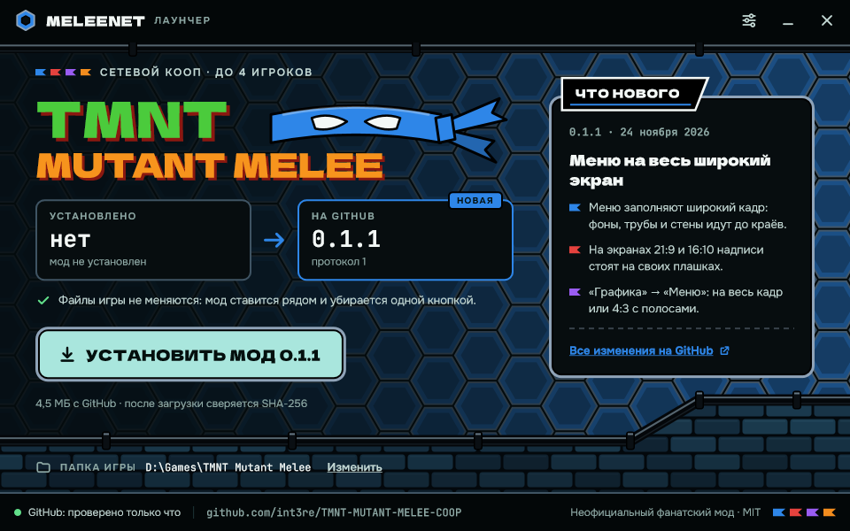

# Установка, обновление и удаление

[Документация](README.md) · **Установка** · [Лаунчер](LAUNCHER.md) · [Сетевая игра](NETPLAY.md) ·
[Управление](CONTROLS.md) · [Настройки](SETTINGS.md) · [Если что-то не так](TROUBLESHOOTING.md)

**Русский** · [English](en/INSTALL.md)

## Что нужно

- **Windows 10 или 11.**
- **Своя копия игры**: русское издание *TMNT Mutant Melee* для ПК, с его `ztmnt.exe`
  (SHA-256 `585a5809349e5e31352f80b94445382d69824d3e3c78ba84e38cf519f9bbdce2`). Ни в репозитории, ни в
  релизах файлов игры нет.
- Для игры через Steam: запущенный клиент Steam и аккаунт. Самой игры в Steam может не быть: мод
  подключается к Steam как тестовое приложение Valve — Spacewar (AppID 480). На настоящих аккаунтах Steam
  это ещё не проверено.
- Для игры по адресу через интернет: порт UDP `47830`, открытый у хоста, или общая виртуальная сеть
  (Radmin VPN, Hamachi). Для игры через Steam порт не нужен.

> **Другое издание игры.** Мод знает один `ztmnt.exe`. С любым другим файлом он ничего не меняет и ничего
> не включает: лаунчер пишет об этом под кнопкой («ztmnt.exe в этой папке не тот, для которого сделан
> мод»), а игра идёт так, будто мода нет.

## Установка

1. Скачайте [`meleenet-launcher.exe`](https://github.com/int3re/TMNT-MUTANT-MELEE-COOP/releases/latest/download/meleenet-launcher.exe).
   Это один файл размером около 4,6 МБ, мод лежит внутри него; сам он никуда не устанавливается и может
   лежать где угодно.
2. Запустите его. Если он не нашёл игру, нажмите **ВЫБРАТЬ ПАПКУ ИГРЫ** (или **Изменить** внизу окна) и
   выберите папку, в которой лежит `ztmnt.exe`.
3. Нажмите **УСТАНОВИТЬ МОД**. Файлы берутся из самого лаунчера; если на GitHub уже вышла версия новее,
   лаунчер сначала скачает её.
4. Нажмите **ИГРАТЬ**.

<p align="center">
  
  
</p>

> Лаунчер не подписан сертификатом, поэтому Windows может показать окно «Система Windows защитила ваш
> компьютер». Нажмите **«Подробнее» → «Выполнить в любом случае»**. SHA-256 файла указан в
> `meleenet-latest.json` каждого
> [релиза](https://github.com/int3re/TMNT-MUTANT-MELEE-COOP/releases).

## Что куда кладётся

Всё кладётся рядом с `ztmnt.exe`. Сам `ztmnt.exe` и данные игры на диске не меняются: мод работает в памяти.

| Файл | Что это |
|---|---|
| `dinput8.dll` | [Ultimate ASI Loader](https://github.com/ThirteenAG/Ultimate-ASI-Loader): загружает мод в игру. Если Ultimate ASI Loader там уже стоит, он остаётся и используется |
| `meleenet.asi` | сам мод |
| `meleenet.ini` | настройки мода. Если файл там уже есть, он остаётся |
| `steam_api.dll` | библиотека Steam (нужна только для игры через Steam) |
| `steam_appid.txt` | номер приложения для Steam (480). Если файл там уже есть, он остаётся |
| `meleenet-README.md` | короткая инструкция на русском |
| `meleenet-install.txt` | список файлов, которые поставил лаунчер; по нему лаунчер убирает именно их |

Если в папке игры уже лежит чужой файл с именем одного из файлов мода (например, другой `dinput8.dll`),
лаунчер переносит его в папку `meleenet-backup\` и возвращает на место, когда мод удаляют.

Что появляется позже, само:

| Файл | Что это |
|---|---|
| `meleenet.log` | журнал последнего запуска игры |
| `meleenet-menu.log` | журнал игры, из которой была начата сетевая игра (до её перезапуска) |
| `tmnt-net.sv` | у гостя сетевой игры: копия сохранения хоста. Ваше собственное сохранение, `tmnt.sv`, не трогается |

Клавиши, которые вы меняете в лаунчере, записываются в файл привязок самой игры, `tmntwire.hks`
([Управление](CONTROLS.md)).

Собственные файлы лаунчера лежат вне папки игры: его настройки — в `%APPDATA%\meleenet\launcher.ini`,
загрузки и копии настроек, сделанные перед изменением, — в `%LOCALAPPDATA%\meleenet\cache`.

## Обновление

Запустите лаунчер. При каждом запуске он спрашивает у GitHub, какой релиз самый новый:

- новый **лаунчер** берётся сам: скачивается, сверяется по SHA-256, встаёт на место старого и запускается
  заново;
- новый **мод** предлагается кнопкой **ОБНОВИТЬ ДО …**. Ваш `meleenet.ini`, ваши клавиши и ваши сохранения
  остаются.

Под двумя версиями лаунчер пишет, можно ли ещё играть с друзьями, у которых старая версия (тот же сетевой
протокол), или обновиться нужно всей командой.

<p align="center">
  
  
</p>

## Удаление

Лаунчер → настройки (значок с ползунками справа вверху) → вкладка **ЛАУНЧЕР** → **Удалить мод**, затем
**Точно удалить?** Убираются именно те файлы, что записаны в `meleenet-install.txt` (в их числе
`meleenet.ini`), и то, что мод записал сам: журналы `meleenet.log` и `meleenet-menu.log` и `tmnt-net.sv` —
копия сохранения хоста. Файлы, перенесённые в `meleenet-backup\`, возвращаются на место. Ваше собственное
сохранение и файлы игры остаются; остаются и клавиши, записанные в `tmntwire.hks`.

Вручную: удалите файлы, перечисленные в `meleenet-install.txt`.

## Без окна лаунчера

```
meleenet-launcher.exe /install "C:\Games\TMNT Mutant Melee" /quiet
```

```
meleenet-launcher.exe /uninstall "C:\Games\TMNT Mutant Melee" /quiet
```

Код выхода — 0, если всё сделано, и 2, если нет (в папке нет `ztmnt.exe`, игра запущена). Без `/quiet`
результат показывается в сообщении.

## Вручную

Соберите мод ([Сборка](BUILDING.md)) или возьмите файлы из установленной копии и положите `dinput8.dll`,
`meleenet.asi`, `meleenet.ini` и, для Steam, `steam_api.dll` рядом с `ztmnt.exe`.
