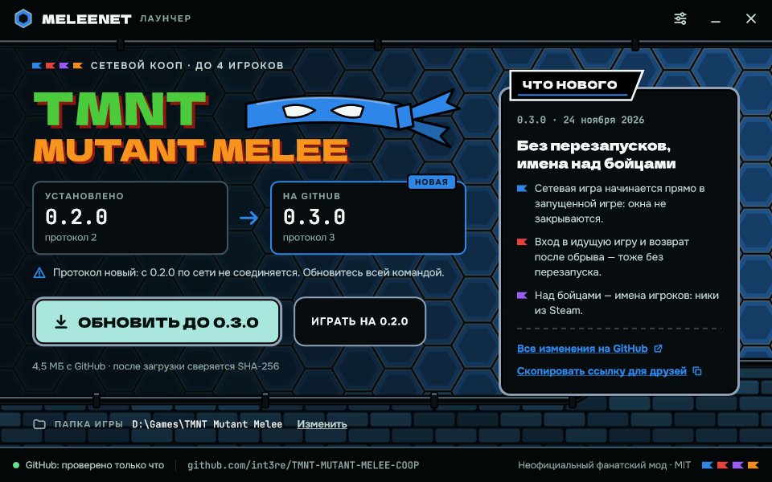
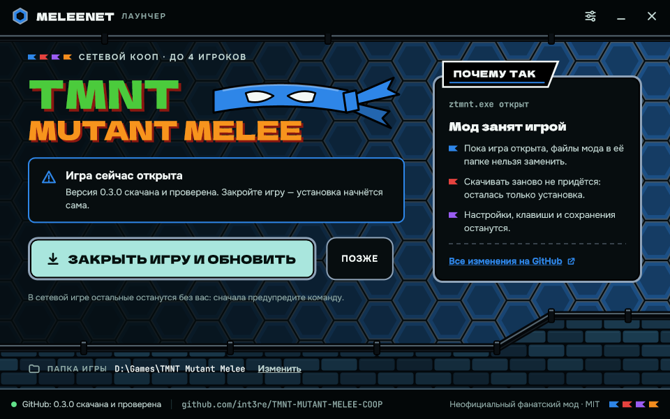
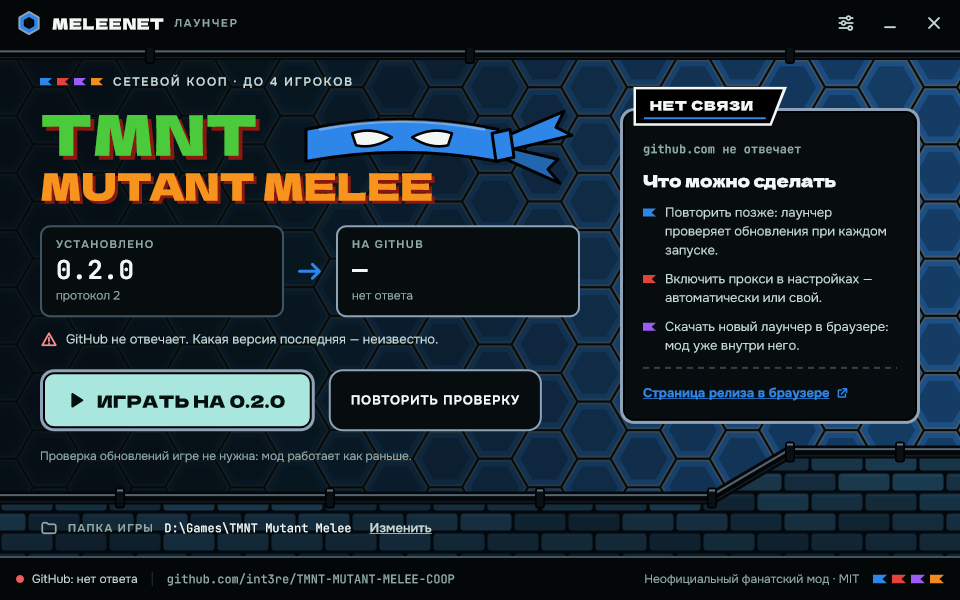
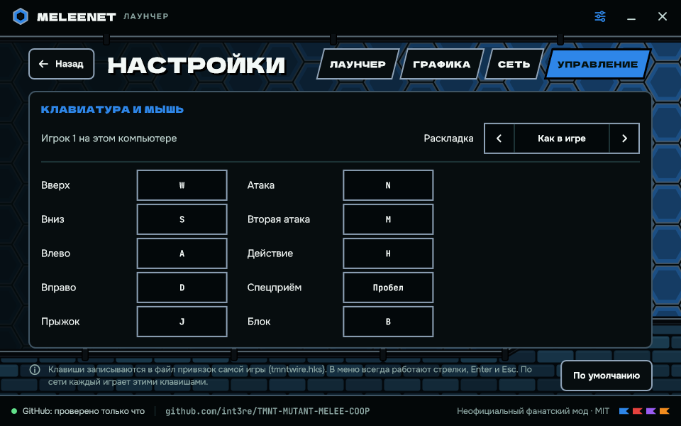

# Лаунчер

[Документация](README.md) · [Установка](INSTALL.md) · **Лаунчер** · [Сетевая игра](NETPLAY.md) ·
[Управление](CONTROLS.md) · [Настройки](SETTINGS.md) · [Если что-то не так](TROUBLESHOOTING.md)

**Русский** · [English](en/LAUNCHER.md)

`meleenet-launcher.exe` — единственный файл, который получает игрок. Мод лежит внутри него. Лаунчер находит
игру, ставит мод и убирает его, обновляет мод и сам себя, настраивает картинку, клавиши и сетевую игру до
запуска игры и запускает игру.

  

Это отдельная программа, а не часть игры: Direct2D и DirectWrite для картинки, WinHTTP для сети,
устанавливать ничего не нужно. `ztmnt.exe` и данные игры лаунчер не трогает; из файлов самой игры он меняет
только файл привязок клавиш `tmntwire.hks` — когда вы меняете клавиши на вкладке УПРАВЛЕНИЕ. Запускается
только один лаунчер: второй запуск показывает окно первого.

Выглядит лаунчер как меню самой игры: соты, которые светлеют к правому краю, чёрные трубы, вдоль нижнего
края — стена из синих кирпичей с пандусом; окна и кнопки чёрные, в стальной кайме, а большая кнопка — светлая
плашка. Цвет сот и акцентов — цвет повязки одной из четырёх черепах; маска этого цвета повязана рядом с
названием.

  

## Главный экран

| Что написано на экране | Большая кнопка | Кнопка рядом |
|---|---|---|
| мод не установлен | **УСТАНОВИТЬ МОД …**: ставит мод, который лежит в лаунчере; если на GitHub версия новее, сначала скачивает её | — |
| «У вас последняя версия. Новее на GitHub нет.» | **ИГРАТЬ** | **ПРОВЕРИТЬ ОБНОВЛЕНИЯ** |
| пометка **НОВАЯ** у версии справа | **ОБНОВИТЬ ДО …** | **ИГРАТЬ НА …** запускает игру на той версии, что у вас стоит |
| «Спрашиваю у GitHub, какая версия последняя.» | **ИГРАТЬ НА …**: ждать ответа не нужно, проверка идёт в фоне | — |
| «GitHub не отвечает. Какая версия последняя — неизвестно.» | **ИГРАТЬ НА …** | **ПОВТОРИТЬ ПРОВЕРКУ** |
| «Игра не найдена» | **ВЫБРАТЬ ПАПКУ ИГРЫ**: выберите папку с `ztmnt.exe` | — |
| «Игра сейчас открыта» | **ЗАКРЫТЬ ИГРУ И ОБНОВИТЬ** просит игру закрыться, как это делает крестик её окна | **ПОЗЖЕ** отменяет |

Клавиша Enter нажимает большую кнопку.

В двух рамках показаны версия, установленная в папке игры, и самая новая на GitHub, у каждой — её
**сетевой протокол**. Встретиться в сетевой игре можно только на версиях с одним протоколом; строка под
рамками словами говорит, можно ли ещё играть с друзьями, у которых старая версия («Протокол тот же…»), или
обновиться нужно всей командой («Протокол новый…»).

Справа, в отдельном окне, — что нового в версии, ссылка **Все изменения на GitHub** и **Скопировать ссылку
для друзей** — ссылка на самый новый релиз. Внизу окна — папка игры и **Изменить**, а в нижней строке — что
ответил GitHub.

  
  
  

  
  

## Обновления

При каждом запуске лаунчер запрашивает у GitHub файл `meleenet-latest.json` самого нового релиза: версия и
протокол мода, заметки, имя файла лаунчера, его размер и SHA-256.

- **Новый лаунчер** сам встаёт на место старого: скачивается, сверяется по SHA-256, кладётся туда, где лежал
  старый, и запускается заново. Мод в папке игры при этом не трогается.
- **Новый мод** приходит внутри нового файла лаунчера. Файл скачивается в кэш лаунчера, проверяется и
  открывается как данные — он не запускается. Файлы мода достаются из него в папку игры.
- Файл с другой контрольной суммой не используется: он удаляется, и лаунчер предлагает скачать его заново.
- `meleenet.ini`, клавиши и сохранения остаются при любом обновлении.
- Пока игра открыта, файлы мода в её папке заменить нельзя: лаунчер просит закрыть игру и ставит
  обновление, как только она закроется.

Проверку при запуске и обновление самого лаунчера можно выключить в настройках. Без GitHub лаунчер всё
равно ставит тот мод, что лежит в нём, и запускает игру.

## Настройки

Значок с ползунками справа вверху; **Назад** или Esc возвращает на главный экран. Четыре вкладки. На
вкладках ГРАФИКА, СЕТЬ и УПРАВЛЕНИЕ кнопка **По умолчанию** справа внизу возвращает строки вкладки к
исходным значениям. Пока мод не установлен, строки этих трёх вкладок бледные: их настройки хранятся в
`meleenet.ini`, который появляется вместе с модом.

### ЛАУНЧЕР — сам лаунчер

  

| Строка | Что она делает |
|---|---|
| **Проверять при запуске** | при каждом запуске спрашивать у GitHub, нет ли нового релиза |
| **Обновлять лаунчер при запуске** | новый лаунчер сам встаёт на место этого |
| **Ставить обновления мода без вопроса** | новый мод ставится при запуске, без кнопки; по умолчанию выключено |
| **Прокси для GitHub**: Авто / Нет / Свой | как добираться до GitHub, когда он не открывается напрямую: как настроено в Windows, а если не вышло — через VPN-клиент на этом ПК; только напрямую; или свой HTTP-прокси `адрес:порт` |
| **Изменить** (у папки игры) | выбрать другую папку с `ztmnt.exe` |
| **Открыть журнал** | открыть `meleenet.log` из папки игры — журнал последнего запуска игры. С модом 0.3.0 в нём записана и сетевая игра: она начинается в том же процессе |
| **Журнал до сессии** | открыть `meleenet-menu.log` — журнал игры, которая стояла на странице сетевой игры перед тем, как запустилась заново в сессию. С модом 0.3.0 этот файл появляется, только когда сессии пришлось запускать новый процесс ([запасной путь](NETPLAY.md#запасной-путь-игра-запускается-заново)); пока его нет, кнопка отвечает «Этого журнала пока нет: он появляется после сетевой игры» |
| **Переустановить мод** | положить файлы мода заново |
| **Удалить мод** → **Точно удалить?** | убрать то, что было поставлено, и то, что мод записал сам ([Установка](INSTALL.md)) |
| **Цвет повязки** | цвет сот и акцентов лаунчера: четыре маски на выбор — синяя Леонардо (стоит по умолчанию), красная Рафаэля, фиолетовая Донателло, оранжевая Микеланджело |
| **Закрывать лаунчер, когда игра запущена** | лаунчер закрывается, как только игра запустилась |

### ГРАФИКА — окно и картинка

  

**ЭКРАН** — окно игры, разрешение, формат кадра и меню; **КАРТИНКА** — сглаживание, фильтр текстур, контуры
героев, тени, частицы и пропуск кадров. Это настройки самого мода, они хранятся в `meleenet.ini` в папке игры
и действуют со следующего запуска игры. Каждая строка описана на странице [Настройки](SETTINGS.md). Размер и
форма кадра на ход игры не влияют, поэтому у игроков сетевой игры они могут быть разными.

**Пропуск кадров** («Вкл» или «Выкл», последняя строка блока КАРТИНКА) появился в лаунчере 1.2.0, вместе с
модом 0.2.0; больше в той версии лаунчера ничего не изменилось. Со «Вкл» — так стоит по умолчанию — кадры
боя, которые компьютер не успевает нарисовать, проигрываются без картинки, и игра не замедляется; в сетевой
игре один медленный компьютер не замедляет бой остальным. Работает это только в боях. Строка бледная, если в
папке игры стоит мод старше 0.2.0: он эту настройку не читает.

### СЕТЬ — сетевая игра и мышь

  

**Задержка ввода** (у всех игроков действует та, что у хоста), **Видят в Steam** (кто видит игру, созданную
через Steam: друзья или все, у кого стоит мод) и **Кнопки мыши в игре**. Эти настройки тоже хранятся в
`meleenet.ini`. Сама сетевая игра начинается не здесь, а в главном меню игры: СЕТЕВАЯ ИГРА. Подробнее — на
странице [Сетевая игра](NETPLAY.md).

Подсказка под строками блока СЕТЕВАЯ ИГРА начинается словами «Над вашим бойцом — ваш ник из Steam»: с модом
0.3.0 в сетевой игре над бойцом каждого игрока написано его имя. Строки для имени в лаунчере нет: без Steam
над бойцом стоит «ИГРОК N» или имя, вписанное от руки в `[net] name` файла `meleenet.ini`
([Настройки](SETTINGS.md#net)). Эта фраза — всё, что изменилось в лаунчере 1.3.0, который несёт в себе мод
0.3.0.

### УПРАВЛЕНИЕ — клавиши и мышь

  
  

Клавиши игрока 1 на этом компьютере: десять действий, у каждого — ячейка с клавишей. Это привязки самой
игры: лаунчер записывает их в её файл `tmntwire.hks`.

- **Раскладка:** «Как в игре» (W S A D, N, M, H, J, Пробел, B), «WASD + мышь» или «Своя» — ваши собственные
  клавиши, если вы их меняли.
- **Клавиша:** нажмите на ячейку действия, затем на новую клавишу. Если клавиша занята другим действием,
  она меняется местами с той, что была у этого. Esc отменяет.
- **Кнопка мыши:** нажмите на ячейку действия, затем нажмите правую, среднюю или боковую кнопку мыши;
  левую — *по этой же ячейке*. Кнопка встаёт на место клавиши: в ячейке тогда написано, например, `ЛКМ`.
- **По умолчанию** возвращает клавиши самой игры.

Подробнее — на странице [Управление](CONTROLS.md).

## Когда GitHub не открывается

Лаунчер по очереди пробует то, что разрешает строка **Прокси для GitHub**. При **Авто** это настройки
самой Windows и локальный прокси VPN-клиента на этом ПК, если такой слушает. Нижняя строка окна говорит,
когда GitHub ответил и через какой прокси. Если не приходят только файлы релиза (страница отвечает, а
сервер загрузок — нет), лаунчер так и пишет: «GitHub отвечает, но файлы релиза не отдаёт. Включите прокси в
настройках» — и даёт ссылку на страницу релиза в браузере.

## Где лаунчер хранит своё

| Путь | Что там |
|---|---|
| `%APPDATA%\meleenet\launcher.ini` | настройки лаунчера |
| `%LOCALAPPDATA%\meleenet\cache` | скачанные релизы; `meleenet.ini.before-launcher` и `tmntwire.hks.before-launcher` — настройки мода и клавиши игры, какими они были до того, как лаунчер впервые за запуск их изменил |

## Из командной строки

| Команда | Что она делает |
|---|---|
| `meleenet-launcher.exe /install "<папка игры>" [/quiet]` | ставит мод; код выхода 0 или 2 |
| `meleenet-launcher.exe /uninstall "<папка игры>" [/quiet]` | убирает его; код выхода 0 или 2 |
| `meleenet-launcher.exe --check --out <файл>` | спрашивает у GitHub самый новый релиз и записывает, что пришло |
| `meleenet-launcher.exe --where --out <файл>` | записывает, где найдена игра и что там установлено |
