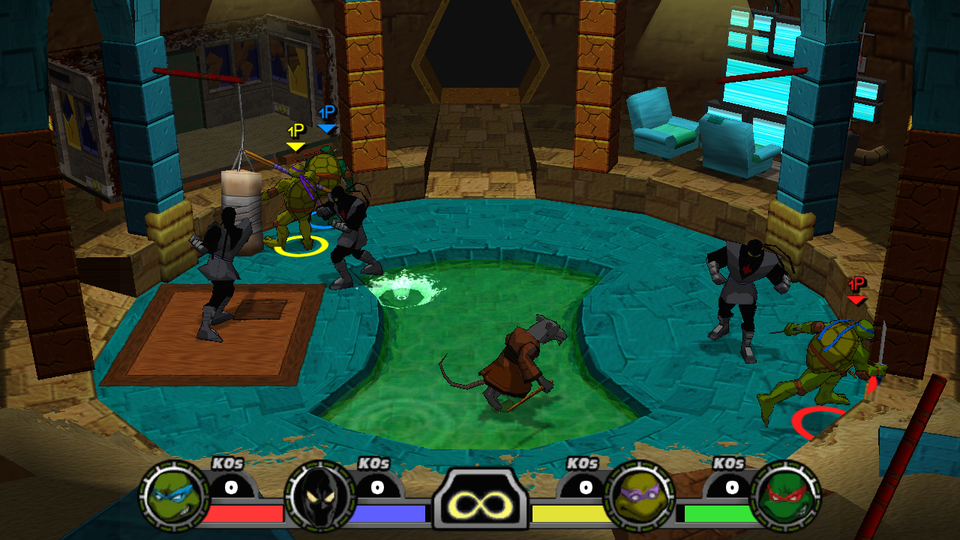

# Игра по сети

[Документация](README.md) · [Установка](INSTALL.md) · [Лаунчер](LAUNCHER.md) · **Сетевая игра** ·
[Управление](CONTROLS.md) · [Настройки](SETTINGS.md) · [Если что-то не так](TROUBLESHOOTING.md)

**Русский** · [English](en/NETPLAY.md)

В игре есть режим на четверых, **РУКОПАШНЫЙ БОЙ**, — за одним компьютером. meleenet даёт тот же режим по
сети: у каждого игрока своя копия игры и свой экран, и каждый компьютер — один из четырёх игроков. Игрок 1 —
тот, кто создаёт игру (хост), остальные подключаются к нему (гости). Играть можно вдвоём, втроём и
вчетвером. **ИСТОРИЯ**, которая в самой игре рассчитана на одного, по сети проходится вместе: остальные
игроки дерутся на стороне героя — см. [«История» вместе](#история-вместе).

   
  Бой четырёх игроков в сетевой игре.

## Перед началом

- У всех игроков **одна и та же игра** — одинаковые `ztmnt.exe` и `archive.arc` — и версии мода с
  **одним сетевым протоколом** (лаунчер показывает его под каждой версией). Хост не пустит гостя, у которого
  файлы другие, а гость увидит причину внизу экрана.
- **Через Steam:** Steam запущен у всех игроков, и они друзья в Steam. Самой игры в Steam может не быть:
  мод подключается к Steam как тестовое приложение Valve — Spacewar (AppID 480). На настоящих аккаунтах
  Steam это ещё не проверено — только на замене Steam в лаборатории.
- **Без Steam:** гостям нужна прямая связь с хостом по UDP, порт `47830`: одна локальная сеть, проброс порта
  на роутере хоста или общая виртуальная сеть (Radmin VPN, Hamachi).
- Клавиши и кнопки мыши настройте заранее, в [лаунчере](LAUNCHER.md).

## Как начать игру

  
  

1. **Все** запускают игру как обычно и в главном меню выбирают **СЕТЕВАЯ ИГРА** — третью кнопку, под
   РУКОПАШНЫЙ БОЙ.
2. **Хост** выбирает **СОЗДАТЬ ИГРУ**. Открывается страница игры: четыре места, **1.** – **4.**; на первом —
   имя хоста, на остальных — СВОБОДНО.
3. **Гости** подключаются:
   - *через Steam* — **ИГРЫ ДРУЗЕЙ В STEAM**, затем строка с именем хоста;
   - *по адресу* — поставьте выделение на строку **АДРЕС** и нажмите Enter; наберите адрес хоста (цифры и
     точки; Backspace стирает, Ctrl+V вставляет адрес из буфера обмена) и нажмите Enter ещё раз; затем
     выберите **ВОЙТИ ПО АДРЕСУ**. Свой адрес хост видит внизу экрана: «АДРЕС ДЛЯ ДРУЗЕЙ: …».
4. Когда все в списке, **хост** выбирает **НАЧАТЬ ИГРУ** (выделение само встаёт на эту строку, как только
   вошёл второй игрок). Игры у всех закрываются и через несколько секунд открываются снова — уже в общей
   игре, сразу в главном меню.
5. Дальше игра идёт как обычно. В главном меню выбрать может любой игрок; в «Рукопашном бою» каждый выбирает
   своего героя, в «Истории» остальные игроки дерутся рядом с героем.

  

### Строки страниц

Страницы листаются клавишами меню самой игры: стрелки, Enter, Esc (назад).

| Страница | Строка | Что она делает |
|---|---|---|
| первая | **СОЗДАТЬ ИГРУ** | открывает вашу игру для других: вы — хост |
| | **ИГРЫ ДРУЗЕЙ В STEAM** | список игр, найденных через Steam. Бледная, пока Steam не подключён |
| | **ВОЙТИ ПО АДРЕСУ** | подключиться к хосту по адресу из строки ниже |
| | **АДРЕС: …** | Enter — начать набор, ещё раз Enter (или Esc) — закончить. К адресу можно дописать порт: `192.168.0.10:47830` |
| | **STEAM ПОДКЛЮЧЕН** / **STEAM НЕ ЗАПУЩЕН** | только сообщает; выбрать её нельзя |
| | **НАЗАД** | в главное меню |
| игры друзей | имя хоста | подключиться к этой игре. Если нельзя, после имени написано почему: другая версия meleenet, другой `ztmnt.exe`. Пометка «ИДЕТ ИГРА» — не отказ: в эту игру уже играют, но выбрать её можно, вы войдёте между двумя боями |
| | **ИДЕТ ПОИСК...** | только сообщает: список обновляется сам |
| созданная игра | **1.** – **4.** | кто уже здесь |
| | **НАЧАТЬ ИГРУ** | у хоста, когда игроков двое или больше; до этого — **ЖДЕМ ИГРОКОВ**. У гостя на этом месте **ЖДЕМ ХОСТА**, а если у хоста уже идёт игра — **ВОЙДЕТЕ ПОСЛЕ БОЯ** |
| | **ЗАКРЫТЬ ИГРУ** / **ВЫЙТИ** | хост закрывает созданную игру; гость выходит из неё |

Все страницы сделаны из шести кнопок главного меню: те же картинки, тот же шрифт, та же подсветка. В шрифте
русского издания на местах цифр 4 и 6 стоят буквы Ч и Б; мод даёт шрифту настоящие 4 и 6, так что адрес и
номера мест читаются как написаны.

Кто видит игру, созданную через Steam, — друзья хоста или все, у кого стоит мод, — выбирается заранее, в
лаунчере: СЕТЬ → «Видят в Steam».

### Сетевая игра начинается с перезапуска

После **НАЧАТЬ ИГРУ** каждая игра закрывается и запускается заново — уже для общей игры. Заставки и экран
«нажми ввод» проходят сами и быстро, и через несколько секунд все оказываются в общем главном меню. Так
сделано потому, что игра, в которой уже что-то сыграли, и только что запущенная игра ведут себя по-разному;
после перезапуска все игры одинаковы с первого кадра.

Запущенные заново игры ждут друг друга до 45 секунд. Если гость за это время не нашёл хоста или к хосту не
пришёл никто, вверху экрана появляется «ИГРОКИ НЕ ПОДКЛЮЧИЛИСЬ. СЕТЕВАЯ ИГРА НЕ НАЧАЛАСЬ»: закройте игру и
начните заново.

### Войти в игру, которая уже идёт

Игра хоста остаётся открытой, пока в неё играют: войти можно и после НАЧАТЬ ИГРУ.

1. Новый игрок запускает игру и идёт на страницу СЕТЕВАЯ ИГРА, как обычно. В списке **ИГРЫ ДРУЗЕЙ В STEAM**
   игра хоста помечена «ИДЕТ ИГРА», и её можно выбрать; по адресу — **ВОЙТИ ПО АДРЕСУ**, как всегда.
2. Он попадает на страницу игры и ждёт. В строке под списком игроков написано **ВОЙДЕТЕ ПОСЛЕ БОЯ**, внизу
   экрана — «У ХОСТА ИДЕТ ИГРА: МЕЖДУ БОЯМИ ОНА НАЧНЕТСЯ ЗАНОВО, УЖЕ С ВАМИ». Хост, если в это время идёт
   бой, видит вверху кадра «НОВЫЙ ИГРОК ЖДЕТ: ОН ВОЙДЕТ ПОСЛЕ БОЯ».
3. Как только сессия оказывается между двумя боями — в главном меню, на выборе героя, арены или параметров
   боя, на выборе героя «Истории» или на её карте, — все игры, и игра нового игрока тоже, закрываются и
   запускаются заново, уже в общую сессию: точно так же, как при первом старте. Бой ради этого не
   прерывается.
4. После запуска все оказываются в главном меню. «История» продолжается с того, что записано в сохранении
   хоста.

Что ещё нужно знать:

- Игроков по-прежнему не больше четырёх. Отказ новый игрок читает внизу экрана, после слов «ХОСТ НЕ ПУСТИЛ»:
  «в игре уже четыре игрока», «игра уже начинается», другая версия мода, другая версия игры или другие файлы
  игры.
- Хост идущей игры ждёт новых игроков обоими путями — в списке игр друзей в Steam и по адресу, — каким бы
  путём ни пришли первые гости: для Steam он должен быть запущен у хоста, для адреса нужен свободный порт.
  Так написано в коде; в лаборатории третий игрок входил тем же путём, что и первые двое.
- Так же **возвращается игрок, у которого пропала связь** или который закрыл игру: см.
  [ниже](#если-по-ходу-игры-что-то-пошло-не-так).

Проверено в лаборатории: третья копия стучится во время боя двоих — по адресу и через замену Steam — и после
боя оказывается в игре; журналы новой сессии совпали кадр в кадр. На настоящем Steam не проверено.

## «История» вместе

   
  Командный матч «Истории» в игре трёх игроков: Леонардо — герой, Рафаэль и Донателло — партнёры,
  Сплинтер — друг по сценарию самой игры; против них трое солдат клана Фут.

В сетевой игре **ИСТОРИЯ** — для всех.

- **Кто ведёт.** Игрок, который выбрал ИСТОРИЯ в главном меню. Он выбирает героя на экране самой «Истории» и
  ходит по карте — как в игре на одного.
- **Что делают остальные.** В каждом матче остальные игроки сессии дерутся рядом с героем — партнёрами.
- **Кем играют партнёры.** Черепахой по номеру игрока: игрок 1 — Леонардо, 2 — Рафаэль, 3 — Донателло, 4 —
  Микеланджело. Если черепаха партнёра — герой «Истории», партнёр берёт первую черепаху, которая никому не
  досталась. Выбрать бойца партнёру пока нельзя.
- **На чьей они стороне.** На стороне героя, по командным правилам самой игры: свои друг друга не ранят,
  враги нападают и на партнёров, у каждого партнёра своя панель в HUD (если все четыре панели — у врагов,
  партнёр берёт одну из них), здоровья в начале матча столько же, сколько у героя.
- **Прогресс и открытия** — в сохранении хоста, как и раньше.

### Как матч выигрывается и проигрывается

- **Матчи «последний на ногах»** с партнёрами идут по командным правилам игры: сторона побеждает, когда
  другая сторона лежит. Падение одного героя матч не заканчивает: его может довести партнёр. Проигран матч,
  когда лежит вся сторона героя.
- **В матчах остальных типов** правила «Истории» остаются как написаны: где нокаут героя заканчивает матч, он
  заканчивает его и с партнёрами.

### Матчи, которые остаются герою одному

В этих матчах партнёры смотрят: их бойцов в матче нет.

- тренировочные матчи с черепахой-роботом;
- матч с бомбой и другие мини-игры;
- четыре матча, в которых враг возвращается другим бойцом, — последние этапы Леонардо, Рафаэля, Донателло и
  Кейси (Шреддер);
- матчи, в которых уже заняты все восемь мест. Если свободных мест меньше, чем партнёров, в матч попадают
  партнёры с меньшими номерами.

### Что проверено

В лаборатории, на двух и трёх копиях: этап-дуэль (победа; герой упал, а партнёр победил; упали все —
поражение и переигровка) и командный этап с другом по сценарию игры (три игрока). Журналы копий совпали кадр
в кадр. **Не проверены** каждый этап каждого героя и настоящая игра.

## В сетевой игре

- **Каждый играет своими клавишами** на своём компьютере — каким бы из четырёх игроков он ни был.
- **РУКОПАШНЫЙ БОЙ — для всех**, до четырёх игроков. **ИСТОРИЯ — тоже**: её ведёт один игрок, остальные
  дерутся рядом с героем ([«История» вместе](#история-вместе)).
- **Меню общие**: что выбрано, то выбрано у всех. В главном меню выбрать может любой игрок; тот, кто выбрал,
  ведёт меню дальше — так устроена сама игра.
- **Пока идёт сетевая игра, пункта СЕТЕВАЯ ИГРА в меню нет**: на его месте написано «В СЕТИ: ИГРОКОВ …».
  Когда сетевая игра для вас окончена — все вышли или пропала связь с хостом, — пункт возвращается: создать
  новую игру или войти в чужую можно из той же запущенной игры.
- **Сохранение — хоста.** Открытые герои и арены — его; гости на время сетевой игры получают копию его
  сохранения (`tmnt-net.sv`). Собственное сохранение гостя, `tmnt.sv`, не трогается.
- **Пауза — любого игрока.** Esc любого игрока ставит бой на паузу у всех; продолжает бой Esc или Enter
  любого игрока. Вторая строка меню паузы — выйти из боя — остаётся за игроком, который ведёт меню (он
  выбрал бой в главном меню): пока выделение стоит на ней, Esc и Enter остальных не действуют. Проверено в
  лаборатории: гость ставит паузу и продолжает бой, ведущий выходит из боя.
- **Ролики не показываются**: два компьютера не вышли бы из ролика в одном и том же кадре.
- **Картинка может быть разной.** Разрешение, формат кадра и вид меню у каждого игрока свои: на ход игры они
  не влияют. Частицы в сетевой игре у всех стоят на 100 %, что бы ни было выбрано в лаунчере: их число — часть
  самой игры.
- **Сообщения мода** — вверху кадра, белыми буквами, шрифтом самой игры: что игрок вышел, что связь пропала,
  что игры разошлись, что новый игрок ждёт конца боя.

## Если по ходу игры что-то пошло не так

- **Долгая загрузка уровня** не рвёт связь: игры остальных в это время ждут. Так же сделано для окна,
  которое перетаскивают мышью, но настоящим окном это не проверено.
- **Пока чья-то игра занята или отстаёт, остальные стоят и ждут**: каждый кадр все игры делают вместе.
- **Медленный компьютер в бою остальных не замедляет**: кадры, которые он не успевает нарисовать, он
  проигрывает без картинки — до трёх подряд. Это настройка «Пропуск кадров», она включена по умолчанию
  ([Настройки](SETTINGS.md)). Вне боя — в меню и в начале боя — такой компьютер по-прежнему замедляет всех.
- **Гость закрыл игру или от него ничего не слышно 15 секунд** — у остальных появляется «ИГРОК … ВЫШЕЛ ИЗ
  ИГРЫ», и они играют дальше; герой вышедшего больше не получает управления. Так написано в коде.
- **Вышедший гость может вернуться.** Для него сессия окончена, и в его главном меню снова есть СЕТЕВАЯ
  ИГРА: он входит к хосту как новый игрок ([Войти в игру, которая уже идёт](#войти-в-игру-которая-уже-идёт)) и
  оказывается в игре между двумя боями. Если это был единственный гость, сетевая игра окончена и у хоста: он
  заново выбирает СЕТЕВАЯ ИГРА → СОЗДАТЬ ИГРУ. Проверено в лаборатории: гость вернулся после того, как связь
  с ним пропала совсем.
- **Хост закрыл игру или связь с ним пропала на 15 секунд** — сетевая игра окончена. У гостей появляется
  «СВЯЗЬ С ХОСТОМ ПОТЕРЯНА. ДАЛЬШЕ ВЫ ИГРАЕТЕ ОДИН», и каждый продолжает сам по себе. Хост, от которого
  ушли все гости, видит «СЕТЕВАЯ ИГРА ОКОНЧЕНА». После этого игра освобождает порт и своё место в Steam:
  новую сетевую игру можно создать или найти, не закрывая игру.
- **«ИГРЫ РАЗОШЛИСЬ. НАЧНИТЕ СЕТЕВУЮ ИГРУ ЗАНОВО»** — игры на разных компьютерах перестали совпадать. Начните
  сетевую игру заново и сохраните `meleenet.log` у всех игроков
  ([Если что-то не так](TROUBLESHOOTING.md)).

## Почему игра одинакова на всех компьютерах

Картинка по сети не передаётся вообще. Каждый компьютер считает всю игру целиком; по сети идут только
нажатия игроков. Кадр не проигрывается, пока для него не пришли нажатия всех игроков, поэтому все игры
кадр за кадром делают одно и то же. Раз в секунду игры сверяют отпечаток своего состояния; если он не
совпал, на экране появляется «ИГРЫ РАЗОШЛИСЬ». Время между нажатием клавиши и кадром, в котором оно
сработает, — это **задержка ввода** (от 1 до 12 кадров, по умолчанию 2; действует значение хоста):
больше — ровнее игра при плохой связи, меньше — отзывчивее.

Поэтому же новый игрок не входит прямо в бой. Игра, которая уже что-то сыграла, хранит следы этого, и две
игры с разным прошлым расходятся; одинаковыми их делает только общий свежий запуск. Между двумя боями все
игры запускаются заново — уже вместе с новым игроком.

## Какие версии играют вместе

| Версии мода | Сетевой протокол | Играют вместе |
|---|---|---|
| 0.2.0 | 2 | только с 0.2.0 |
| 0.1.0 – 0.1.1 | 1 | друг с другом — да |

Версия 0.2.0 с версиями 0.1.x не играет: протокол другой, обновиться нужно всем игрокам. Гостю с другой
версией хост отвечает отказом, и причина написана у гостя внизу экрана.

Версия 0.1.1 с версией 0.1.0 проверена в лаборатории: сетевая игра, в которой хост — 0.1.1, а гость — 0.1.0,
оставалась одинаковой на обоих 2500 кадров, включая бой.

## Что проверено, а что нет

- Проверено в лаборатории — на нескольких копиях игры на одном компьютере, без окна на экране: сетевые игры
  двух, трёх и четырёх копий по адресу и через замену Steam, с потерями пакетов; копии с разной формой
  кадра; «История» вместе на двух и трёх копиях ([что именно](#что-проверено)); вход третьей копии в идущую
  игру и возвращение гостя после обрыва связи; пауза гостя и выход ведущего из боя; пропуск кадров у одной
  копии из двух.
- **Настоящей игрой не проверено:** Steam на настоящих аккаунтах; настоящее окно игры на переднем плане —
  клавиатура, кнопки мыши, набор адреса; геймпады; долгие сессии; каждый этап «Истории».
