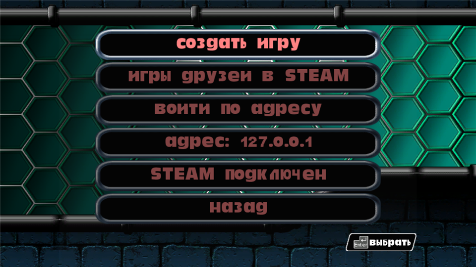
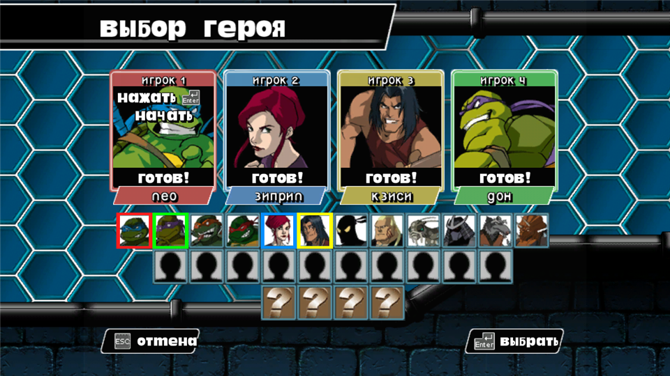

# Игра по сети

[Документация](README.md) · [Установка](INSTALL.md) · [Лаунчер](LAUNCHER.md) · **Сетевая игра** ·
[Управление](CONTROLS.md) · [Настройки](SETTINGS.md) · [Если что-то не так](TROUBLESHOOTING.md)

**Русский** · [English](en/NETPLAY.md)

В игре есть режим на четверых, **РУКОПАШНЫЙ БОЙ**, — за одним компьютером. meleenet даёт тот же режим по
сети: у каждого игрока своя копия игры и свой экран, и каждый компьютер — один из четырёх игроков. Игрок 1 —
тот, кто создаёт игру (хост), остальные подключаются к нему (гости). Играть можно вдвоём, втроём и
вчетвером.

   
  Бой четырёх игроков в сетевой игре.

## Перед началом

- У всех игроков **одна и та же игра** — одинаковые `ztmnt.exe` и `archive.arc` — и версии мода с
  **одним сетевым протоколом** (лаунчер показывает его под каждой версией). Хост не пустит гостя, у которого
  файлы другие, а гость увидит причину внизу экрана.
- **Через Steam:** Steam запущен у всех игроков, и они друзья в Steam. Самой игры в Steam может не быть:
  мод подключается к Steam как тестовое приложение Valve — Spacewar (AppID 480). На настоящих аккаунтах
  Steam это ещё не проверено — только на замене Steam в лаборатории.
- **Без Steam:** гостям нужна прямая связь с хостом по UDP, порт `47830`: одна локальная сеть, проброс порта
  на роутере хоста или общая виртуальная сеть (Radmin VPN, Hamachi).
- Клавиши и кнопки мыши настройте заранее, в [лаунчере](LAUNCHER.md).

## Как начать игру

  
  

1. **Все** запускают игру как обычно и в главном меню выбирают **СЕТЕВАЯ ИГРА** — третью кнопку, под
   РУКОПАШНЫЙ БОЙ.
2. **Хост** выбирает **СОЗДАТЬ ИГРУ**. Открывается страница игры: четыре места, **I.** – **IV.**; на первом —
   имя хоста, на остальных — СВОБОДНО.
3. **Гости** подключаются:
   - *через Steam* — **ИГРЫ ДРУЗЕЙ В STEAM**, затем строка с именем хоста;
   - *по адресу* — поставьте выделение на строку **АДРЕС** и нажмите Enter; наберите адрес хоста (цифры и
     точки; Backspace стирает, Ctrl+V вставляет адрес из буфера обмена) и нажмите Enter ещё раз; затем
     выберите **ВОЙТИ ПО АДРЕСУ**. Свой адрес хост видит внизу экрана: «АДРЕС ДЛЯ ДРУЗЕЙ: …».
4. Когда все в списке, **хост** выбирает **НАЧАТЬ ИГРУ** (выделение само встаёт на эту строку, как только
   вошёл второй игрок). Игры у всех закрываются и через несколько секунд открываются снова — уже в общей
   игре, сразу в главном меню.
5. Дальше игра идёт как обычно. Меню ведёт любой игрок; в «Рукопашном бою» каждый выбирает своего героя.

  

### Строки страниц

Страницы листаются клавишами меню самой игры: стрелки, Enter, Esc (назад).

| Страница | Строка | Что она делает |
|---|---|---|
| первая | **СОЗДАТЬ ИГРУ** | открывает вашу игру для других: вы — хост |
| | **ИГРЫ ДРУЗЕЙ В STEAM** | список игр, найденных через Steam. Бледная, пока Steam не подключён |
| | **ВОЙТИ ПО АДРЕСУ** | подключиться к хосту по адресу из строки ниже |
| | **АДРЕС: …** | Enter — начать набор, ещё раз Enter (или Esc) — закончить. К адресу можно дописать порт: `192.168.0.10:47830` |
| | **STEAM ПОДКЛЮЧЕН** / **STEAM НЕ ЗАПУЩЕН** | только сообщает; выбрать её нельзя |
| | **НАЗАД** | в главное меню |
| игры друзей | имя хоста | подключиться к этой игре. Если нельзя, после имени написано почему: другая версия meleenet, другой `ztmnt.exe`, «уже играет» |
| | **ИДЕТ ПОИСК...** | только сообщает: список обновляется сам |
| созданная игра | **I.** – **IV.** | кто уже здесь |
| | **НАЧАТЬ ИГРУ** | у хоста, когда игроков двое или больше; до этого — **ЖДЕМ ИГРОКОВ**. У гостя на этом месте **ЖДЕМ ХОСТА** |
| | **ЗАКРЫТЬ ИГРУ** / **ВЫЙТИ** | хост закрывает созданную игру; гость выходит из неё |

Все страницы сделаны из шести кнопок главного меню: те же картинки, тот же шрифт, та же подсветка. В
русском шрифте игры цифры 4 и 6 нарисованы как «ч» и «б» — так они и выглядят в адресе; места игроков
поэтому пронумерованы римскими цифрами.

Кто видит игру, созданную через Steam, — друзья хоста или все, у кого стоит мод, — выбирается заранее, в
лаунчере: СЕТЬ → «Видят в Steam».

### Сетевая игра начинается с перезапуска

После **НАЧАТЬ ИГРУ** каждая игра закрывается и запускается заново — уже для общей игры. Заставки и экран
«нажми ввод» проходят сами и быстро, и через несколько секунд все оказываются в общем главном меню. Так
сделано потому, что игра, в которой уже что-то сыграли, и только что запущенная игра ведут себя по-разному;
после перезапуска все игры одинаковы с первого кадра.

Запущенные заново игры ждут друг друга до 45 секунд. Если гость за это время не нашёл хоста или к хосту не
пришёл никто, вверху экрана появляется «ИГРОКИ НЕ ПОДКЛЮЧИЛИСЬ. СЕТЕВАЯ ИГРА НЕ НАЧАЛАСЬ»: закройте игру и
начните заново.

## В сетевой игре

- **Каждый играет своими клавишами** на своём компьютере — каким бы из четырёх игроков он ни был.
- **РУКОПАШНЫЙ БОЙ — для всех**, до четырёх игроков. **ИСТОРИЯ** в самой игре рассчитана на одного: по сети
  в ней играет один игрок, остальные смотрят.
- **Меню общие.** Их ведёт любой игрок: что выбрал один, то выбрано у всех.
- **Пункта СЕТЕВАЯ ИГРА в меню нет**: на его месте написано «В СЕТИ: ИГРОКОВ …». Чтобы создать новую сетевую
  игру, запустите игру заново.
- **Сохранение — хоста.** Открытые герои и арены — его; гости на время сетевой игры получают копию его
  сохранения (`tmnt-net.sv`). Собственное сохранение гостя, `tmnt.sv`, не трогается.
- **Пауза.** Esc в бою — пауза самой игры. По коду это нажатие идёт в общую игру, как любое другое, так что
  пауза должна вставать у всех; настоящей игрой и в лаборатории это ещё не проверено.
- **Ролики не показываются**: два компьютера не вышли бы из ролика в одном и том же кадре.
- **Картинка может быть разной.** Разрешение, формат кадра и вид меню у каждого игрока свои: на ход игры они
  не влияют. Частицы в сетевой игре у всех стоят на 100 %, что бы ни было выбрано в лаунчере: их число — часть
  самой игры.
- **Сообщения мода** — вверху кадра, белыми буквами, шрифтом самой игры: что игрок вышел, что связь пропала,
  что игры разошлись.

## Если по ходу игры что-то пошло не так

- **Долгая загрузка уровня** не рвёт связь: игры остальных в это время ждут. Так же сделано для окна,
  которое перетаскивают мышью, но настоящим окном это не проверено.
- **Пока чья-то игра занята или отстаёт, остальные стоят и ждут**: каждый кадр все игры делают вместе.
  Поэтому же медленный компьютер замедляет игру у всех.
- **Гость закрыл игру или от него ничего не слышно 15 секунд** — у остальных появляется «ИГРОК … ВЫШЕЛ ИЗ
  ИГРЫ», и они играют дальше; герой вышедшего больше не получает управления. Так написано в коде; выход
  гостя посреди боя ещё не проверялся.
- **Хост закрыл игру или связь с ним пропала на 15 секунд** — сетевая игра окончена. У гостей появляется
  «СВЯЗЬ С ХОСТОМ ПОТЕРЯНА. ДАЛЬШЕ ВЫ ИГРАЕТЕ ОДИН», и каждый продолжает сам по себе. Хост, от которого
  ушли все гости, видит «СЕТЕВАЯ ИГРА ОКОНЧЕНА».
- **«ИГРЫ РАЗОШЛИСЬ. НАЧНИТЕ СЕТЕВУЮ ИГРУ ЗАНОВО»** — игры на разных компьютерах перестали совпадать. Начните
  сетевую игру заново и сохраните `meleenet.log` у всех игроков
  ([Если что-то не так](TROUBLESHOOTING.md)).
- **Войти в уже идущую игру или вернуться в неё нельзя**: сетевая игра начинается для всех сразу, с
  перезапуска.

## Почему игра одинакова на всех компьютерах

Картинка по сети не передаётся вообще. Каждый компьютер считает всю игру целиком; по сети идут только
нажатия игроков. Кадр не проигрывается, пока для него не пришли нажатия всех игроков, поэтому все игры
кадр за кадром делают одно и то же. Раз в секунду игры сверяют отпечаток своего состояния; если он не
совпал, на экране появляется «ИГРЫ РАЗОШЛИСЬ». Время между нажатием клавиши и кадром, в котором оно
сработает, — это **задержка ввода** (от 1 до 12 кадров, по умолчанию 2; действует значение хоста):
больше — ровнее игра при плохой связи, меньше — отзывчивее.

## Какие версии играют вместе

| Версии мода | Сетевой протокол | Играют вместе |
|---|---|---|
| 0.1.0 – 0.1.1 | 1 | да |

Версия 0.1.1 с версией 0.1.0 проверена в лаборатории: сетевая игра, в которой хост — 0.1.1, а гость — 0.1.0,
оставалась одинаковой на обоих 2500 кадров, включая бой.

## Что проверено, а что нет

- Проверено в лаборатории — на нескольких копиях игры на одном компьютере, с окнами за пределами экрана:
  сетевые игры двух, трёх и четырёх копий по адресу и через замену Steam, с потерями пакетов; копии с разной
  формой кадра; версия 0.1.1 против 0.1.0.
- **Настоящей игрой не проверено:** настоящие аккаунты Steam; настоящее окно игры на переднем плане —
  клавиатура, кнопки мыши, набор адреса; геймпады; долгие сетевые игры; пауза в сетевой игре; выход гостя
  посреди боя.
