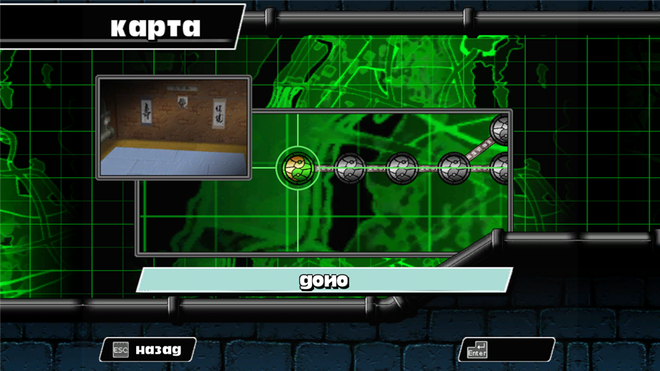

# Что добавлено и что изменено — в картинках

[Документация](README.md) · [Установка](INSTALL.md) · [Лаунчер](LAUNCHER.md) · [Сетевая игра](NETPLAY.md) ·
[Управление](CONTROLS.md) · [Настройки](SETTINGS.md) · [Если что-то не так](TROUBLESHOOTING.md)

**Русский** · [English](en/TOUR.md)

Картинки игры сняты в лаборатории — на нескольких копиях игры на одном компьютере; имена игроков на них
вымышлены.

## В игре

### Главное меню: одна новая кнопка

  

**СЕТЕВАЯ ИГРА** — третья кнопка, под РУКОПАШНЫЙ БОЙ. В игре здесь пять кнопок; с модом их шесть: ИСТОРИЯ,
РУКОПАШНЫЙ БОЙ, СЕТЕВАЯ ИГРА, БИБЛИОТЕКА, ПАРАМЕТРЫ, ВЫХОД. Новая кнопка сделана из той же картинки, что
остальные, написана тем же шрифтом и въезжает на экран так же, как они. Внизу экрана мелко написана версия
мода.

В игре, которая уже идёт по сети, на этом месте написано **В СЕТИ: ИГРОКОВ …**, и выбрать эту строку нельзя.

### Страница сетевой игры

  

Страницы сетевой игры — те же шесть кнопок главного меню с другими словами. Окон поверх игры мод не рисует:
всё сделано из кнопок и шрифта самой игры.

- Первая страница: **СОЗДАТЬ ИГРУ**, **ИГРЫ ДРУЗЕЙ В STEAM**, **ВОЙТИ ПО АДРЕСУ**, **АДРЕС: …** (адрес хоста
  набирается на клавиатуре), строка о том, подключён ли Steam, и **НАЗАД**.
- Страница созданной игры: четыре места, **1.** – **4.**, с именами игроков или словом СВОБОДНО; под ними
  у хоста **НАЧАТЬ ИГРУ** и **ЗАКРЫТЬ ИГРУ**, у гостя — **ЖДЕМ ХОСТА** и **ВЫЙТИ**. Внизу экрана хост видит
  адрес, который могут набрать гости.

Цифры в адресе и в номерах мест — настоящие. В шрифте русского издания на местах 4 и 6 стоят буквы Ч и Б; мод
даёт шрифту меню настоящие 4 и 6 — они же видны в часах и счёте боя и в параметрах. В словах Ч и Б остаются
буквами.

**После НАЧАТЬ ИГРУ окна не закрываются.** Игра у каждого за пару секунд проходит свой запуск заново — в том
же окне, в восемь раз быстрее обычного, — и все оказываются в главном меню общей игры. До версии 0.3.0 каждая
игра для этого закрывалась и открывалась снова.

**Войти можно и в игру, которая уже идёт.** В списке игр друзей в Steam она помечена «ИДЕТ ИГРА». Новый игрок
ждёт на странице игры — там написано **ВОЙДЕТЕ ПОСЛЕ БОЯ**, — и между двумя боями игра у всех начинается
заново, уже вместе с ним: тоже без закрытия окон. Так же возвращается игрок, у которого пропала связь.

Подробнее: [Сетевая игра](NETPLAY.md).

### Сетевая игра: до четырёх игроков

  

Выбор героев в «Рукопашном бою». В самой игре это режим на четверых за одним компьютером; по сети каждый
компьютер — один из четырёх игроков, и каждый выбирает своего героя сам.

  

Бой четырёх игроков. Картинка по сети не передаётся: каждая из игр считает бой сама, по сети идут только
нажатия игроков. Паузу в бою ставит Esc любого игрока — она встаёт у всех.

### Имена над бойцами

  

В самой игре над бойцом человека стоит метка: стрелка цвета игрока и подпись 1P – 4P. В сетевой игре на месте
подписи — имя игрока, тем же цветом: и в «Рукопашном бою», и в «Истории». Имя — ник игрока в Steam; без Steam —
«ИГРОК N» по номеру игрока или имя, которое игрок сам вписал в `meleenet.ini`. На картинке имена лабораторные:
LEO, RAPH, DON и MIKE — это имена четырёх игроков, а не героев, которыми они играют. Подробнее:
[Имена над бойцами](NETPLAY.md#имена-над-бойцами).

### «История» вместе

  

Командный матч «Истории» в игре трёх игроков: Леонардо — герой, Рафаэль и Донателло — партнёры, Сплинтер —
друг по сценарию самой игры; против них трое солдат клана Фут. Над бойцами игроков — их имена. В самой игре
«История» рассчитана на одного. По сети её ведёт тот, кто выбрал её в главном меню, а остальные игроки в каждом
матче дерутся на стороне героя — черепахой по номеру игрока. С версии 0.3.0 партнёры дерутся и в тренировках с
черепахой-роботом, и в последних этапах, где враг возвращается другим бойцом (Шреддер, затем золотой Шреддер):
«Историю» можно пройти вместе до конца. Герою одному остаются мини-игры и матчи, где уже заняты все восемь
мест. Подробнее: [«История» вместе](NETPLAY.md#история-вместе).

### Широкий экран: бой и меню

  

Одно и то же меню дважды: 4:3 с чёрными полосами по бокам и на весь широкий кадр — фоны, трубы и кирпичные
стены идут до краёв экрана. Надписи, кнопки и портреты стоят там же, где стояли в 4:3. Что из двух показывать,
выбирается в лаунчере: ГРАФИКА → «Меню».

  

Карта «Истории» в широком кадре: затемнённая рамка вокруг окна карты доведена до краёв экрана.

В боях кадр — по форме монитора (16:9, 16:10, 21:9), и обзор шире по бокам, чем в родном 4:3.

### Чего на картинках не видно

- Вместо эксклюзивного полного экрана 640×480 — окно без рамки на весь монитор или обычное окно, с любым
  разрешением. Alt+Tab работает сразу.
- Сглаживание краёв (MSAA) до 8x и анизотропная фильтрация текстур до 16x.
- Игра идёт ровно 60 кадров в секунду. Если компьютер не успевает столько рисовать, кадры боя проигрываются
  без картинки, и игра не замедляется.
- Кнопки мыши можно назначить действиям, как клавиши.
- Исправлено редкое падение игры на экране загрузки.

## В лаунчере

### Одно окно на всё

  
  

Слева — первый запуск: мод лежит внутри лаунчера и ставится одной кнопкой. Справа — обычный вид: какая версия
стоит в папке игры, какая самая новая, сетевой протокол каждой и что в версии нового.

  
  

Вышла новая версия: лаунчер пишет, можно ли по-прежнему играть с друзьями на старой, обновляет одной кнопкой
и сверяет скачанное по SHA-256.

  
  

Слева — GitHub не отвечает: играть всё равно можно. Справа — настройки самого лаунчера: обновления, прокси
для GitHub, журналы, переустановка и удаление мода, цвет повязки.

### Стена из меню игры и цвет повязки

  

Лаунчер выглядит как меню самой игры: соты, которые светлеют к правому краю, чёрные трубы, вдоль нижнего
края — стена из синих кирпичей с пандусом, чёрные окна и кнопки в стальной кайме. Цвет сот и акцентов — цвет
повязки одной из четырёх черепах: синий Леонардо (он стоит по умолчанию), красный Рафаэля, фиолетовый
Донателло или оранжевый Микеланджело. Маска выбранного цвета повязана рядом с названием.

### Настройки игры до её запуска

  
  

**ГРАФИКА** — окно, разрешение, формат кадра, меню и качество картинки. **СЕТЬ** — задержка ввода, кто видит
игру, созданную через Steam, и кнопки мыши; подсказка под строками напоминает, что над вашим бойцом в сетевой
игре стоит ваш ник из Steam.

  
  

**УПРАВЛЕНИЕ** — клавиши игрока и готовые раскладки: клавиши самой игры или «WASD + мышь». Справа ячейка
ждёт клавишу или кнопку мыши.

Подробнее: [Лаунчер](LAUNCHER.md), [Настройки](SETTINGS.md), [Управление](CONTROLS.md).
