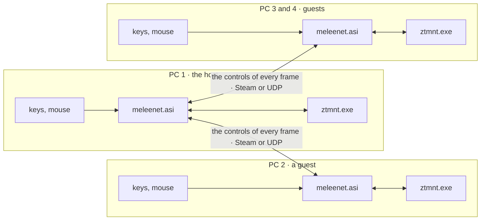

# How it works

[Documentation](README.md) · [Building](BUILDING.md) · [History](CHANGELOG.md)

**English** · [Русский](../ARCHITECTURE.md)

meleenet is two programs: the **mod**, `meleenet.asi`, which lives inside the game's process, and the
**launcher**, which never goes into the game at all.

The game is TMNT Mutant Melee for the PC: Konami Hawaii's own engine on RenderWare 3.5, Direct3D 8. This
page says what the mod does to it and why. How the game itself is made — the main loop, time, input, the
screen, the interface's scripts, with every address — is written down in the notes,
[`re/notes.md`](../../re/notes.md) (in Russian); the addresses and structures the mod uses are in
[`src/mod/game.h`](../../src/mod/game.h), each with a note.

The mod has been checked in the lab only — on copies of the game on one computer. What has not been checked
is listed [at the end of the page](#what-has-not-been-checked).

## Getting into the game

- The game imports `DINPUT8.dll` at its start. In the game's folder that name is
  [Ultimate ASI Loader](https://github.com/ThirteenAG/Ultimate-ASI-Loader), which loads `meleenet.asi` and
  passes the call of `DirectInput8Create` on to Windows' own `dinput8.dll`.
- `ztmnt.exe` is neither packed nor protected: its addresses are right from the first instruction. The
  loader calls the mod's `InitializeASI()` right after loading it, before the game's own code starts to
  run, and the hooks on the game's functions go in there (`dllmain.cpp`).
- The mod checks the SHA-256 of `ztmnt.exe`. One build is supported — "Nov 22 2004", 1 753 088 bytes, the
  one the Russian release has. With a file it does not know the mod puts no hook on the game: the game
  runs as it does without the mod, and `meleenet.log` has a line about it. Only the writing of crashes
  into the log works then.
- Hooks are [MinHook](https://github.com/TsudaKageyu/minhook) trampolines (`patch.cpp`). Besides them the
  mod redirects a few entries of the import table (`Direct3DCreate8`, the window's functions), hooks
  methods of the Direct3D 8 interfaces and changes bytes of the code in memory in a few places. Before a
  function of the game is hooked, `sim.cpp`, `input.cpp`, `menu.cpp` and `sound.cpp` compare its first
  bytes with what they should be; if they differ, that feature is switched off and the log says so. The
  file `ztmnt.exe` on the disk is not changed.

## Time: the same on every computer

The engine steps its world by the real time a frame took, multiplied by its "speed scale" of 0.85 and
smoothed. Two computers would never make the same steps. So the mod gives the game a clock of its own
(`sim.cpp`):

- **A game frame is exactly 0.85 / 60 s.** At the end of every frame the game makes its "system update"
  (0x408CB0): it keeps the pads' previous state, handles the window's messages, steps the clock, reads the
  devices. A game frame is such a pass after the Update of the game's current mode. The hook on the
  reading of the devices is the mod's *frame gate*: this is where it is decided what the game learns of
  the pads of this frame.
- **The mod holds the frames at 60 a second** itself. The clock's step does not depend on real time: a
  frame that took longer than 1/60 s still moves the game by one step, and after a long frame the mod does
  not catch up.
- **A loading screen is not the game's time.** While the main thread loads a level, the game's second
  thread draws the loading screen and calls the same system update — as many times as the loading takes,
  which is different on every computer. The mod does not count those passes as game frames: the game's
  time stands still, and in a network game the pads stay what the last game frame made them.
- **Stopwatches.** Besides its clock the game measures real time with stopwatches: the fade between two
  modes (0.35 s), waits at the start and while loading. A fade would end a frame earlier on one computer
  than on another. The mod's stopwatches run on game frames: a frame is 1/60 s for them, however long it
  took.
- **Movies** (Bink) are a loop inside one call, as long as the movie. In a network game movies are not
  played: two computers would not leave a movie in one and the same frame.

### Random numbers and the heroes' lines

The game's main generator is RenderWare's RpRandom: 71 functions draw from it. The C library's `rand()`
serves the sound only.

The heroes' lines are a case of their own. The game's rules keep asking the sound "is a line being said?",
and the answer decides what the game does next and how many random numbers it draws. The honest answer
depends on the sound card: a line ends a frame earlier on one computer than on another, and never plays
at all on a computer without sound. So the mod answers, by the game's clock (`sound.cpp`): a line lasts
exactly as long as its clip in `soundPC\VCLIP.BKT`, counted in game frames from the frame it was asked
for. Which of an event's lines is said, the mod draws from numbers of its own.

### Why a network game begins with a restart

The game is the same on every computer only if it has the same past, and a game that has already played a
fight keeps traces of it. In the lab two fresh copies with one script of presses are the same from the
first frame (5200 frames, with a fight), while a copy that has already played a fight parts from a fresh
one after about 500 frames of a fight. So a network game is a game **started anew**: it has no past. The
players meet before its first frame and play the same from the very first one.

## A network game: lockstep

Each computer plays the whole game. Only the players' controls go over the network (`netplay.cpp`). There
are two to four computers; the host is the centre: the guests talk to it only.

- At the frame gate each copy reads **its own player-1 controls** and sets them for the frame *now + input
  delay* (2 frames by default; the host tells everybody the delay). A guest sends its pads to the host,
  the host sends everybody the pads of all players. The host is player 1, the guests are players 2–4.
- A frame begins only when the pads of all players for it are known. A packet carries every frame the
  other side has not acknowledged yet, so lost packets cost nothing but time.
- Every 60 frames the guests send the host a fingerprint of the game's state (the random number generator
  and the game's time). If the fingerprints differ, every copy writes it into the log and shows «ИГРЫ
  РАЗОШЛИСЬ» (the games have parted).
- A second thread keeps the connection alive while the game's own thread is busy for seconds (a level
  being loaded, a window being dragged).
- At the meeting a guest tells the host the fingerprints of its `ztmnt.exe` and `archive.arc`; the host
  refuses a guest whose files differ. A guest with another network protocol is answered with a refusal on
  the host's network page.
- A network game is played on the host's save. A guest receives it and writes into a file of its own,
  `tmnt-net.sv`: the save file's name is replaced in the game's code; the guest's own save is not touched.
- If a guest has left, or nothing is heard from it for 15 seconds, the network game goes on without it
  while at least one guest remains. If the host has left, it is over; everybody plays on alone.

Transports (`src/common`): **ENet** over UDP for a game by address, **Steam Networking Messages** for a
game over Steam (through Valve's test application Spacewar, AppID 480), and a stand-in for Steam that the
lab uses to run several "Steam players" on one computer. The host listens both ways at once: one network
game may have guests from Steam and guests by address (`multi_transport.h`).

### What had to be made the same

Same controls give the same game only if nothing else differs. Besides the clock, the stopwatches and the
lines, this is what the mod pins down:

- **The start.** In a game started for a network game, until the main menu is entered for the first time,
  the step of the clock and of the stopwatches is eight times longer and the pace of 60 frames a second is
  not held — on every computer alike. The "press Enter" screen is pressed for everybody by the host's
  game.
- **Particles.** How many particles to make, the game decides with random numbers, so in a network game
  the particles setting is 100 % for everybody.
- **Movies** are not played (above).
- **The frame's shape is no part of the logic**: copies with a 16:9 and a 4:3 frame compute the same. So
  every player has a window and a resolution of their own.

## Controls

Once a frame the game reads the keyboard and the joysticks and turns them, by the bindings in the file
`tmntwire.hks`, into four "pads" — 19 numbers each: a stick and buttons. Everything in the game, menus and
fights alike, reads those pads. The mod sits right after that reading (`input.cpp`): in a network game
what the game is told for each player is what came over the network. The game's developers' menu stays
this computer's own business: it does not go over the network.

The game turns the keyboard into a pad in one function. Before it, the mod adds to the keyboard's state
five "keys" no keyboard has — the left, right and middle buttons of the mouse and the two side ones. It
takes their state from Windows while the game's window is in front and the pointer is over its picture.
That is why a button of the mouse can be bound to an action like a key: these are the game's own
bindings, and over the network they go as ordinary controls.

## The picture

- **A window instead of the full screen** (`video.cpp`). The game itself knows only a full screen: at
  every start it takes 640×480 in 16 bits, minimizes itself when another window comes in front, and starts
  itself again to change the resolution. The mod makes the Direct3D 8 device a windowed one and places the
  game's window itself: without a frame over the whole monitor, or as an ordinary window.
- **Any size of the frame.** The mod adds its own size as one more mode at the end of the list of video
  modes the game chooses from.
- **Wide screen.** The engine has the consoles' own 16:9 switch: more is seen at the sides, the 2D layer is
  drawn towards the middle, the sides of the menus are covered by two black bars. The mod turns it on and
  puts the shape of its own frame into its numbers — any shape, not 16:9 only.
- **Quality.** Smoothed edges (MSAA) are set in the device's parameters and work when the frame fills the
  whole window; anisotropic filtering replaces the linear filtering of textures the game asks for.
- **Two threads in one device.** The game draws the loading screen on a second thread while the first one
  makes the level's textures and buffers, and it makes its Direct3D device without the multithreading
  flag. Hence rare crashes while loading. The mod adds the flag when the device is made.

### Menus over the whole wide frame

The game's screens are scripts, `ui/scripts/UI_*.txt` in its archive, laid out for 4:3: 640 units wide. On
a wide frame a screen comes out as a 4:3 block with empty sides. Every script goes to the game's parser
through the mod and is made wider on the way (`uiwide.cpp`):

- an element that ends at an edge of the layout is taken on to the frame's edge, in the way that suits its
  texture: a repeating one (the honeycomb of the background, the pipe along the top) goes on as tiles; a
  few stretched texels (black boxes, lines) are stretched further; the brick walls along the bottom and
  the loading screen's picture get a second element beside them with the texture mirrored; the headings'
  plates and the speed lines get a second element made of the one column of texels at the edge;
- an element that waits beyond the layout's edge to slide in, or slides out beyond it, waits beyond the
  frame's edge;
- texts, buttons and portraits stay in their 4:3 places.

The black bars at the sides of the menus (0x40AB90) are not drawn then. The map of the story mode, ИСТОРИЯ
(Story), is drawn by code, not by a script: the mod draws the four dim strips around the map's window on
to the frame's edges (`video.cpp`). The library, БИБЛИОТЕКА (Library), is left a 4:3 page on black. The
setting `menus = bars` in the section `[video]` brings back the 4:3 menus with bars.

## The mod's menus are the game's own

The mod draws no windows of its own over the game (`menu.cpp`).

- **The main menu** of the game is a script, `UI_ModeSel_PC.txt`, with five buttons and one function of
  the main menu's mode that drives them. The mod hands the game a script of its own — six buttons made
  from the game's: the same picture, the same sounds, the same movement — and drives them itself in place
  of that function. СЕТЕВАЯ ИГРА (network game) is the third button.
- **The network pages** — open a game, friends' games, an address, the list of players — are the same six
  buttons with other words. Nothing is drawn that the game does not draw itself.
- **The words.** The mod writes its texts into the game's language table, over strings that only another
  console shows (its memory-card messages) — in place and no longer than the old ones (`gametext.cpp`).
- **The font.** In the Russian release's font the Cyrillic letters are painted in the places of the small
  Latin letters and of some digits, and the game's texts are written in that "cipher". The mod writes the
  same way. The digits 4 and 6 are the letters «ч» and «б» on the screen, so the players' places in the
  list are numbered with Roman numerals.
- **Messages** at the top of the frame — who has left, that the games have parted — are drawn by the game
  itself, with its own text drawing, right after the mode has drawn the frame (`notice.cpp`, `menu.cpp`).

The players meet on the page while everybody's game is an ordinary single game (`netlobby.cpp`): one
opens a game — a Steam lobby for friends and a UDP port for an address — and up to three others find it
among their friends' games or type the address. When the host starts, each game starts itself again with
the network game written into environment variables: it begins with the process, before the first frame.
The log of the game that ran before the restart stays in `meleenet-menu.log`.

## Modules of the mod

| File | What it does |
|---|---|
| `dllmain.cpp` | the mod's entry: the check of `ztmnt.exe`, putting the other modules in |
| `patch.cpp` | hooks, checked changes of bytes, redirected imports |
| `config.cpp` | `meleenet.ini` |
| `game.h` | the addresses and structures of `ztmnt.exe` |
| `sim.cpp` | the clock, the frame gate, the pace, the stopwatches, the lab's frame log |
| `input.cpp` | the players' pads, the mouse's buttons, the lab's script |
| `netplay.cpp` | the network game: the meeting before the first frame, lockstep, checks, players leaving |
| `multi_transport.h` | Steam and an address at the host at once |
| `netlobby.cpp` | meeting on the network page: Steam's lobby, the address, the games' restart |
| `menu.cpp` | the main menu and the network pages made of the game's buttons; showing the messages |
| `gametext.cpp` | the mod's texts in the game's language table, the Russian release's font |
| `uiwide.cpp` | the screens' scripts made as wide as a wide frame |
| `notice.cpp` | a message and how long it is shown |
| `video.cpp` | the window, the device, the frame's size and shape, smoothing and filtering, the lab's pictures |
| `d3d8.h` | the little of Direct3D 8 the mod needs |
| `sound.cpp` | the heroes' lines by the game's clock |
| `diag.cpp` | crash reports into the log |

`src/common` holds what does not depend on the game: the protocol's packets (`protocol.h`), the ENet and
Steam transports, Steam's start-up and its stand-in for the lab, Steam's lobbies, the log, SHA-256.

## The launcher

A program of its own: Direct2D and DirectWrite, WinHTTP — nothing but Windows; the fonts and the mod's
files are in its resources. It looks like the game's own menus (`view.cpp`): the background is a honeycomb
that brightens towards the right edge, black pipes and a wall of blue bricks with a ramp; windows and
buttons are black, in a steel rim. The colour of the honeycomb and of the accents is the bandana of one of
the four turtles, as the player chooses; a mask in that colour is tied beside the title.

| File | What it does |
|---|---|
| `main.cpp` | the window, the mouse and the keyboard, the jobs in the background, the command line |
| `view.cpp` | what is drawn: every screen from the model |
| `gfx.cpp` | Direct2D: shapes, text, PNG |
| `core.cpp` | the game's folder, the installed mod, the settings, the newest release |
| `package.cpp` | the mod inside a launcher file; putting it into the game's folder and taking it out by the list |
| `net.cpp` | HTTP, with or without a proxy |
| `gameset.cpp` | the rows of the tabs ГРАФИКА (graphics), СЕТЬ (network) and УПРАВЛЕНИЕ (controls): `meleenet.ini` and the keys in `tmntwire.hks` |

The mod is put next to `ztmnt.exe`; installing touches neither `ztmnt.exe` nor the game's data. Every
installed file and every backup is listed in `meleenet-install.txt` in the game's folder: by that list the
mod is taken out and the earlier files are put back. What the mod wrote itself — its logs and
`tmnt-net.sv` — is removed with it; the player's save stays. The player's `meleenet.ini` stays through an
update.

A new version comes as a new launcher file: it is downloaded, checked by the SHA-256 the release names,
and **opened as data** — the mod's files are read out of its resources. It is run only when it replaces
the launcher itself.

## What has not been checked

- The real Steam: only its stand-in for the lab was checked.
- The game's real window in front of a player: the keyboard, the mouse, typing an address.
- The launcher in a person's hands — under a real mouse and keyboard.
- Gamepads.
- Long network games, a pause in a network game, a guest leaving in the middle of a fight.
- The story mode over the network: in the game itself it is for one player, the others watch.
- Wide menus on the screens of a fight's results, of the story's victory, defeat and unlocks, and in the
  credits: those screens were not pictured in the lab.
