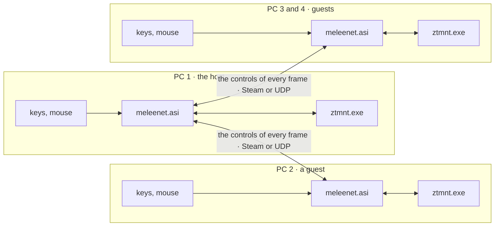

# How it works

[Documentation](README.md) · [Building](BUILDING.md) · [History](CHANGELOG.md)

**English** · [Русский](../ARCHITECTURE.md)

meleenet is two programs: the **mod**, `meleenet.asi`, which lives inside the game's process, and the
**launcher**, which never goes into the game at all.

The game is TMNT Mutant Melee for the PC: Konami Hawaii's own engine on RenderWare 3.5, Direct3D 8. This
page says what the mod does to it and why. How the game itself is made — the main loop, time, input, the
screen, the interface's scripts, with every address — is written down in the notes,
[`re/notes.md`](../../re/notes.md) (in Russian); the addresses and structures the mod uses are in
[`src/mod/game.h`](../../src/mod/game.h), each with a note.

The mod has been checked in the lab only — on copies of the game on one computer. What has not been checked
is listed [at the end of the page](#what-has-not-been-checked).

## Getting into the game

- The game imports `DINPUT8.dll` at its start. In the game's folder that name is
  [Ultimate ASI Loader](https://github.com/ThirteenAG/Ultimate-ASI-Loader), which loads `meleenet.asi` and
  passes the call of `DirectInput8Create` on to Windows' own `dinput8.dll`.
- `ztmnt.exe` is neither packed nor protected: its addresses are right from the first instruction. The
  loader calls the mod's `InitializeASI()` right after loading it, before the game's own code starts to
  run, and the hooks on the game's functions go in there (`dllmain.cpp`).
- The mod checks the SHA-256 of `ztmnt.exe`. One build is supported — "Nov 22 2004", 1 753 088 bytes, the
  one the Russian release has. With a file it does not know the mod puts no hook on the game: the game
  runs as it does without the mod, and `meleenet.log` has a line about it. Only the writing of crashes
  into the log works then.
- Hooks are [MinHook](https://github.com/TsudaKageyu/minhook) trampolines (`patch.cpp`). Besides them the
  mod redirects a few entries of the import table (`Direct3DCreate8`, the window's functions,
  `DirectSoundCreate`), hooks methods of the Direct3D 8 and DirectSound interfaces and changes bytes of the
  code in memory in a few places. Before a function of the game is hooked, `sim.cpp`, `input.cpp`,
  `menu.cpp`, `sound.cpp`, `story.cpp`, `digits.cpp` and `nametag.cpp` compare its first bytes with what
  they should be; if they differ, that feature is switched off and the log says so. The file `ztmnt.exe` on
  the disk is not changed.

## Time: the same on every computer

The engine steps its world by the real time a frame took, multiplied by its "speed scale" of 0.85 and
smoothed. Two computers would never make the same steps. So the mod gives the game a clock of its own
(`sim.cpp`):

- **A game frame is exactly 0.85 / 60 s.** At the end of every frame the game makes its "system update"
  (0x408CB0): it keeps the pads' previous state, handles the window's messages, steps the clock, reads the
  devices. A game frame is such a pass after the Update of the game's current mode. The hook on the
  reading of the devices is the mod's *frame gate*: this is where it is decided what the game learns of
  the pads of this frame.
- **The mod holds the frames at 60 a second** itself. The clock's step does not depend on real time: a
  frame that took longer than 1/60 s still moves the game by one step, and after a long frame — a level
  has loaded — the mod does not catch up.
- **A frame without its picture.** One function of the game draws a game frame's picture (0x4051E0), and
  the mod is hooked on it. A computer that cannot draw 60 pictures a second would play the game slower
  than it is, and in a network game everybody plays at the pace of the slowest. So while the game is more
  than a frame behind its clock, a fight's frame is played without its picture — up to three in a row
  (`[video] frame_skip`, on by default). This is done in the fight's mode only: menus and a fight's opening
  are drawn every frame. The game's own function has such a rule — for the consoles — but with the mod's
  steady clock it never fires.
- **A loading screen is not the game's time.** While the main thread loads a level, the game's second
  thread draws the loading screen and calls the same system update — as many times as the loading takes,
  which is different on every computer. The mod does not count those passes as game frames: the game's
  time stands still, and in a network game the pads stay what the last game frame made them.
- **Stopwatches.** Besides its clock the game measures real time with stopwatches: the fade between two
  modes (0.35 s), waits at the start and while loading. A fade would end a frame earlier on one computer
  than on another. The mod's stopwatches run on game frames: a frame is 1/60 s for them, however long it
  took.
- **Movies** (Bink) are a loop inside one call, as long as the movie. In a network game movies are not
  played: two computers would not leave a movie in one and the same frame.

### Random numbers and the heroes' lines

The game's main generator is RenderWare's RpRandom: 71 functions draw from it. The C library's `rand()`
serves the sound only.

The heroes' lines are a case of their own. The game's rules keep asking the sound "is a line being said?",
and the answer decides what the game does next and how many random numbers it draws. The honest answer
depends on the sound card: a line ends a frame earlier on one computer than on another, and never plays
at all on a computer without sound. So the mod answers, by the game's clock (`sound.cpp`): a line lasts
exactly as long as its clip in `soundPC\VCLIP.BKT`, counted in game frames from the frame it was asked
for. Which of an event's lines is said, the mod draws from numbers of its own.

Drawing and particles are one more case (`sim.cpp`). While it draws a frame the game takes random numbers
too — for sparks, for smoke: a number more or less by what is in view — and from the same generator the
rules use. So after every picture the mod puts the generator back as it was before it: what is drawn, how
wide the frame is, or whether it is drawn at all does not move the numbers the rules get. A particle
system's update (0x481A50) draws from there as well, and which particle systems there are, and in what
order, depends on what the game has shown before. So the particles have a generator state of their own: the
mod swaps it in for the call. Sparks and smoke may differ from computer to computer; the rules' numbers do
not.

### The game begins anew without a new process

The game is the same on every computer only if it has the same past, and a game that has already played a
fight keeps traces of it — the order of its particle systems, the AI's queued messages and more, in pools
and globals that no reset reaches. In the lab two fresh copies with one script of presses are the same from
the first frame (5200 frames, with a fight), while a copy that has already played a fight parts from a fresh
one after about 500 frames of a fight. Only a process that has just started has no past. So a network game
is a game **begun anew**: the players meet before its first frame and play the same from the very first one.

Before version 0.3.0 "anew" meant a new process: every game closed and started itself again. Since 0.3.0 the
mod takes the running game back to the state of a just started process — in the same window, with the same
video device (`rewind.cpp`, the namespace `anew`).

**What is kept.** At the moment the game enters its very first mode (`TtMemCardBootCheckMode`), before the
mode's `Enter`, the mod copies everything the game's logic lives in (`anew::capture()`):

- the exe's writable sections, 0x583000..0x68A000: `.data` with its bss and RenderWare's data segment. The
  exe's image is never moved, so the addresses are the same;
- the game's own heap — one block of 64 MB that the game takes at its start; every allocation of the game
  and of RenderWare is in it. The used part is kept — everything up to the last byte that is not zero, about
  8 MB;
- a handful of blocks the sound code took from the C library's heap at start-up: voices, banks, buffers.

**What lies outside.** The kept memory points at objects outside itself: Direct3D textures, buffers and
surfaces, DirectSound buffers. Those that were alive when the memory was kept are held — the mod adds a
reference of its own and remembers their count of references — so that they cannot go away. What was made
later is nobody's after the memory is put back, and the mod lets it go itself. To know which is which the mod
watches what is made:

- hooks on the device's methods `CreateTexture`, `CreateCubeTexture`, `CreateVertexBuffer`,
  `CreateIndexBuffer`, `CreateDepthStencilSurface`, `CreateImageSurface`, and on the making and deleting of
  vertex and pixel shaders;
- a Direct3D resource tells of its own end: the mod gives it a "witness" — a piece of private data that is
  an object (`SetPrivateData` with the `IUnknown` flag); the resource releases it with itself;
- a sound buffer has no private data, so `DirectSoundCreate` (an import entry of the exe),
  `CreateSoundBuffer`, `DuplicateSoundBuffer` and a buffer's `Release` are hooked: the mod sees the last
  `Release`;
- the device's state is kept in a state block (`CreateStateBlock`).

**Putting it back** (`anew::restore()`) happens at the same place of the code — before the first mode is
entered — and takes 15–30 ms:

1. the mod waits until the thread that draws the loading screen is out of the game's frame; while a level is
   being loaded nothing is put back;
2. a save that is being written is finished; all sounds stop, and the sound buffers made after the memory was
   kept are let go;
3. the memory is put back: the exe's variables, the heap (what the game used beyond the kept part is zeroed),
   the sound blocks. The one thing left as it is now is the game's own lock (its `CRITICAL_SECTION`);
4. the game's events are reset: a game that has just started has none of them set;
5. the device gets the kept state (`ApplyStateBlock`) and its render target; the Direct3D resources and
   shaders made after the memory was kept are let go; the held objects get their count of references of then.

After that the game is a just started process again: its clock, its random numbers and its modes are that
process's. The start-up is played again — with no logos, eight times as fast as usual
([below](#what-had-to-be-made-the-same)).

**Who asks for it.** A moment from which two games are the same is an "epoch" in `sim.cpp`:
`request_epoch()` makes the game's first mode its next mode, and the hook on entering a mode calls
`anew::restore()` before the mode's `Enter`. A session in place is begun by `netplay::begin()` — the role,
the way, the number of players, then the epoch — and the players meet as they do in a new process: before
the first mode. `netlobby.cpp` calls `begin()` instead of starting a process; the games of a session begin
anew the same way when the host lets a new player in
([The host's door](#the-hosts-door-coming-into-a-running-game)).

**After a session.** A guest plays a session on the host's save: the save file's name is replaced for the
time of the session. When the session is over for a guest and the guest's game is back at its main menu, the
mod asks for an epoch once more: the game begins anew, now on the player's own save. The host's save is the
host's own all along; its game only stops being a session's game.

**The fallback.** If the memory cannot be kept or put back, a session starts as in 0.2.0, as a new process
(`netplay::in_place()` says no, and `netlobby.cpp` starts the game again). This is the case:

- with `[video] mode = game` — the game's own exclusive full screen;
- when the video device is lost and reset (`Reset`) after the game has started: nothing can be held through a
  reset. Before the reset the mod lets go of everything it held and forgets what it kept
  (`anew::before_reset()`);
- when the game's memory is not laid out as the mod expects (the game started with the developers' switch
  `-usemalloc`, for example), or the device gave no state block.

A game that takes the fallback and games that begin in place play together: the protocol's messages are the
same.

One change in `video.cpp` belongs here. RenderWare's driver makes a device that "does not wait for the
monitor" and, at the first picture shown, makes it anew with the waiting on — a device reset in the game's
very first frame. A window's device has no such setting, and a reset would let nothing be held. When it makes
a windowed device, the mod tells the driver the waiting is on already: there is no reset in the first frame
any more.

Checked in the lab: a session begun in place was compared line by line with a session of freshly started
processes — the same frames; a copy that had played fights and the story and visited the library before the
session against a copy with no past, both put back to their start — identical 4500 frames; five returns to
the start in a row after played fights — the process's memory stays about 280 MB and does not grow. Not
checked: a real game with sound audible (the lab runs muted), and a lost device.

## A network game: lockstep

Each computer plays the whole game. Only the players' controls go over the network (`netplay.cpp`). There
are two to four computers; the host is the centre: the guests talk to it only.

- At the frame gate each copy reads **its own player-1 controls** and sets them for the frame *now + input
  delay* (2 frames by default; the host tells everybody the delay). A guest sends its pads to the host,
  the host sends everybody the pads of all players. The host is player 1, the guests are players 2–4.
- A frame begins only when the pads of all players for it are known. A packet carries every frame the
  other side has not acknowledged yet, so lost packets cost nothing but time.
- Every 60 frames the guests send the host a fingerprint of the game's state (the random number generator
  and the game's time). A guest's game may be a frame or two ahead of the host's: the host keeps the
  fingerprint of a frame it has not played yet and compares it when it gets to that frame. If the
  fingerprints differ, every copy writes it into the log and shows «ИГРЫ РАЗОШЛИСЬ» (the games have
  parted).
- A second thread keeps the connection alive while the game's own thread is busy for seconds (a level
  being loaded, a window being dragged).
- At the meeting a guest tells the host the fingerprints of its `ztmnt.exe` and `archive.arc`; the host
  refuses a guest whose files differ. A guest with another network protocol is answered with a refusal on
  the host's network page.
- A network game is played on the host's save. A guest receives it and writes into a file of its own,
  `tmnt-net.sv`: the save file's name is replaced in the game's code; the guest's own save is not touched.
- If a guest has left, or nothing is heard from it for 15 seconds, the network game goes on without it
  while at least one guest remains. From the frame the host let it go, the pad of the one who left carries
  a "gone" mark — a bit the game never reads: every computer knows from the same frame who is in. If the
  host has left, the network game is over; everybody plays on alone.
- A game for which the session is over shuts its transport and its Steam lobby: the port and the place on
  Steam are free, and a new network game can be opened or joined from the same running game.
- **The pause.** The game reads the pause key and the pause menu from one pad only — the one that leads
  the menus. In a session, before the game gets a frame's pads, the mod adds the other players' Esc to the
  leading pad and, while the fight is paused, their Enter too: any player pauses and goes on. While the
  highlight is on the pause menu's second row — leave the fight — the others' keys are not added: that row
  stays the leader's.

Transports (`src/common`): **ENet** over UDP for a game by address, **Steam Networking Messages** for a
game over Steam (through Valve's test application Spacewar, AppID 480), and a stand-in for Steam that the
lab uses to run several "Steam players" on one computer. The host listens both ways at once: one network
game may have guests from Steam and guests by address (`multi_transport.h`). In a session the host listens
both ways as well, whichever way its first guests came: a later player may come the other way.

### The host's door: coming into a running game

The games of a session are the same because they started together. A player who comes later — or comes
back after a lost link — waits at the host's "door" (`netplay.cpp`).

- While the session is played the host still answers a `Knock` from a game that is not in it: it checks
  the protocol's version and the fingerprints of `ztmnt.exe` and `archive.arc`, counts the places — four at
  most in a session, those who wait included — and answers with a `Lobby` marked "the host's game is being
  played", or with a refusal. The host's Steam lobby stays for the time of the game, in the state `ingame`:
  friends see the game in their list and can choose it.
- The one who waits stands on the network page. If a fight is going on, the host shows a notice about the
  new player.
- When the session is between two fights — the modes of the main menu, of the choice of a hero, of an
  arena and of a fight's options, of the story's choice of a hero and of its map — the host sends `Go` to
  every game of the session and to every game at the door. A moment later each of them begins anew into a
  session of all of them: the way the games start from the network page — in place
  ([above](#the-game-begins-anew-without-a-new-process)) or, by the fallback, as a new process.
- In place the host begins 0.3 s after `Go` and the guests 1.5 s after it: the host must have closed its old
  port and opened the new one before a guest dials it. With new processes it is the other way round — a
  process takes seconds to come up, so the guests go first and the host a moment later.
- A fight is not interrupted for it: the host waits for a mode between fights.

### What had to be made the same

Same controls give the same game only if nothing else differs. Besides the clock, the stopwatches and the
lines, this is what the mod pins down:

- **The start.** In a game that begins a network game — in place or as a new process — until the main menu
  is entered for the first time, the step of the clock and of the stopwatches is eight times longer and the
  pace of 60 frames a second is not held — on every computer alike. The "press Enter" screen is pressed for
  everybody by the host's game. The start-up of a guest whose game goes back to its own save after a session
  runs the same way: there the mod itself presses "press Enter".
- **Particles.** How many particles to make, the game decides with random numbers, so in a network game
  the particles setting is 100 % for everybody.
- **Drawing and the particles' update** take no random numbers from the rules (above).
- **Movies** are not played (above).
- **The frame's shape is no part of the logic**: copies with a 16:9 and a 4:3 frame compute the same. So
  every player has a window and a resolution of their own.

## Controls

Once a frame the game reads the keyboard and the joysticks and turns them, by the bindings in the file
`tmntwire.hks`, into four "pads" — 19 numbers each: a stick and buttons. Everything in the game, menus and
fights alike, reads those pads. The mod sits right after that reading (`input.cpp`): in a network game
what the game is told for each player is what came over the network. The game's developers' menu stays
this computer's own business: it does not go over the network.

The game turns the keyboard into a pad in one function. Before it, the mod adds to the keyboard's state
five "keys" no keyboard has — the left, right and middle buttons of the mouse and the two side ones. It
takes their state from Windows while the game's window is in front and the pointer is over its picture.
That is why a button of the mouse can be bound to an action like a key: these are the game's own
bindings, and over the network they go as ordinary controls.

## The story together

In the game itself the story is for one: a hero against the matches of a script. But a story match is
built from the same parts as a fight of РУКОПАШНЫЙ БОЙ (Melee): up to eight fighters in two teams, and the
hero's team may have "friends" from the script — led by the computer, and unable to hurt their own side. In
a network session the mod adds the other players to every match as such friends and hands their fighters to
those players' pads (`story.cpp`).

- The hook is on the game's function that builds a match's fighters (0x455F00). Before it, the mod adds a
  "friend" record per partner to the match — at the end of the friends' list: the story reads "the hero's
  side has won" from the first places. After it, the fighters built from those records get a human in
  place of the computer, and their player's pad.
- A partner's record: the turtle by the player's number (or the first one nobody has, if that turtle is
  the hero), the hero's team, the hero's health, a HUD panel — a free one or, if none is free, one of the
  enemies'.
- A "last man standing" match becomes a team one, and the hero's rule "the hero's knock-out ends the
  match" is taken off: a side wins when the other side is down. In a survival match without a clock an
  enemy's record gets the rule "the end when the team is down": such a match ends when the enemies' side is
  down. The mod touches no other rule of a match.
- Partners are not added to the bomb match and the other mini-games — they run in a mode of the game's own,
  made for one fighter — or to a match that uses all eight places. To the training matches with the mecha
  turtle partners are added since version 0.3.0: such a match runs in the ordinary mode of a fight.
- **An enemy's second life** (since version 0.3.0). In the last stages an enemy comes back as another one:
  its record has a "next life" record. That record takes a place in the list of characters a match loads but
  gets no fighter of its own. The game gives the i-th loaded character to the i-th fighter, and the match
  builder puts the second life's character into the list right after the enemy: in the game's own matches
  that is the last place, and the character lands on the spare fighter after the last one. With partners
  after the enemy the list would shift, so after the match is built the mod puts the list in order again:
  every fighter's character first, then the second lives. And a second thing: the round's reset (0x454880)
  puts records on fighters by a record's place in the lists, and in a match with a second life every friend
  would land one fighter too far — after the reset the mod puts the friends' records on their real fighters
  (0x453560). A second life counts when the free places are counted, too.
- Before a match is built again, the mod takes out of it what it added.

## The picture

- **A window instead of the full screen** (`video.cpp`). The game itself knows only a full screen: at
  every start it takes 640×480 in 16 bits, minimizes itself when another window comes in front, and starts
  itself again to change the resolution. The mod makes the Direct3D 8 device a windowed one and places the
  game's window itself: without a frame over the whole monitor, or as an ordinary window.
- **Any size of the frame.** The mod adds its own size as one more mode at the end of the list of video
  modes the game chooses from.
- **Wide screen.** The engine has the consoles' own 16:9 switch: more is seen at the sides, the 2D layer is
  drawn towards the middle, the sides of the menus are covered by two black bars. The mod turns it on and
  puts the shape of its own frame into its numbers — any shape, not 16:9 only.
- **Quality.** Smoothed edges (MSAA) are set in the device's parameters and work when the frame fills the
  whole window; anisotropic filtering replaces the linear filtering of textures the game asks for.
- **Two threads in one device.** The game draws the loading screen on a second thread while the first one
  makes the level's textures and buffers, and it makes its Direct3D device without the multithreading
  flag. Hence rare crashes while loading. The mod adds the flag when the device is made.

### Menus over the whole wide frame

The game's screens are scripts, `ui/scripts/UI_*.txt` in its archive, laid out for 4:3: 640 units wide. On
a wide frame a screen comes out as a 4:3 block with empty sides. Every script goes to the game's parser
through the mod and is made wider on the way (`uiwide.cpp`):

- an element that ends at an edge of the layout is taken on to the frame's edge, in the way that suits its
  texture: a repeating one (the honeycomb of the background, the pipe along the top) goes on as tiles; a
  few stretched texels (black boxes, lines) are stretched further; the brick walls along the bottom and
  the loading screen's picture get a second element beside them with the texture mirrored; the headings'
  plates and the speed lines get a second element made of the one column of texels at the edge;
- a black border that stands right at the layout's edge (the story's results screen) is moved to the
  frame's edge as narrow as it was, not stretched across the wall beside it;
- an element that waits beyond the layout's edge to slide in, or slides out beyond it, waits beyond the
  frame's edge;
- texts, buttons and portraits stay in their 4:3 places.

The black bars at the sides of the menus (0x40AB90) are not drawn then. The map of the story mode, ИСТОРИЯ
(Story), is drawn by code, not by a script: the mod draws the four dim strips around the map's window on
to the frame's edges (`video.cpp`). The library, БИБЛИОТЕКА (Library), is left a 4:3 page on black. The
setting `menus = bars` in the section `[video]` brings back the 4:3 menus with bars.

## The mod's menus are the game's own

The mod draws no windows of its own over the game (`menu.cpp`).

- **The main menu** of the game is a script, `UI_ModeSel_PC.txt`, with five buttons and one function of
  the main menu's mode that drives them. The mod hands the game a script of its own — six buttons made
  from the game's: the same picture, the same sounds, the same movement — and drives them itself in place
  of that function. СЕТЕВАЯ ИГРА (network game) is the third button.
- **The network pages** — open a game, friends' games, an address, the list of players — are the same six
  buttons with other words. Nothing is drawn that the game does not draw itself.
- **The words.** The mod writes its texts into the game's language table, over strings that only another
  console shows (its memory-card messages) — in place and no longer than the old ones (`gametext.cpp`).
- **The font.** In the Russian release's font the Cyrillic letters are painted in the places of the small
  Latin letters and of two digits: Ч stands in the place of 4, Б in the place of 6. The game's texts are
  written in that "cipher", and the mod writes the same way.
- **The digits 4 and 6.** `digits.cpp` gives the menu font a real 4 and 6: two new glyphs under codes that
  no text of the game uses. The 6 is the font's own 9 turned half a turn; the 4 is painted into a free cell
  of the font's picture (`glyph4.h`, made by `tools/glyph_four.py`). A hook on the game's text drawing
  (0x40AC30) replaces, on the way to the font, the 4s and 6s that are digits and not letters: a word
  without small Latin letters is a number. A few words made of "digits" only (ОБ, ОБО, БОБ, ЗОБ, ОБОЗ) and
  a lone Б after ЧТО and ПЛАНА stay letters. The players' places in the list are numbered 1.–4.; if the
  font could not be added to, they are numbered I.–IV., as in 0.1.x.
- **Messages** at the top of the frame — who has left, that the games have parted — are drawn by the game
  itself, with its own text drawing, right after the mode has drawn the frame (`notice.cpp`, `menu.cpp`).
- **Names over the fighters** (`nametag.cpp`). The tag over a human's fighter — an arrow in the player's
  colour and the words "1P"…"4P" — is drawn by one function of the game (0x419FF0, the fighter in `ecx`). A
  hook on it remembers whose tag the game is drawing. The words themselves go through the same text drawing
  (0x40AC30) that the digits' hook is on: when a tag is being drawn, the text is "1P"…"4P" and a session is
  on, the name of the player whose pad leads that fighter is drawn in its place — in the menu font (it has
  every letter and digit) and in a rectangle twice as wide. The game draws the words' shadow in a second
  call — by then the text is replaced already. The players tell each other their names at the meeting, in
  the packets `Hello` and `Welcome`: the Steam name, or without Steam `[net] name` or `player`; the name
  `player` becomes «ИГРОК N» (player N) on a tag. A tag holds 16 characters at most. Outside a session the
  tags stay the game's own.

The players meet on the page while everybody's game is an ordinary single game (`netlobby.cpp`): one
opens a game — a Steam lobby for friends and a UDP port for an address — and up to three others find it
among their friends' games or type the address. When the host starts, each game shuts the page's network and
begins the session in place: `netplay::begin()` takes the game back to its start
([The game begins anew without a new process](#the-game-begins-anew-without-a-new-process)). By the fallback
a game starts itself again with the network game written into environment variables: it begins with the
process, before the first frame; the log of the game that ran before the restart stays in
`meleenet-menu.log`. A game that knocks at a host whose session is being played waits on the same page: the
host answers it from the session ([The host's door](#the-hosts-door-coming-into-a-running-game)).

## Modules of the mod

| File | What it does |
|---|---|
| `dllmain.cpp` | the mod's entry: the check of `ztmnt.exe`, putting the other modules in |
| `patch.cpp` | hooks, checked changes of bytes, redirected imports |
| `config.cpp` | `meleenet.ini` |
| `game.h` | the addresses and structures of `ztmnt.exe` |
| `sim.cpp` | the clock, the frame gate, the pace, frames without their pictures, random numbers of their own for drawing and particles, the stopwatches, epochs (the moments from which games are the same), the lab's frame log |
| `rewind.cpp` | the namespace `anew`: a copy of the game's memory at the beginning of its start-up and putting that copy back — the game begins anew without a new process; holding the Direct3D and DirectSound objects |
| `input.cpp` | the players' pads, the mouse's buttons, the lab's script |
| `netplay.cpp` | the network game: beginning a session inside the running game, the meeting before the first frame, lockstep, checks, players leaving, anybody's pause, the host's door, a guest's return to its own save |
| `story.cpp` | the story together: partners in a match's records, their fighters to the players' pads, the order of characters and records in a match with an enemy's second life; the lab's switches for the story |
| `multi_transport.h` | Steam and an address at the host at once |
| `netlobby.cpp` | meeting on the network page: Steam's lobby, the address, beginning the session — in place or, by the fallback, as a new process |
| `menu.cpp` | the main menu and the network pages made of the game's buttons; showing the messages |
| `gametext.cpp` | the mod's texts in the game's language table, the Russian release's font |
| `digits.cpp`, `glyph4.h` | a real 4 and 6 in the menu font: two glyphs, and the digits replaced on the way to the text drawing |
| `nametag.cpp` | the players' names over the fighters: a hook on a fighter's tag, and its words replaced in the text drawing |
| `uiwide.cpp` | the screens' scripts made as wide as a wide frame |
| `notice.cpp` | a message and how long it is shown |
| `video.cpp` | the window, the device, the frame's size and shape, smoothing and filtering, the lab's pictures |
| `d3d8.h` | the little of Direct3D 8 the mod needs |
| `sound.cpp` | the heroes' lines by the game's clock |
| `diag.cpp` | crash reports into the log |

`src/common` holds what does not depend on the game: the protocol's packets (`protocol.h`), the ENet and
Steam transports, Steam's start-up and its stand-in for the lab, Steam's lobbies, the log, SHA-256.

## The launcher

A program of its own: Direct2D and DirectWrite, WinHTTP — nothing but Windows; the fonts and the mod's
files are in its resources. It looks like the game's own menus (`view.cpp`): the background is a honeycomb
that brightens towards the right edge, black pipes and a wall of blue bricks with a ramp; windows and
buttons are black, in a steel rim. The colour of the honeycomb and of the accents is the bandana of one of
the four turtles, as the player chooses; a mask in that colour is tied beside the title.

| File | What it does |
|---|---|
| `main.cpp` | the window, the mouse and the keyboard, the jobs in the background, the command line |
| `view.cpp` | what is drawn: every screen from the model |
| `gfx.cpp` | Direct2D: shapes, text, PNG |
| `core.cpp` | the game's folder, the installed mod, the settings, the newest release |
| `package.cpp` | the mod inside a launcher file; putting it into the game's folder and taking it out by the list |
| `net.cpp` | HTTP, with or without a proxy |
| `gameset.cpp` | the rows of the tabs ГРАФИКА (graphics), СЕТЬ (network) and УПРАВЛЕНИЕ (controls): `meleenet.ini` and the keys in `tmntwire.hks` |

The mod is put next to `ztmnt.exe`; installing touches neither `ztmnt.exe` nor the game's data. Every
installed file and every backup is listed in `meleenet-install.txt` in the game's folder: by that list the
mod is taken out and the earlier files are put back. What the mod wrote itself — its logs and
`tmnt-net.sv` — is removed with it; the player's save stays. The player's `meleenet.ini` stays through an
update.

A new version comes as a new launcher file: it is downloaded, checked by the SHA-256 the release names,
and **opened as data** — the mod's files are read out of its resources. It is run only when it replaces
the launcher itself.

## What has not been checked

- The real Steam: only its stand-in for the lab was checked.
- The game's real window in front of a player: the keyboard, the mouse, typing an address.
- The launcher in a person's hands — under a real mouse and keyboard.
- Gamepads.
- Sound after the game's return to its start: the lab runs muted.
- A lost video device and the fallback after it.
- The story together: a duel stage, a team stage, the training and the last stage were played in the lab, not
  every stage of every hero.
- Coming into a running game and coming back after a lost link — on real Steam.
- Wide menus on the screens of a fight's results, of the story's victory, defeat and unlocks, and in the
  credits: those screens were not pictured in the lab. The exception is the story's results screen: in
  0.2.0 its black borders were put at the picture's edges.

Checked in the lab in version 0.2.0: the story on two and three copies, a third copy coming in during a
fight of two (by address and through the stand-in for Steam), a guest coming back after a lost link, a
guest's pause and the leader leaving the fight, frame skipping on one copy of two. In detail — in the
[history of versions](CHANGELOG.md#020).

Checked in the lab in version 0.3.0: sessions of two, three and four copies begun in place (by address and
through the stand-in for Steam, with antialiasing on and off), and such a session against a session of
freshly started processes; a copy with a past against a copy without one; five returns to the start in a
row; a third copy coming into a running game; a guest that loses its link, gets its own game back and joins
again — five times in a row; a 15000-frame session with two fights played out; the story's last stage with
three copies and the training with two. In detail — in the [history of versions](CHANGELOG.md#030).
