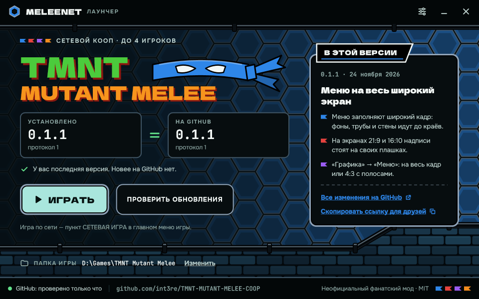

# Installing, updating and removing

[Documentation](README.md) · **Install** · [Launcher](LAUNCHER.md) · [Network play](NETPLAY.md) ·
[Controls](CONTROLS.md) · [Settings](SETTINGS.md) · [Troubleshooting](TROUBLESHOOTING.md)

**English** · [Русский](../INSTALL.md)

The mod and the launcher speak Russian, like the release of the game they are made for. Names of buttons
and menu items are given here as they are on the screen, with a translation in brackets.

## What you need

- **Windows 10 or 11.**
- **Your own copy of the game**: the Russian PC release of *TMNT Mutant Melee*, with its `ztmnt.exe`
  (SHA-256 `585a5809349e5e31352f80b94445382d69824d3e3c78ba84e38cf519f9bbdce2`). The repository and the
  releases hold no files of the game.
- For a game over Steam: the Steam client running, and an account. The game does not have to be in Steam:
  the mod comes to Steam as Valve's test application Spacewar (AppID 480). This has not been checked on
  real Steam accounts yet.
- For a game by address over the internet: UDP port `47830` open at the host, or a common virtual network
  (Radmin VPN, Hamachi). A game over Steam needs no port.

> **Another edition of the game.** The mod knows one `ztmnt.exe`. With any other file it changes nothing
> and turns nothing on: the launcher says so under its button («ztmnt.exe в этой папке не тот, для которого
> сделан мод» — the ztmnt.exe in this folder is not the one the mod is made for), and the game runs as if
> there were no mod.

## Install

1. Download [`meleenet-launcher.exe`](https://github.com/int3re/TMNT-MUTANT-MELEE-COOP/releases/latest/download/meleenet-launcher.exe).
   It is one file of about 4.6 MB with the mod inside; it installs itself nowhere and can lie anywhere.
2. Start it. If it has not found the game, press **ВЫБРАТЬ ПАПКУ ИГРЫ** (Choose the game's folder) or
   **Изменить** (Change) at the bottom of the window, and choose the folder that holds `ztmnt.exe`.
3. Press **УСТАНОВИТЬ МОД** (Install the mod). The files come out of the launcher itself; if a newer version
   is already out on GitHub, the launcher downloads that one first.
4. Press **ИГРАТЬ** (Play).

<p align="center">
  
  
</p>

> The launcher is not signed with a certificate, so Windows may show "Windows protected your PC". Press
> **More info → Run anyway**. The SHA-256 of the file is in `meleenet-latest.json` of every
> [release](https://github.com/int3re/TMNT-MUTANT-MELEE-COOP/releases).

## What is put where

Everything goes next to `ztmnt.exe`. `ztmnt.exe` itself and the game's data are not changed on the disk:
the mod works in memory.

| File | What it is |
|---|---|
| `dinput8.dll` | [Ultimate ASI Loader](https://github.com/ThirteenAG/Ultimate-ASI-Loader): loads the mod into the game. If an Ultimate ASI Loader is there already, it is kept and used |
| `meleenet.asi` | the mod |
| `meleenet.ini` | the mod's settings. A file that is there already is kept |
| `steam_api.dll` | Steam's library (needed only for a game over Steam) |
| `steam_appid.txt` | the application's number for Steam (480). A file that is there already is kept |
| `meleenet-README.md` | a short instruction in Russian |
| `meleenet-install.txt` | the list of files the launcher put in; by it the launcher removes exactly them |

If the game's folder already holds somebody else's file under the name of one of the mod's files (another
`dinput8.dll`, say), the launcher moves it into the folder `meleenet-backup\` and puts it back when the mod
is removed.

What appears later, by itself:

| File | What it is |
|---|---|
| `meleenet.log` | the log of the game's last run |
| `meleenet-menu.log` | the log of the game a network game was started from (before it started again) |
| `tmnt-net.sv` | at a guest of a network game: a copy of the host's save. Your own save, `tmnt.sv`, is not touched |

The keys you change in the launcher are written into the game's own file of bindings, `tmntwire.hks`
([Controls](CONTROLS.md)).

The launcher's own files are outside the game's folder: its settings in `%APPDATA%\meleenet\launcher.ini`,
downloads and copies of settings made before a change in `%LOCALAPPDATA%\meleenet\cache`.

## Update

Start the launcher. It asks GitHub for the newest release at every start:

- a newer **launcher** is taken by itself: downloaded, checked by SHA-256, put in the old one's place and
  started again;
- a newer **mod** is offered with the button **ОБНОВИТЬ ДО …** (Update to …). Your `meleenet.ini`, your keys
  and your saves stay.

Under the two versions the launcher says whether friends on the older version can still be played with
(the same network protocol) or the whole team has to update.

<p align="center">
  
  
</p>

## Remove

Launcher → the settings (the sliders icon at the top right) → tab **ЛАУНЧЕР** (Launcher) → **Удалить мод**
(Remove the mod), then **Точно удалить?** (Sure?). Exactly the files of `meleenet-install.txt` are removed
(`meleenet.ini` among them), and what the mod wrote itself: the logs `meleenet.log` and `meleenet-menu.log`,
and `tmnt-net.sv`, the copy of a host's save. Files that were moved into `meleenet-backup\` are put back.
Your own save and the game's files stay; so do the keys written into `tmntwire.hks`.

By hand: delete the files listed in `meleenet-install.txt`.

## Without the launcher's window

```
meleenet-launcher.exe /install "C:\Games\TMNT Mutant Melee" /quiet
```

```
meleenet-launcher.exe /uninstall "C:\Games\TMNT Mutant Melee" /quiet
```

The exit code is 0 when it is done and 2 when it is not (no `ztmnt.exe` in the folder, the game is
running). Without `/quiet` the result is shown in a message.

## By hand

Build the mod ([Building](BUILDING.md)) or take the files out of an installed copy, and put `dinput8.dll`,
`meleenet.asi`, `meleenet.ini` and, for Steam, `steam_api.dll` next to `ztmnt.exe`.
