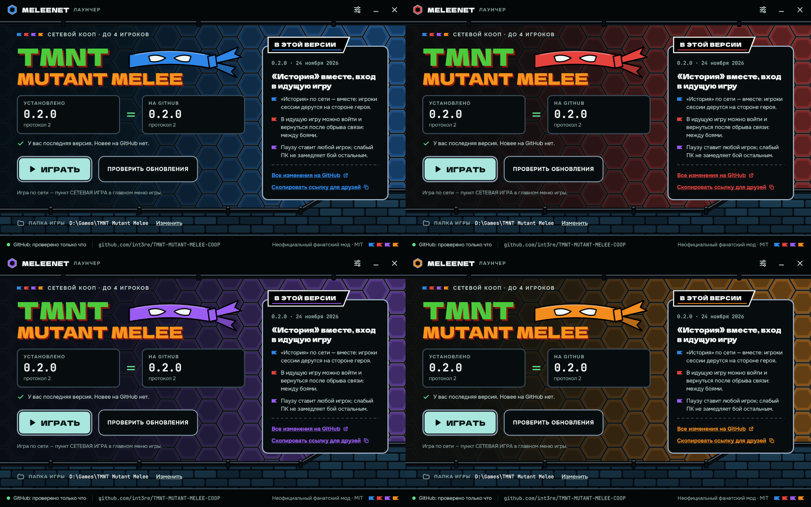
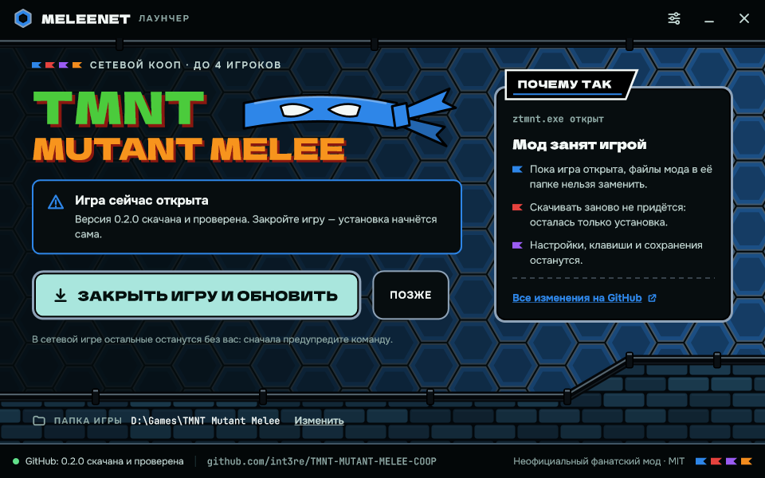
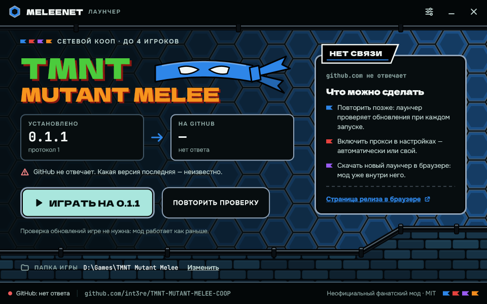
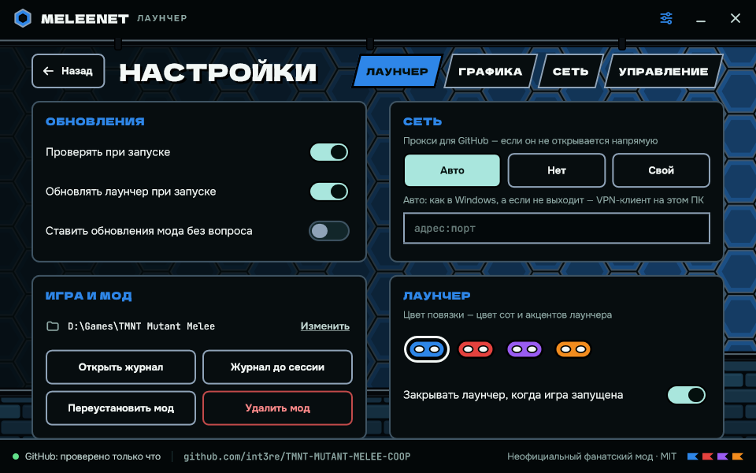

# The launcher

[Documentation](README.md) · [Install](INSTALL.md) · **Launcher** · [Network play](NETPLAY.md) ·
[Controls](CONTROLS.md) · [Settings](SETTINGS.md) · [Troubleshooting](TROUBLESHOOTING.md)

**English** · [Русский](../LAUNCHER.md)

`meleenet-launcher.exe` is the one file a player gets. The mod is inside it. The launcher finds the game,
puts the mod in and takes it out, keeps the mod and itself up to date, sets the picture, the keys and the
network game before the game starts, and starts the game.

  

It is a program of its own, not a part of the game: Direct2D and DirectWrite for the picture, WinHTTP for
the network, nothing to install. It does not touch `ztmnt.exe` or the game's data; of the game's own files
it changes only the file of key bindings, `tmntwire.hks`, when you change keys on the tab УПРАВЛЕНИЕ
(Controls). Only one launcher runs at a time: a second start shows the window of the first.

The launcher looks like the game's own menus: a honeycomb that brightens towards the right edge, black
pipes, a wall of blue bricks with a ramp along the bottom; the windows and buttons are black, in a steel
rim, and the big button is a pale plate. The colour of the honeycomb and of the accents is the bandana of
one of the four turtles; a mask in that colour is tied beside the title.

  

## The main screen

| The screen says | The big button | The button beside it |
|---|---|---|
| the mod is not installed | **УСТАНОВИТЬ МОД …** (Install the mod): puts in the mod the launcher carries; if GitHub has a newer version, downloads that one first | — |
| «У вас последняя версия. Новее на GitHub нет.» (you have the newest version) | **ИГРАТЬ** (Play) | **ПРОВЕРИТЬ ОБНОВЛЕНИЯ** (Check for updates) |
| the mark **НОВАЯ** (new) on the version at the right | **ОБНОВИТЬ ДО …** (Update to …) | **ИГРАТЬ НА …** (Play on …) starts the game on the version you have |
| «Спрашиваю у GitHub, какая версия последняя.» (asking GitHub for the newest version) | **ИГРАТЬ НА …**: no need to wait for the answer, the check goes on in the background | — |
| «GitHub не отвечает. Какая версия последняя — неизвестно.» (GitHub does not answer) | **ИГРАТЬ НА …** | **ПОВТОРИТЬ ПРОВЕРКУ** (Check again) |
| «Игра не найдена» (the game is not found) | **ВЫБРАТЬ ПАПКУ ИГРЫ** (Choose the game's folder): choose the folder with `ztmnt.exe` | — |
| «Игра сейчас открыта» (the game is open now) | **ЗАКРЫТЬ ИГРУ И ОБНОВИТЬ** (Close the game and update) asks the game to close, as the cross of its window does | **ПОЗЖЕ** (Later) cancels |

The Enter key presses the big button.

The two boxes show the version installed in the game's folder and the newest one on GitHub, each with its
**network protocol**. Players can meet in a network game only on versions with the same protocol; the line
under the boxes says in words whether friends on the older version can still be played with («Протокол тот
же…» — the protocol is the same) or the whole team has to update («Протокол новый…» — the protocol is new).

On the right, in a window of its own, is what is new in the version, the link **Все изменения на GitHub**
(All the changes on GitHub) and **Скопировать ссылку для друзей** (Copy the link for friends) — the link to
the newest release. At the bottom of the window are the game's folder and **Изменить** (Change), and the
bottom line says what GitHub answered.

  
  
  

  
  

## Updates

At every start the launcher asks GitHub for `meleenet-latest.json` of the newest release: the mod's version
and protocol, the notes, the launcher file's name, size and SHA-256.

- **A newer launcher** takes the old one's place by itself: it is downloaded, checked by SHA-256, put where
  the old one was and started again. The mod in the game's folder is not touched by that.
- **A newer mod** comes inside the newer launcher file. The file is downloaded into the launcher's cache,
  checked, and opened as data — it is not run. The mod's files are taken out of it into the game's folder.
- A file with another checksum is not used: it is deleted, and the launcher offers to download it again.
- `meleenet.ini`, the keys and the saves stay through every update.
- While the game is open, the mod's files in its folder cannot be replaced: the launcher asks to close the
  game and installs the update as soon as it has closed.

The check at the start and the launcher's own update can be turned off in the settings. Without GitHub the
launcher still installs the mod it carries and starts the game.

## The settings

The sliders icon at the top right; **Назад** (Back) or Esc returns to the main screen. Four tabs. On the
tabs ГРАФИКА (Picture), СЕТЬ (Network) and УПРАВЛЕНИЕ the button **По умолчанию** (Defaults) at the bottom
right returns the tab's rows to their defaults. Until the mod is installed the rows of these three tabs are
pale: their settings are kept in `meleenet.ini`, which comes with the mod.

### ЛАУНЧЕР — the launcher itself

  

| Row | What it does |
|---|---|
| **Проверять при запуске** (check at the start) | ask GitHub for a newer release at every start |
| **Обновлять лаунчер при запуске** (update the launcher at the start) | a newer launcher takes this one's place by itself |
| **Ставить обновления мода без вопроса** (install the mod's updates without asking) | a newer mod is installed at the start without the button; off by default |
| **Прокси для GitHub** (a proxy for GitHub): Авто / Нет / Свой | how to reach GitHub when it does not open directly: as Windows is set up and, failing that, through a VPN client on this PC; directly only; or your own HTTP proxy `address:port` |
| **Изменить** (beside the game's folder) | choose another folder with `ztmnt.exe` |
| **Открыть журнал** (open the log) | open `meleenet.log` of the game's folder — the log of the game's last run |
| **Журнал до сессии** (the log before the session) | open `meleenet-menu.log` — the log of the game that stood on the network page before it started itself again into the session. While there has been no network game the button answers «Этого журнала пока нет: он появляется после сетевой игры» (there is no such log yet: it appears after a network game) |
| **Переустановить мод** (reinstall the mod) | put the files of the mod in again |
| **Удалить мод** (remove the mod) → **Точно удалить?** (sure?) | remove what was put in and what the mod wrote itself ([Install](INSTALL.md)) |
| **Цвет повязки** (the colour of the bandana) | the colour of the honeycomb and of the launcher's accents: four masks to choose from — Leonardo's blue (the default), Raphael's red, Donatello's purple, Michelangelo's orange |
| **Закрывать лаунчер, когда игра запущена** (close the launcher when the game is up) | the launcher closes once the game has started |

### ГРАФИКА — the window and the picture

  

**ЭКРАН** (Screen) — the game's window, the resolution, the shape of the frame and the menus; **КАРТИНКА**
(Picture) — smoothing, the texture filter, the heroes' outlines, shadows, particles and frame skipping. These
are the mod's own settings: they are kept in `meleenet.ini` in the game's folder and take effect at the next
start of the game. Every row is described in [Settings](SETTINGS.md). The size and the shape of the frame do
not change how the game plays, so the players of a network game may have them different.

**Пропуск кадров** (Frame skipping: «Вкл», on, or «Выкл», off; the last row of КАРТИНКА) came with launcher
1.2.0 and mod 0.2.0; nothing else changed in this version of the launcher. With «Вкл», the default, the
frames of a fight that the computer cannot draw in time are played without their pictures and the game is
not slowed; in a network game one slow computer does not slow the fight for the others. It works in fights
only. The row is pale when the mod in the game's folder is older than 0.2.0: that mod does not read the
setting.

### СЕТЬ — the network game and the mouse

  

**Задержка ввода** (Input delay; the host's value is the one in force for everybody), **Видят в Steam**
(Seen in Steam: who sees a game opened over Steam — friends, or everybody who has the mod) and **Кнопки мыши
в игре** (The mouse's buttons in the game). These settings are kept in `meleenet.ini` too. A network game
itself is not started here but in the game's main menu: СЕТЕВАЯ ИГРА (Network game). More in
[Network play](NETPLAY.md).

### УПРАВЛЕНИЕ — the keys and the mouse

  
  

The keys of player 1 at this computer: ten actions, each with a cell that holds its key. They are the
game's own bindings: the launcher writes them into its file `tmntwire.hks`.

- **Раскладка** (Layout): «Как в игре» (as in the game: W S A D, N, M, H, J, Space, B), «WASD + мышь»
  (WASD + mouse) or «Своя» (your own) — your own keys, if you have changed any.
- **A key:** press the action's cell, then the new key. A key that another action has changes places with
  the one this action had. Esc cancels.
- **A button of the mouse:** press the action's cell, then press the right, the middle or a side button of
  the mouse; the left one — *on that same cell*. The button takes the key's place: the cell then says, for
  example, `ЛКМ` (the left button).
- **По умолчанию** returns the game's own keys.

More in [Controls](CONTROLS.md).

## When GitHub does not open

The launcher tries, in turn, what the row **Прокси для GitHub** allows. With **Авто** these are Windows'
own settings and a VPN client's local proxy on this PC, if one is listening. The bottom line of the window
says when GitHub answered and through which proxy. If only the files of a release do not come (the page
answers, the download host does not), the launcher says so — «GitHub отвечает, но файлы релиза не отдаёт.
Включите прокси в настройках» (GitHub answers but does not give the release's files; turn a proxy on in the
settings) — and gives a link to the release's page in the browser.

## Where the launcher keeps its own

| Path | What |
|---|---|
| `%APPDATA%\meleenet\launcher.ini` | the launcher's settings |
| `%LOCALAPPDATA%\meleenet\cache` | downloaded releases; `meleenet.ini.before-launcher` and `tmntwire.hks.before-launcher` — the mod's settings and the game's keys as they were before the launcher first changed them in a run |

## From the command line

| Command | What it does |
|---|---|
| `meleenet-launcher.exe /install "<game folder>" [/quiet]` | puts the mod in; exit code 0 or 2 |
| `meleenet-launcher.exe /uninstall "<game folder>" [/quiet]` | takes it out; exit code 0 or 2 |
| `meleenet-launcher.exe --check --out <file>` | asks GitHub for the newest release and writes what came |
| `meleenet-launcher.exe --where --out <file>` | writes where the game is found and what is installed there |
