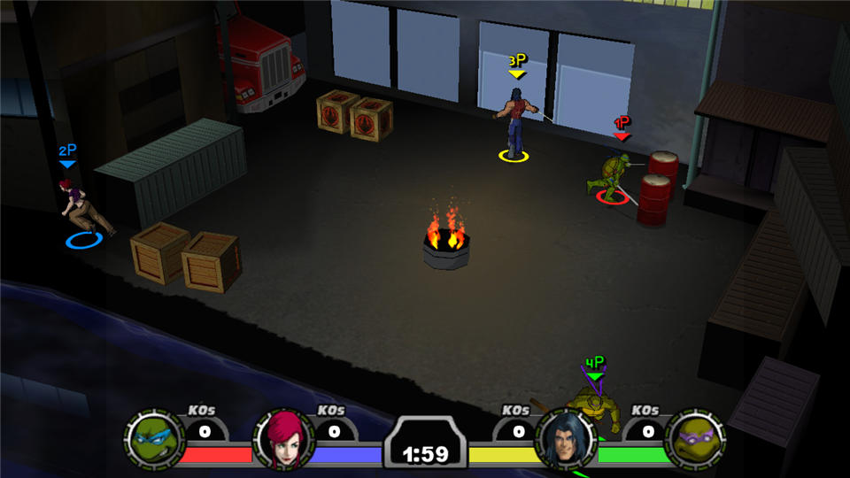
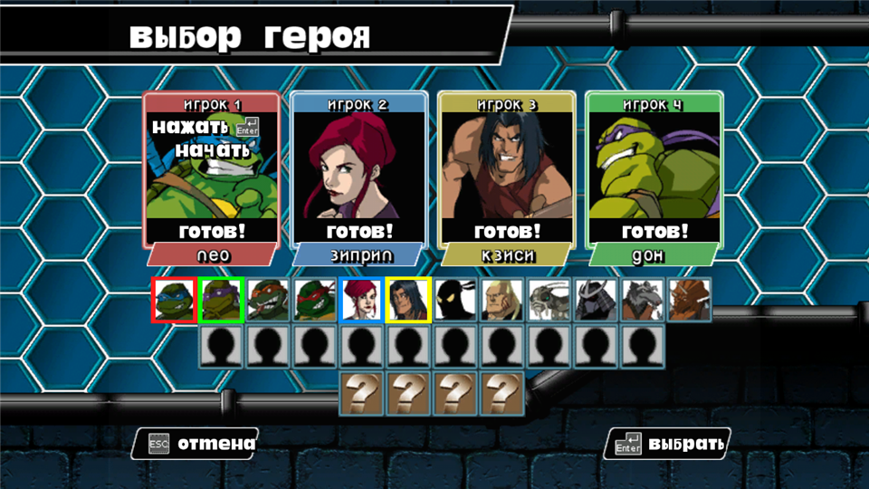
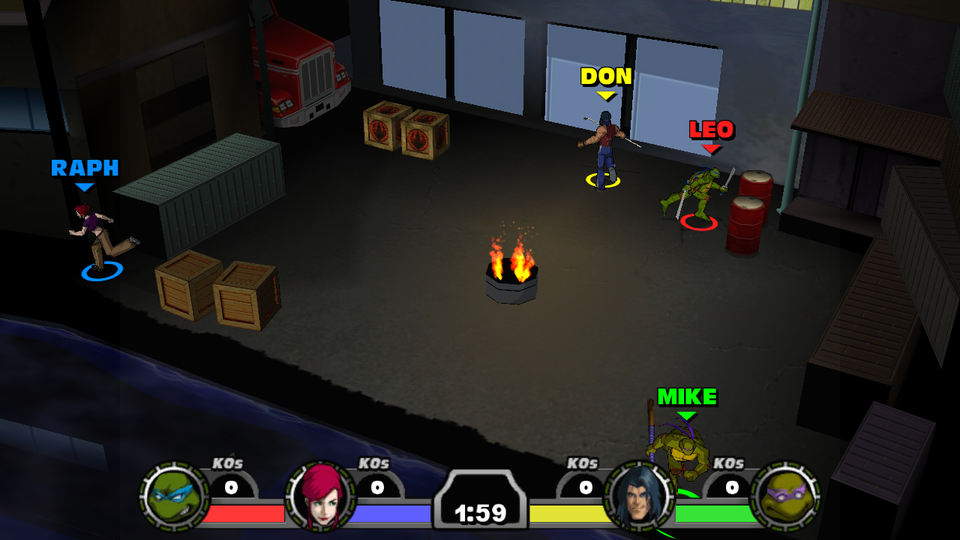
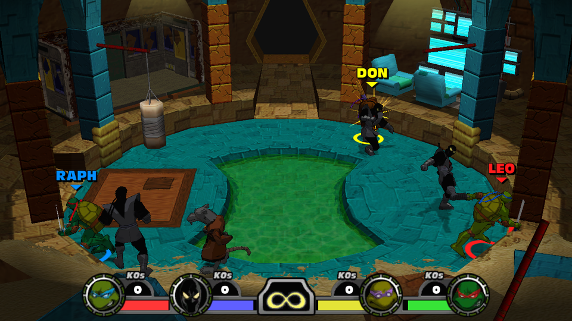

# Playing over the network

[Documentation](README.md) · [Install](INSTALL.md) · [Launcher](LAUNCHER.md) · **Network play** ·
[Controls](CONTROLS.md) · [Settings](SETTINGS.md) · [Troubleshooting](TROUBLESHOOTING.md)

**English** · [Русский](../NETPLAY.md)

The game has a mode for four, **РУКОПАШНЫЙ БОЙ** (Melee), on one computer. meleenet plays that same mode
over the network: each player has a copy of the game and a screen of their own, and each computer is one of
the four players. Player 1 is the one who opens the game (the host); the others join (the guests). Two,
three or four can play. **ИСТОРИЯ** (Story), which the game itself makes for one player, is played together
over the network: the other players fight on the hero's side — see [The story together](#the-story-together).

   
  A fight of four players in a network game.

## Before you start

- All players have **the same game** — the same `ztmnt.exe` and the same `archive.arc` — and versions of
  the mod with **the same network protocol** (the launcher shows it under each version). The host does not
  let in a guest whose files differ, and the guest sees why at the bottom of the screen.
- **Over Steam:** Steam is running at all players and they are friends in Steam. The game does not have to
  be in Steam: the mod comes to Steam as Valve's test application Spacewar (AppID 480). This has not been
  checked on real Steam accounts yet — only with a stand-in for Steam in the lab.
- **Without Steam:** the guests need a direct way to the host over UDP, port `47830`: one local network, a
  port forwarded at the host's router, or a common virtual network (Radmin VPN, Hamachi).
- Set the keys and the mouse's buttons beforehand, in the [launcher](LAUNCHER.md).

## Starting a game

  
  

1. **Everybody** starts the game as usual and chooses **СЕТЕВАЯ ИГРА** (Network game) in the main menu —
   the third button, under РУКОПАШНЫЙ БОЙ.
2. **The host** chooses **СОЗДАТЬ ИГРУ** (Open a game). The page of the game opens: four places, **1.** –
   **4.**; the first holds the host's name, the others say СВОБОДНО (free).
3. **The guests** join:
   - *over Steam* — **ИГРЫ ДРУЗЕЙ В STEAM** (Friends' games on Steam), then the row with the host's name;
   - *by address* — put the highlight on the row **АДРЕС** (Address) and press Enter; type the host's
     address (digits and dots; Backspace deletes, Ctrl+V pastes an address from the clipboard) and press
     Enter again; then choose **ВОЙТИ ПО АДРЕСУ** (Join by address). The host sees their own address at
     the bottom of the screen: «АДРЕС ДЛЯ ДРУЗЕЙ: …» (address for friends).
4. When everybody is in the list, **the host** chooses **НАЧАТЬ ИГРУ** (Start the game; the highlight goes
   to this row by itself as soon as a second player is in). No window is closed: everybody's game goes through
   its start-up again in a couple of seconds — and all are in the main menu of the common game.
5. From there the game goes on as usual. In the main menu any player may choose; in РУКОПАШНЫЙ БОЙ each
   player picks their own hero, in ИСТОРИЯ the other players fight beside the hero.

  

### The rows of the pages

The pages are walked with the keys of the game's own menus: the arrows, Enter, Esc (back).

| Page | Row | What it does |
|---|---|---|
| the first | **СОЗДАТЬ ИГРУ** | opens your game for the others: you are the host |
| | **ИГРЫ ДРУЗЕЙ В STEAM** | the list of games found over Steam. Pale until Steam is up |
| | **ВОЙТИ ПО АДРЕСУ** | join the host at the address of the row below |
| | **АДРЕС: …** | Enter starts the typing, Enter again (or Esc) ends it. A port can be added to the address: `192.168.0.10:47830` |
| | **STEAM ПОДКЛЮЧЕН** (Steam is up) / **STEAM НЕ ЗАПУЩЕН** (Steam is not running) | only tells; it cannot be chosen |
| | **НАЗАД** (Back) | to the main menu |
| friends' games | the host's name | join that game. If it cannot be joined, the reason follows the name: another version of meleenet, another `ztmnt.exe`. The mark «ИДЕТ ИГРА» (a game is going on) is not a refusal: that game is being played, but it can be chosen, and you come in between two fights |
| | **ИДЕТ ПОИСК...** (Searching) | only tells: the list refreshes by itself |
| an open game | **1.** – **4.** | who is here already |
| | **НАЧАТЬ ИГРУ** | the host's, once there are two players or more; before that **ЖДЕМ ИГРОКОВ** (Waiting for players). A guest has **ЖДЕМ ХОСТА** (Waiting for the host) in this place, or **ВОЙДЕТЕ ПОСЛЕ БОЯ** (You come in after the fight) when the host's game is already being played |
| | **ЗАКРЫТЬ ИГРУ** (Close the game) / **ВЫЙТИ** (Leave) | the host closes the game they opened; a guest leaves it |

All the pages are made of the six buttons of the main menu: the same pictures, the same font, the same
highlight. The Russian release's font has the letters Ч and Б in the places of the digits 4 and 6; the mod
gives the font a real 4 and 6, so an address and the places' numbers read as they are written.

Who sees a game opened over Steam — the host's friends, or everybody who has the mod — is chosen
beforehand, in the launcher: СЕТЬ (Network) → «Видят в Steam» (Seen in Steam).

### A network game begins inside the running game

After **НАЧАТЬ ИГРУ** nothing is closed. The picture goes through the game's start-up again in a couple of
seconds — eight times as fast as usual, with no logos to sit through, and the "press Enter" screen passes by
itself — and everybody is in the main menu of the common game. The window, the video device and Steam stay as
they are.

Before version 0.3.0 each game closed and started again for this. The reason is the same as then: a game in
which something has already been played and a game that has just started do not behave alike. Now the mod
keeps a copy of the game's memory at the very beginning of its start-up, and to begin a network game it puts
that copy back: everybody's game is a just started one again and the same from the first frame — without a new
process.

The games that began anew wait for each other for up to 45 seconds. If a guest has not found the host in
that time, or nobody has come to the host, the top of the screen says «ИГРОКИ НЕ ПОДКЛЮЧИЛИСЬ. СЕТЕВАЯ ИГРА
НЕ НАЧАЛАСЬ» (the players did not connect; the network game did not start), and the game goes on to its
main menu by itself — your own game again, on your own save. Begin the network game again.

Checked in the lab: sessions of two, three and four copies begun this way through the network page — by
address and through the stand-in for Steam, with antialiasing on and off; such a session was compared line by
line with a session of freshly started processes — the same frames. Not checked by a real game with sound
audible: the lab runs muted.

### The fallback: the game starts again

In two cases the game's memory cannot be kept or put back, and the mod does what version 0.2.0 did: after
**НАЧАТЬ ИГРУ** the game closes and opens again a few seconds later, as a new process — in the common game.

- `meleenet.ini` has `[video] mode = game` — the game's own exclusive full screen ([Settings](SETTINGS.md)).
- The video device was lost and reset after the game had started — the screen was locked, for example.

This happens at the player whose game it is; the others' windows are not closed. A game that takes this path
and games that begin in place play together. The log of the game that ran before the restart stays in
`meleenet-menu.log`. A lost video device was not checked in the lab.

### Coming into a game that is being played

The host's game stays open while it is played: a player can join after НАЧАТЬ ИГРУ too.

1. The new player starts the game and goes to the СЕТЕВАЯ ИГРА page, as usual. In **ИГРЫ ДРУЗЕЙ В STEAM**
   the host's game is marked «ИДЕТ ИГРА» (a game is going on) and can be chosen; by address it is **ВОЙТИ ПО
   АДРЕСУ**, as always.
2. They get to the page of the game and wait. The row under the list of players says **ВОЙДЕТЕ ПОСЛЕ БОЯ**
   (you come in after the fight), the bottom of the screen says «У ХОСТА ИДЕТ ИГРА: МЕЖДУ БОЯМИ ОНА НАЧНЕТСЯ
   ЗАНОВО, УЖЕ С ВАМИ» (the host is playing: between two fights the game starts again with you in). If a
   fight is going on at that moment, the host sees «НОВЫЙ ИГРОК ЖДЕТ: ОН ВОЙДЕТ ПОСЛЕ БОЯ» (a new player
   waits: they come in after the fight) at the top of the frame.
3. As soon as the session is between two fights — in the main menu, at the choice of a hero, of an arena or
   of a fight's options, at the story's choice of a hero or on its map — everybody's game, the newcomer's too,
   begins anew into a session of all of them, exactly as at the first start: in place, with no window closed.
   A fight is not interrupted for it.
4. A couple of seconds later everybody is in the main menu. A story goes on from what the host's save holds.

What else to know:

- Still four players at most. A newcomer reads a refusal at the bottom of the screen, after the words «ХОСТ
  НЕ ПУСТИЛ» (the host did not let you in): «в игре уже четыре игрока» (the game already has four players),
  «игра уже начинается» (the game is already starting), another version of the mod, another version of the
  game or other files of the game.
- The host of a game that is being played waits for newcomers both ways - among the friends' games on Steam
  and by address - whichever way its first guests came: for Steam it must be running at the host's, for an
  address the port must be free. This is what the code says; in the lab the third player came the same way
  as the first two.
- **A player whose link was lost**, or who closed the game, comes back the same way: see
  [below](#when-something-goes-wrong-on-the-way).

Checked in the lab: a third copy knocks during a fight of two — by address and through the stand-in for
Steam — and is in the game after the fight; the logs of the new session were identical frame by frame. In
version 0.3.0 the same with no windows closing: a third copy comes into a running game; a guest loses its
link, gets its own game back and joins again — five times in a row. Not checked on real Steam.

## Names over the fighters

   
  A fight of four players: over every fighter is the player's name, in that player's colour. The names in
  the picture are the lab's.

In the game itself a human's fighter has a tag over it: an arrow in the player's colour and the words 1P – 4P.
In a network game **the player's name** is in the place of those words, in РУКОПАШНЫЙ БОЙ and in ИСТОРИЯ
alike.

- **The name is the player's Steam name.** Steam is asked even when the game itself goes by address: it is
  enough that Steam is running (with `[net] transport = enet` the mod does not turn to Steam at all).
- **Without Steam** (a game by address, Steam not running) the name is taken from the line `name` of the
  section `[net]` in `meleenet.ini`, if the player wrote a name there by hand; Cyrillic works. The launcher
  has no such row: the note under the rows of its tab СЕТЬ (Network) says «Над вашим бойцом — ваш ник из
  Steam» (over your fighter is your Steam name).
- **With neither**, the tag says «ИГРОК N» (player N) by the player's number: «ИГРОК 2».
- A name is written in capitals, in the game's own font: Latin and Cyrillic letters, digits and a few
  punctuation marks; any other character becomes "?". The tag holds the first 16 characters of a name. Names
  with digits show a real 4 and 6.

More about the line `name`: [Settings](SETTINGS.md#net).

## The story together

   
  A team match of the story in a game of three players: Leonardo is the hero, Raphael and Donatello are
  partners, Splinter is the friend the game's own script gives; against them, three Foot soldiers. Over the
  players' fighters are their names.

In a network game **ИСТОРИЯ** (Story) is for everybody.

- **Who leads.** The player who chose ИСТОРИЯ in the main menu. They choose the hero on the story's own
  screen and move on the map — as in a game for one.
- **What the others do.** In every match the other players of the session fight beside the hero, as
  partners.
- **Who the partners play.** A turtle by the player's number: player 1 Leonardo, 2 Raphael, 3 Donatello, 4
  Michelangelo. A partner whose turtle is the story's hero takes the first turtle nobody has. A partner
  cannot choose a fighter yet.
- **Whose side they are on.** The hero's, by the game's own team rules: team-mates cannot hurt each other,
  enemies attack the partners too, each partner has a panel in the HUD (when all four panels are the
  enemies', a partner takes one of theirs), and each starts a match with the same health as the hero.
- **Progress and unlocks** are the host's save, as before.

### How a match is won and lost

- **"Last man standing" matches** are played by the game's team rules when partners are in: a side wins
  when the other side is down. The hero's fall alone does not end the match: a partner can finish it. The
  match is lost when the whole of the hero's side is down.
- **In the other match types** the story's own rules stay as written: where the hero's knock-out ends a
  match, it still does, partners or not.

### The matches the partners fight in

Since version 0.3.0 — nearly all of them, so a story can be played together to its end:

- the ordinary matches — duels and team matches, as in 0.2.0;
- the training matches with the mecha turtle (in 0.2.0 they were for the hero alone);
- the matches where an enemy comes back as another one — the last stage of Leonardo, Raphael, Donatello and
  Casey: Shredder, then the golden Shredder (in 0.2.0 they were for the hero alone too).

### Matches that stay for the hero alone

In these matches the partners watch: their fighters are not in.

- the bomb match and the other mini-games: they run in a mode of the game's own, made for one fighter;
- matches that already use all eight places. If fewer places are free than there are partners, the partners
  with the lower numbers get them.

### What has been checked

In the lab, on two and three copies: a duel stage (won; the hero down and the partner wins; everybody down —
lost, then the rematch) and a team stage with a friend from the game's script (three players). In version
0.3.0: the last stage with three copies — the golden Shredder appears — and the training with two. The
copies' logs were identical frame by frame. **Not checked:** every stage of every hero, a real game.

## In a network game

- **Each plays with their own keys** on their own computer — whichever of the four players they are.
- **РУКОПАШНЫЙ БОЙ is for everybody**, up to four players. **So is ИСТОРИЯ** (Story): one player leads it,
  the others fight beside the hero ([The story together](#the-story-together)).
- **The menus are common**: what is chosen is chosen for all. In the main menu any player may choose; the
  one who chose leads the menus from there — that is how the game itself is made.
- **While a network game is on there is no СЕТЕВАЯ ИГРА item in the menu**: its place says «В СЕТИ: ИГРОКОВ
  …» (online: … players). When the network game is over for you — everybody has left, or the link to the
  host is lost — the item is back: another game can be opened or joined from the same running game.
- **Names over the fighters.** Over every player's fighter is that player's name, the Steam name
  ([Names over the fighters](#names-over-the-fighters)).
- **The save is the host's.** The heroes and arenas that are unlocked are theirs; for the network game the
  guests get a copy of the host's save (`tmnt-net.sv`). A guest's own save, `tmnt.sv`, is not touched. When
  the network game is over for a guest and the guest's game is back at its main menu, the game begins anew
  once more by itself — a couple of seconds — now on the guest's own save.
- **The pause is anybody's.** Esc of any player pauses the fight for everybody; any player's Esc or Enter
  goes on with it. The pause menu's second row — leave the fight — stays with the player who leads the
  menus (the one who chose the fight in the main menu): while the highlight is on that row, the others' Esc
  and Enter do nothing. Checked in the lab: a guest pauses and goes on with the fight, the leader leaves the
  fight.
- **Movies are not shown**: no two computers would leave a movie in the same frame.
- **The picture may differ.** Resolution, the shape of the frame and the look of the menus are each
  player's own: they do not change how the game plays. Particles are at 100 % for everybody in a network
  game, whatever was chosen in the launcher: their number is a part of the game itself.
- **The mod's messages** are at the top of the frame, in white letters of the game's own font: that a
  player has left, that the connection is lost, that the games have parted, that a new player waits for the
  end of the fight.

## When something goes wrong on the way

- **A long level load** does not break the connection: the others' games wait meanwhile. The same is done
  for a window being dragged with the mouse, but that has not been checked with a real window.
- **While somebody's game is busy or falls behind, the others stand and wait**: all the games make every
  frame together.
- **A slow computer does not slow a fight for the others**: the frames it cannot draw in time it plays
  without their pictures — up to three in a row. This is the setting «Пропуск кадров» (frame skipping), on
  by default ([Settings](SETTINGS.md)). Outside a fight — in the menus and in a fight's opening — such a
  computer still slows everybody.
- **A guest has closed the game, or nothing is heard from them for 15 seconds** — the others see «ИГРОК …
  ВЫШЕЛ ИЗ ИГРЫ» (player … has left the game) and play on; the hero of the one who left gets no more
  controls. This is what the code says.
- **A guest who left can come back.** For them the session is over. When their game is back at its main
  menu, it begins anew by itself — a couple of seconds, the window is not closed — now on their own save, and
  СЕТЕВАЯ ИГРА is in the main menu again: they join the host as a newcomer
  ([Coming into a game that is being played](#coming-into-a-game-that-is-being-played)) and are in the game
  between two fights. If that was the only guest, the network game is over for the host too: the host
  chooses СЕТЕВАЯ ИГРА → СОЗДАТЬ ИГРУ again. Checked in the lab: a guest loses its link for good, gets its
  own game back and joins again — five times in a row.
- **The host has closed the game, or the connection to them is lost for 15 seconds** — the network game is
  over. The guests see «СВЯЗЬ С ХОСТОМ ПОТЕРЯНА. ДАЛЬШЕ ВЫ ИГРАЕТЕ ОДИН» (the connection to the host is
  lost; you play on alone), and each goes on by themselves. A host whom all the guests have left sees
  «СЕТЕВАЯ ИГРА ОКОНЧЕНА» (the network game is over). After that the game frees its port and its place on
  Steam: a new network game can be opened or joined without closing the game. A guest's game, once back at
  its main menu, begins anew by itself — on the guest's own save: in the session the guest played on the
  host's.
- **«ИГРЫ РАЗОШЛИСЬ. НАЧНИТЕ СЕТЕВУЮ ИГРУ ЗАНОВО»** (the games have parted; start the network game again) —
  the games on different computers no longer match. Start the network game again and keep `meleenet.log` of
  every player ([If something is wrong](TROUBLESHOOTING.md)).

## How it stays the same on all computers

Nothing of the picture is sent. Each computer plays the whole game; only the players' presses go over the
network. A frame is not played until the presses of all the players for it have come, so all the games do
the same thing frame for frame. Once a second the games compare a fingerprint of their state; if it does
not match, the screen says «ИГРЫ РАЗОШЛИСЬ». The delay between pressing a key and the frame that uses it is
the **input delay** (1 to 12 frames, 2 by default; the host's value is the one in force): more of it is
smoother on a poor connection, less is more responsive.

This is also why a new player does not come straight into a fight. A game that has already played keeps
things of it, and two games with different pasts part; only a common beginning — the state of a game that has
just started — makes them the same. Between two fights everybody's game goes back to that state, now with
the new player in: the mod puts back the copy of the memory it kept at the very beginning of the game's
start-up. No new process is needed for it
([how it works](ARCHITECTURE.md#the-game-begins-anew-without-a-new-process)).

## Versions that play together

| Versions of the mod | Network protocol | Play together |
|---|---|---|
| 0.3.0 | 3 | with 0.3.0 only |
| 0.2.0 | 2 | with 0.2.0 only |
| 0.1.0 – 0.1.1 | 1 | with each other — yes |

Version 0.3.0 does not play with versions 0.2.0 and 0.1.x, nor 0.2.0 with 0.1.x: the protocol is another one,
and every player has to update. The host refuses a guest with another version, and the guest reads why at the
bottom of the screen.

Version 0.1.1 with version 0.1.0 was checked in the lab: a network game with 0.1.1 as the host and 0.1.0 as
the guest stayed the same on both for 2500 frames, a fight included.

## What has been checked and what has not

- Checked in the lab — on several copies of the game on one computer, with no window on the screen: network
  games of two, three and four copies by address and through a stand-in for Steam, with packet loss; copies
  with frames of different shapes; the story together on two and three copies
  ([what exactly](#what-has-been-checked)); a third copy coming into a running game and a guest coming back
  after a lost link; a guest's pause and the leader leaving the fight; frame skipping on one copy of two.
- Checked in the lab in version 0.3.0: sessions of two, three and four copies begun inside the running game —
  and such a session against a session of freshly started processes (the same frames); a copy that had played
  fights and the story and visited the library before the session against a copy that had not (identical 4500
  frames); five returns to the start in a row after played fights (the process's memory stays about 280 MB
  and does not grow); a 15000-frame session with two fights played out; a guest loses its link, gets its own
  game back and joins again — five times in a row.
- **Not checked by a real game:** Steam on real accounts; the game's real window in front — the keyboard,
  the mouse's buttons, typing an address; gamepads; sound after the game's return to its start (the lab runs
  muted); every stage of the story. A lost video device was not checked in the lab either.
