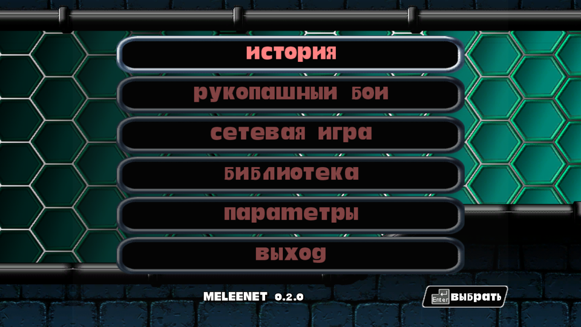
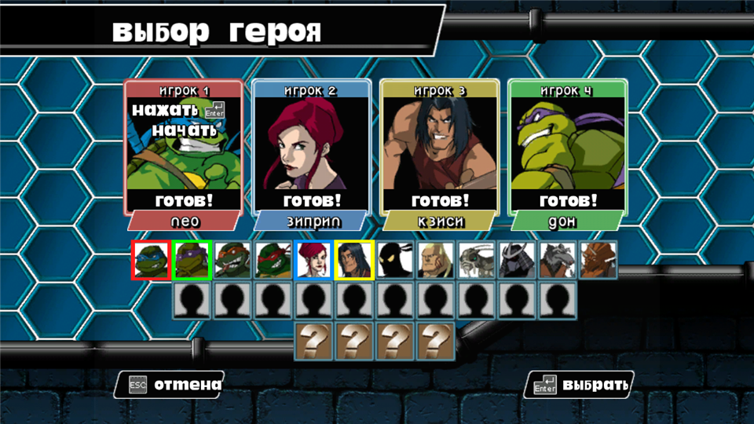
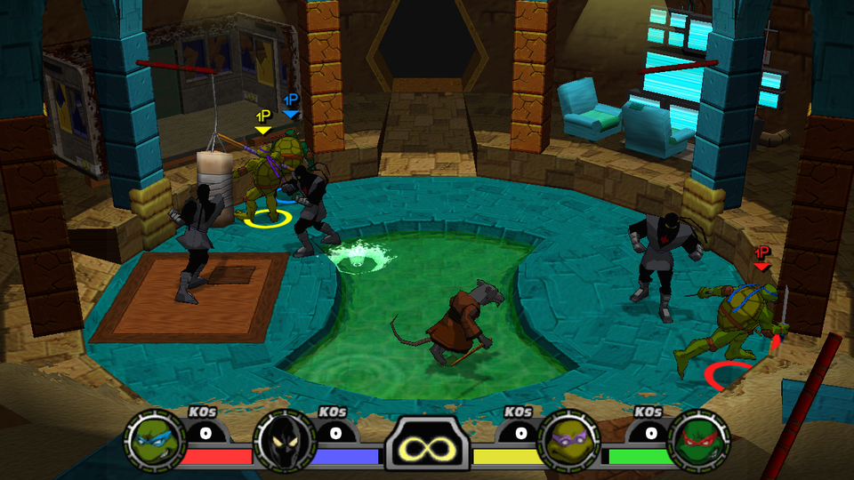
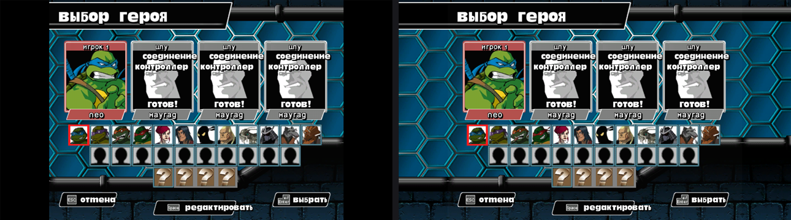
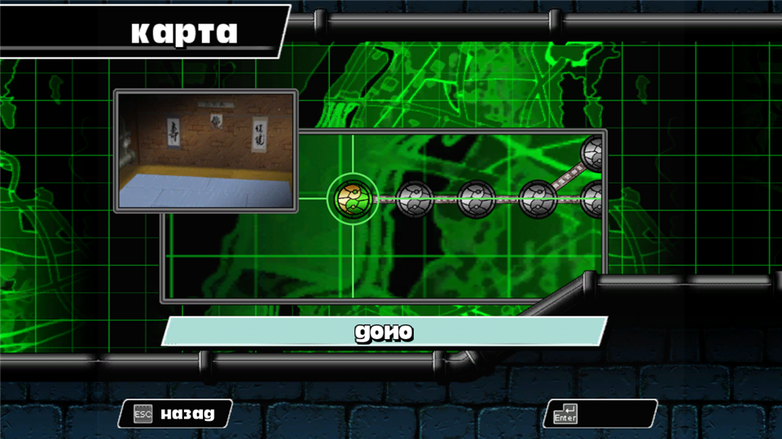
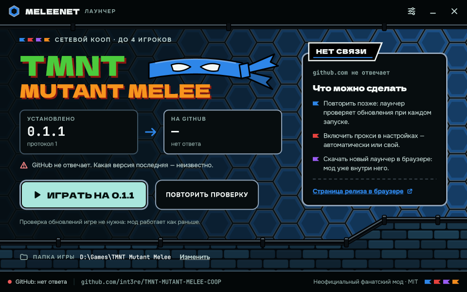
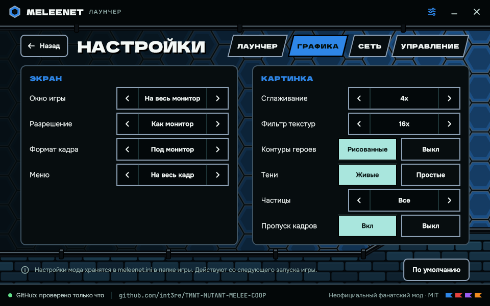

# What the mod adds and changes — in pictures

[Documentation](README.md) · [Install](INSTALL.md) · [Launcher](LAUNCHER.md) · [Network play](NETPLAY.md) ·
[Controls](CONTROLS.md) · [Settings](SETTINGS.md) · [Troubleshooting](TROUBLESHOOTING.md)

**English** · [Русский](../TOUR.md)

The pictures of the game were taken in the test lab, on several copies of the game on one computer; the
players' names in them are made up.

## In the game

### The main menu: one new button

  

**СЕТЕВАЯ ИГРА** (Network game) is the third button, under РУКОПАШНЫЙ БОЙ (Melee). The game has five
buttons here; with the mod there are six: ИСТОРИЯ (Story), РУКОПАШНЫЙ БОЙ, СЕТЕВАЯ ИГРА, БИБЛИОТЕКА
(Library), ПАРАМЕТРЫ (Options), ВЫХОД (Quit). The new button is made of the same picture as the others,
written in the same font, and slides onto the screen the way they do. The mod's version is written small at
the bottom of the screen.

In a game that is already a network one this place says **В СЕТИ: ИГРОКОВ …** (Online: … players), and the
row cannot be chosen.

### The network pages

  

The pages of the network game are the same six buttons of the main menu with other words on them. The mod
draws no windows over the game: everything is made of the game's own buttons and font.

- The first page: **СОЗДАТЬ ИГРУ** (Open a game), **ИГРЫ ДРУЗЕЙ В STEAM** (Friends' games on Steam),
  **ВОЙТИ ПО АДРЕСУ** (Join by address), **АДРЕС: …** (Address; the host's address is typed on the
  keyboard), a row that says whether Steam is up, and **НАЗАД** (Back).
- The page of an open game: four places, **1.** – **4.**, with the players' names or the word СВОБОДНО
  (free); under them the host has **НАЧАТЬ ИГРУ** (Start the game) and **ЗАКРЫТЬ ИГРУ** (Close the game), a
  guest has **ЖДЕМ ХОСТА** (Waiting for the host) and **ВЫЙТИ** (Leave). At the bottom of the screen the
  host sees the address the guests can type.

The digits in an address and in the places' numbers are real ones. The Russian release's font has the
letters Ч and Б in the places of 4 and 6; the mod gives the menu font a real 4 and 6 — they show in a
fight's clock and scores and in the options too. Words keep their Ч and Б.

**A game that is already being played can be joined too.** Among friends' games on Steam it is marked «ИДЕТ
ИГРА» (a game is going on). The new player waits on the page of the game — it says **ВОЙДЕТЕ ПОСЛЕ БОЯ** (you
come in after the fight) — and between two fights every game starts again, now with the new player in. A
player whose link was lost comes back the same way.

More: [Network play](NETPLAY.md).

### A network game: up to four players

  

Choosing heroes in РУКОПАШНЫЙ БОЙ. In the game itself this is a mode for four at one computer; over the
network each computer is one of the four players, and each player picks their own hero.

  

A fight of four players. Nothing of the picture is sent over the network: each game plays the fight itself,
and only the players' presses travel. Any player's Esc pauses the fight — for everybody.

### The story together

  

A team match of the story in a game of three players: Leonardo is the hero, Raphael and Donatello are
partners, Splinter is the friend the game's own script gives; against them, three Foot soldiers. In the game
itself ИСТОРИЯ (Story) is made for one player. Over the network the player who chose it in the main menu
leads it, and in every match the other players fight on the hero's side — each as a turtle by their player
number. A few matches stay for the hero alone: the training with the mecha turtle, the mini-games, the
matches where an enemy comes back as another one. More: [The story together](NETPLAY.md#the-story-together).

### Wide screen: fights and menus

  

One and the same menu twice: 4:3 with black bars at the sides, and filling the wide frame — backgrounds,
pipes and brick walls go on to the edges of the screen. Texts, buttons and portraits stand where they stood
in 4:3. Which of the two is shown is chosen in the launcher: ГРАФИКА (Picture) → «Меню» (Menus).

  

The map of ИСТОРИЯ in a wide frame: the dim frame around the map's window goes on to the edges of the
screen.

In fights the frame has the shape of the monitor (16:9, 16:10, 21:9), and more is seen at the sides than in
the original 4:3.

### What the pictures do not show

- Instead of the exclusive 640×480 full screen: a window without a frame over the whole monitor, or an
  ordinary window, at any resolution. Alt+Tab works at once.
- Smoothed edges (MSAA) up to 8x and anisotropic texture filtering up to 16x.
- The game runs at exactly 60 frames a second. If the computer cannot draw that many, a fight's frames are
  played without their pictures and the game is not slowed.
- Buttons of the mouse can be bound to actions like keys.
- A rare crash of the game on the loading screen is fixed.

## In the launcher

### One window for everything

  
  

On the left the first start: the mod is inside the launcher and goes in with one button. On the right the
everyday view: the version in the game's folder, the newest one, the network protocol of each and what is
new in the version.

  
  

A newer version: the launcher says whether friends on the older one can still be played with, updates with
one button, and checks what it downloaded by SHA-256.

  
  

On the left GitHub does not answer: the game can still be played. On the right the launcher's own settings:
updates, a proxy for GitHub, the logs, reinstalling and removing the mod, the colour of the bandana.

### The wall of the game's menus and the colour of a bandana

  

The launcher looks like the game's own menus: a honeycomb that brightens towards the right edge, black
pipes, a wall of blue bricks with a ramp along the bottom, black windows and buttons in a steel rim. The
colour of the honeycomb and of the accents is the bandana of one of the four turtles: Leonardo's blue (the
default), Raphael's red, Donatello's purple or Michelangelo's orange. A mask in the chosen colour is tied
beside the title.

### The game's settings before the game starts

  
  

**ГРАФИКА** — the window, the resolution, the shape of the frame, the menus and the quality of the picture.
**СЕТЬ** (Network) — the input delay, who sees a game opened over Steam, and the mouse's buttons.

  
  

**УПРАВЛЕНИЕ** (Controls) — the player's keys and the ready layouts: the game's own keys or «WASD + мышь»
(WASD + mouse). On the right a cell waits for a key or a button of the mouse.

More: [The launcher](LAUNCHER.md), [Settings](SETTINGS.md), [Controls](CONTROLS.md).
